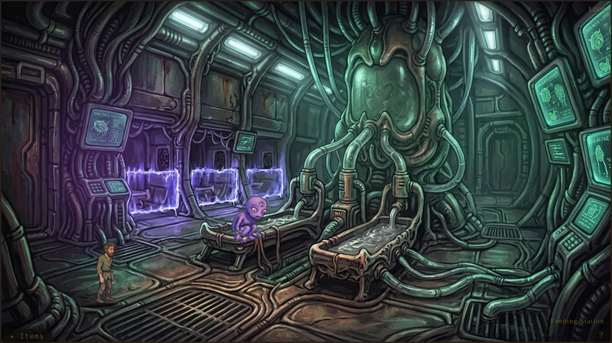
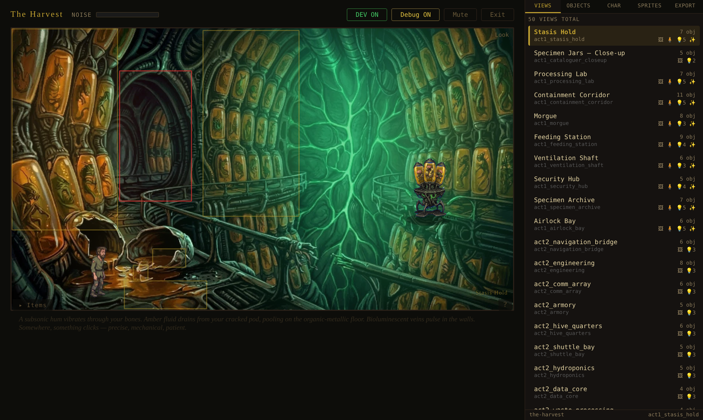
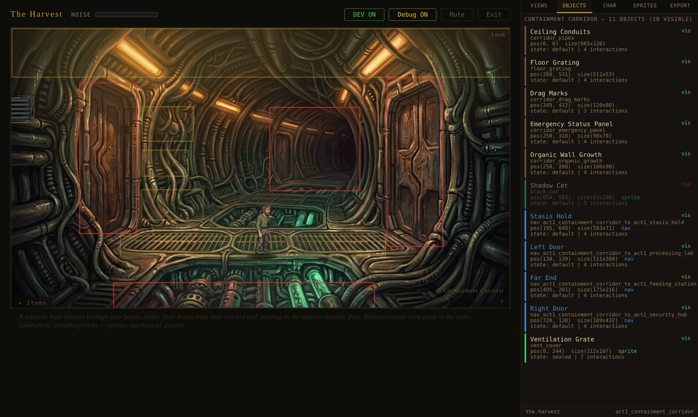
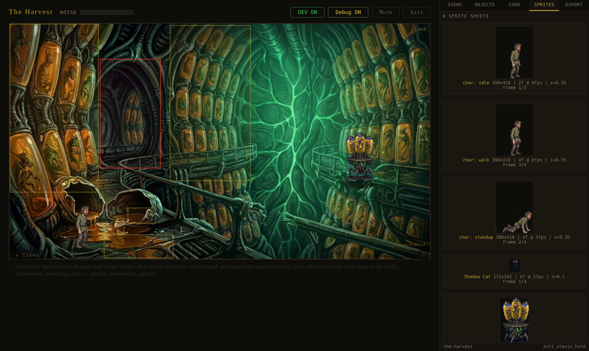
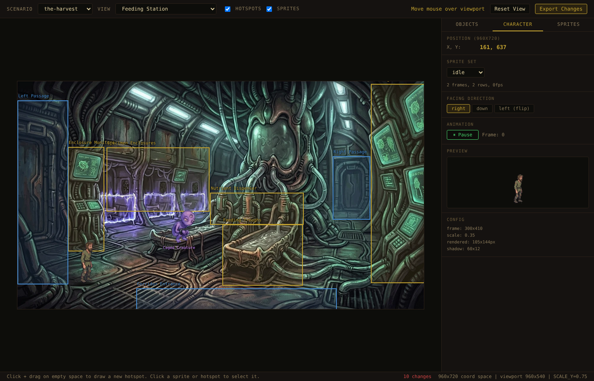
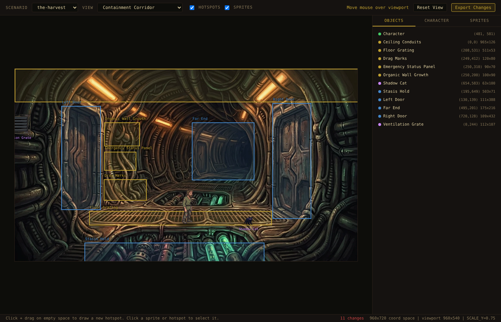
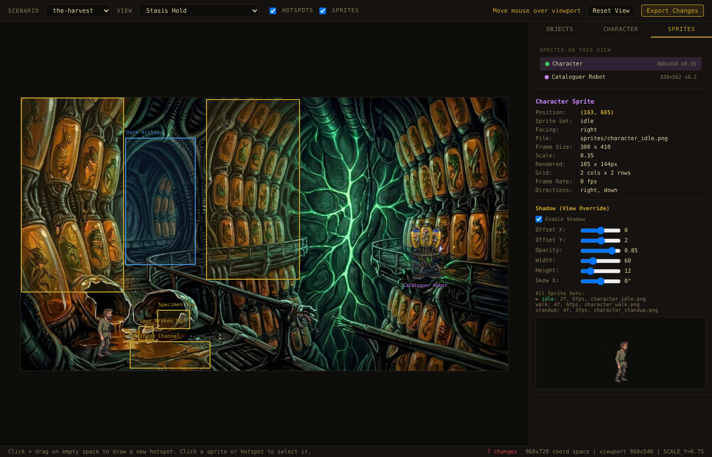

# Adventure Builder Guide

> **Create point-and-click adventure games without writing any code.**
> Define your game in a single JSON file, drop in background art and audio, and it's playable.

<p align="center">
  
  <br />
  <em>Everything in this scene — the room, the prisoner, the energy barrier, the dialogue, the puzzles — is defined in a single JSON file.</em>
</p>

This guide covers everything you need to build a scenario package for the Adventure Engine. You don't need to understand the engine's source code — the JSON schema is the product.

---

## Table of Contents

1. [Package Structure](#package-structure)
2. [Quick Start — Your First Scenario](#quick-start--your-first-scenario)
3. [The Four Verbs](#the-four-verbs)
4. [Coordinate System](#coordinate-system)
5. [Views](#views)
6. [Objects](#objects)
7. [Interactions](#interactions)
8. [Conditions Reference](#conditions-reference)
9. [Effects Reference](#effects-reference)
10. [Items & Inventory](#items--inventory)
11. [Item Combinations](#item-combinations)
12. [Navigation](#navigation)
13. [Visual Effects](#visual-effects)
14. [Audio](#audio)
15. [Phases](#phases)
16. [Win & Lose Conditions](#win--lose-conditions)
17. [Advanced Features](#advanced-features)
18. [Developer Tools](#developer-tools)
19. [Registration & Testing](#registration--testing)
20. [Design Patterns](#design-patterns)
21. [Art Direction](#art-direction)

---

## Package Structure

A scenario is a self-contained folder inside `scenarios/`. Everything about your game lives in one place:

```
scenarios/my-scenario/
├── scenario.json          # Game definition (required)
├── design.md              # Story/puzzle design doc (optional, but recommended)
├── backgrounds/           # Background images for each view
│   ├── main_room.webp     #   1920x1080 recommended, any resolution works
│   └── closet_closeup.webp
├── closeups/              # Detail images for show_closeup effect (optional)
│   └── safe_interior.webp #   Any resolution, shown in framed overlay
├── audio/                 # Ambient audio tracks (optional)
│   └── rain_loop.mp3      #   MP3/WAV/OGG supported, loops automatically
├── sprites/               # Character + object sprite sheets, transparent PNG (optional)
│   └── rusty_key.png      #   pixel-art world sprite, bottom-center anchored
└── items/                 # Item icons for inventory panel (optional)
    └── rusty_key.png      #   326x273 transparent PNG
```

Making the art (prompts, blue-screen keying, sizing, placement, icons, checking it in-game) is covered step by step in **[docs/ART_GUIDE.md](docs/ART_GUIDE.md)**. Backgrounds are painted; sprites and icons are pixel art that matches the player character.

The engine discovers your scenario by its folder name and reads `scenario.json` from it. No build step, no compilation. Edit JSON → refresh browser → see changes.

---

## Quick Start — Your First Scenario

Here's a complete 2-room scenario. A locked room with a key hidden in a desk drawer. Find the key, unlock the door, escape.

Create `scenarios/my-first-escape/scenario.json`:

```json
{
  "schema_version": "1.0",
  "metadata": {
    "id": "my-first-escape",
    "title": "My First Escape",
    "description": "You wake in a locked room. A desk sits in the corner. Find a way out.",
    "author": "your-name",
    "difficulty": "easy",
    "estimated_minutes": 2,
    "tags": ["tutorial", "escape"],
    "version": "1.0"
  },
  "setting": {
    "initial_view": "bedroom",
    "ambient_text": "A bare room. The door is locked from outside.",
    "room_style": {
      "background_color": "#1a1a2e",
      "wall_color": "#16213e",
      "floor_color": "#0f3460"
    }
  },
  "views": [
    {
      "id": "bedroom",
      "background_key": "bedroom",
      "background_file": "backgrounds/bedroom.webp",
      "objects": ["door", "desk", "window"]
    },
    {
      "id": "desk_closeup",
      "background_key": "desk_closeup",
      "background_file": "backgrounds/desk_closeup.webp",
      "objects": ["desk_drawer", "desk_lamp"],
      "back_label": "Step back from desk"
    }
  ],
  "flags": {
    "drawer_opened": "false"
  },
  "items": [
    {
      "id": "rusty_key",
      "name": "Rusty Key",
      "description": "An old iron key. It might fit a door.",
      "icon": "key",
      "examine": [
        {
          "verb": "look",
          "when": [],
          "then": [
            { "type": "message", "text": "Cold iron, slightly bent. Stamped on the bow: 'MASTER'." }
          ]
        }
      ]
    }
  ],
  "combinations": [],
  "objects": [
    {
      "id": "door",
      "name": "Wooden Door",
      "description": "A heavy wooden door. Locked from the outside.",
      "position": { "x": 100, "y": 200 },
      "size": { "width": 120, "height": 350 },
      "visual": { "color": "rgba(139, 90, 43, 0.3)", "label": "Door" },
      "initial_state": "locked",
      "initially_visible": true,
      "interactions": [
        {
          "verb": "look",
          "when": [{ "type": "object_state", "object": "door", "state": "locked" }],
          "then": [
            { "type": "message", "text": "A solid wooden door. The handle won't turn — locked from outside." }
          ]
        },
        {
          "verb": "look",
          "when": [{ "type": "object_state", "object": "door", "state": "unlocked" }],
          "then": [
            { "type": "message", "text": "The door is unlocked. Freedom awaits." }
          ]
        },
        {
          "verb": "hand",
          "when": [{ "type": "object_state", "object": "door", "state": "locked" }],
          "then": [
            { "type": "message", "text": "You rattle the handle. Locked tight." }
          ]
        },
        {
          "verb": "hand",
          "when": [{ "type": "object_state", "object": "door", "state": "unlocked" }],
          "then": [
            { "type": "game_over", "result": "win", "reason": "You pull the door open and step into the hallway. You're free." }
          ]
        },
        {
          "verb": "use_item",
          "item": "rusty_key",
          "when": [{ "type": "object_state", "object": "door", "state": "locked" }],
          "then": [
            { "type": "message", "text": "The key turns with a satisfying click. The door is unlocked." },
            { "type": "set_state", "object": "door", "state": "unlocked" },
            { "type": "remove_item", "item": "rusty_key" }
          ]
        }
      ]
    },
    {
      "id": "desk",
      "name": "Old Desk",
      "description": "A battered wooden desk against the wall.",
      "position": { "x": 600, "y": 400 },
      "size": { "width": 200, "height": 150 },
      "visual": { "color": "rgba(101, 67, 33, 0.3)", "label": "Desk" },
      "initial_state": "default",
      "initially_visible": true,
      "interactions": [
        {
          "verb": "look",
          "when": [],
          "then": [
            { "type": "message", "text": "A desk with a single drawer. There might be something inside." },
            { "type": "set_view", "view": "desk_closeup" }
          ]
        }
      ]
    },
    {
      "id": "window",
      "name": "Barred Window",
      "description": "A small window with iron bars.",
      "position": { "x": 400, "y": 150 },
      "size": { "width": 140, "height": 120 },
      "visual": { "color": "rgba(100, 140, 180, 0.2)", "label": "Window" },
      "initial_state": "barred",
      "initially_visible": true,
      "interactions": [
        {
          "verb": "look",
          "response": "Iron bars. No way through. You can see a garden outside — so close."
        },
        {
          "verb": "hand",
          "when": [],
          "then": [
            { "type": "message", "text": "You pull at the bars. They don't budge." }
          ]
        }
      ]
    },
    {
      "id": "desk_drawer",
      "name": "Desk Drawer",
      "description": "A wooden drawer.",
      "position": { "x": 400, "y": 450 },
      "size": { "width": 200, "height": 80 },
      "visual": { "color": "rgba(120, 80, 40, 0.3)", "label": "Drawer" },
      "initial_state": "closed",
      "initially_visible": true,
      "interactions": [
        {
          "verb": "look",
          "when": [{ "type": "object_state", "object": "desk_drawer", "state": "closed" }],
          "then": [
            { "type": "message", "text": "A drawer. Might be worth opening." }
          ]
        },
        {
          "verb": "look",
          "when": [{ "type": "object_state", "object": "desk_drawer", "state": "open" }],
          "then": [
            { "type": "message", "text": "The drawer is empty now." }
          ]
        },
        {
          "verb": "hand",
          "when": [
            { "type": "object_state", "object": "desk_drawer", "state": "closed" },
            { "type": "not_has_item", "item": "rusty_key" }
          ],
          "then": [
            { "type": "message", "text": "You slide the drawer open. Inside: an old iron key." },
            { "type": "set_state", "object": "desk_drawer", "state": "open" },
            { "type": "add_item", "item": "rusty_key" },
            { "type": "set_flag", "flag": "drawer_opened", "value": "true" }
          ]
        },
        {
          "verb": "hand",
          "when": [{ "type": "object_state", "object": "desk_drawer", "state": "open" }],
          "then": [
            { "type": "message", "text": "The drawer is already open. Nothing else inside." }
          ]
        }
      ]
    },
    {
      "id": "desk_lamp",
      "name": "Desk Lamp",
      "description": "A dusty brass lamp.",
      "position": { "x": 700, "y": 200 },
      "size": { "width": 80, "height": 120 },
      "visual": { "color": "rgba(180, 160, 60, 0.2)", "label": "Lamp" },
      "initial_state": "off",
      "initially_visible": true,
      "interactions": [
        {
          "verb": "look",
          "response": "A brass desk lamp, coated in dust. The bulb looks intact."
        },
        {
          "verb": "hand",
          "when": [{ "type": "object_state", "object": "desk_lamp", "state": "off" }],
          "then": [
            { "type": "message", "text": "Click. The lamp flickers on, casting warm light across the desk." },
            { "type": "set_state", "object": "desk_lamp", "state": "on" }
          ]
        },
        {
          "verb": "hand",
          "when": [{ "type": "object_state", "object": "desk_lamp", "state": "on" }],
          "then": [
            { "type": "message", "text": "Click. The lamp goes dark." },
            { "type": "set_state", "object": "desk_lamp", "state": "off" }
          ]
        }
      ]
    }
  ],
  "win_conditions": [
    {
      "id": "escaped",
      "description": "You escaped the room!",
      "conditions": [{ "type": "object_state", "object": "door", "state": "unlocked" }]
    }
  ]
}
```

### What just happened

- **`metadata`** — Who you are, what this game is. The title and description show on the scenario selection screen.
- **`setting`** — Which view the player starts in, atmospheric flavor text, fallback colors when no background image exists.
- **`views`** — Two screens: the bedroom and a desk close-up. Each lists which objects appear there.
- **`flags`** — Global state variables. Simple key-value strings. Track progress like "has the drawer been opened?"
- **`items`** — Inventory objects the player can carry. The rusty key has an examine interaction for when the player inspects it from their inventory.
- **`objects`** — Everything clickable in the world. Each has a position, size, visual appearance, state, and a list of interactions.
- **`win_conditions`** — What triggers the victory screen. Here: unlocking the door.

---

## The Four Verbs

Players interact with the world through four verbs, inspired by King's Quest V:

| Verb | Cursor | What It Does | Default Fail Message |
|------|--------|-------------|---------------------|
| **Look** | eye | Examine visually. Always safe. No noise. | Shows the object's `description` field |
| **Move** | footprints | Navigate between rooms. Click nav hotspots. | "You can't go that way." |
| **Hand** | hand | Physical manipulation — push, pull, open, take, touch. | "You can't do anything useful with {name} right now." |
| **Talk** | speech bubble | Speak, listen, read aloud. | "Talking to {name} doesn't accomplish anything." |

There are no verb buttons. The player **right-clicks** the game view to cycle look → move → hand → talk (the default is look), and the cursor changes to show the active verb. The fail messages above are one of several random variants per verb.

### Using Inventory Items

There is no "Use" verb button. Instead:

1. Player clicks an item in their inventory panel (selects it)
2. Player clicks a world object
3. The engine automatically tries `use_item` with that item on that object
4. If no matching interaction exists, the player sees: "That doesn't seem to work."

In your JSON, define inventory-use interactions with `"verb": "use_item"` and `"item": "the_item_id"`.

### Verb Fallback

The engine tries `hand` first. If no interaction matches, it automatically retries with `take` — this ensures backwards compatibility with older scenario JSONs that used separate hand/take verbs.

### Every Click Gets Feedback

Even when an action does nothing, the player gets a King's Quest-style message. You don't need to write fail interactions — the engine provides generic feedback for every verb. But you *can* override the generic message by writing a specific interaction for that verb+state combination.

---

## Coordinate System

All object positions use a **960x720 coordinate space** with origin at top-left. **Position** is the **top-left corner** of the hotspot rectangle, not its center.

```
(0,0) ─────────────────────── (960,0)
  │                               │
  │     960 x 720 design space    │
  │                               │
  │    Position = top-left corner │
  │    of the hotspot box          │
  │                               │
(0,720) ────────────────────── (960,720)
```

- **Background images** can be any resolution (1376x768 and 1920x1080 are common). The engine renders them with `object-fit: cover` to fill the 960x540 pixel viewport.
- **The viewport** renders at 960x540 pixels. The engine maps the 960x720 coordinate space to this viewport using `SCALE_X = 1.0` (no horizontal change) and `SCALE_Y = 0.75` (vertical compression).
- **Object positions** are the **top-left corner** of the hotspot box in the 960x720 space.
- **Object sizes** define the clickable area dimensions in the same 960x720 space.

### How Positions Actually Render

The engine positions hotspots as absolutely-positioned `<div>` elements inside the 960x540 viewport:

```
Rendered left  = position.x × 1.0     (no horizontal scaling)
Rendered top   = position.y × 0.75    (vertical compression)
Rendered width = size.width × 1.0
Rendered height= size.height × 0.75
```

**Example**: An object at `position: {x: 480, y: 360}` with `size: {width: 100, height: 80}` renders as a div at `left: 480px, top: 270px, width: 100px, height: 60px` inside the 960x540 viewport.

### Converting Background Image Coordinates to JSON Positions

This is the most common task: you have a background image and need to place a hotspot over a specific visual element. Here's the step-by-step process:

#### Step 1: Measure the pixel coordinates in your image

Open your background image in any image editor and find the **bounding box** of the area you want to make clickable. Record:
- The **top-left pixel** `(img_x, img_y)` of the region
- The **width and height** in pixels `(img_w, img_h)`

#### Step 2: Convert image pixels to the 960x720 coordinate space

The background image is rendered with `object-fit: cover`, which scales the image to fill the 960x540 viewport (may crop edges). The conversion depends on your image resolution:

**For 1376x768 images** (current Harvest backgrounds):
```
json_x = img_x × (960 / 1376)  ≈  img_x × 0.698
json_y = img_y × (720 / 768)   ≈  img_y × 0.9375
json_w = img_w × (960 / 1376)  ≈  img_w × 0.698
json_h = img_h × (720 / 768)   ≈  img_h × 0.9375
```

**For 1920x1080 images** (recommended resolution):
```
json_x = img_x × (960 / 1920)  =  img_x × 0.5
json_y = img_y × (720 / 1080)  ≈  img_y × 0.667
json_w = img_w × (960 / 1920)  =  img_w × 0.5
json_h = img_h × (720 / 1080)  ≈  img_h × 0.667
```

**General formula** for any image resolution `(IMG_W × IMG_H)`:
```
json_x = img_x × (960 / IMG_W)
json_y = img_y × (720 / IMG_H)
json_w = img_w × (960 / IMG_W)
json_h = img_h × (720 / IMG_H)
```

> **Important**: `object-fit: cover` may crop the image if its aspect ratio doesn't match 16:9. For 1376x768 (≈1.79:1) the match is nearly exact. For other ratios, the engine crops from edges — your measurements should account for any visible cropping.

#### Step 3: Round and validate

- Round all values to the nearest integer
- Verify `json_x + json_w ≤ 960` and `json_y + json_h ≤ 720`
- Be generous with size — a hotspot that's 10-20% larger than the visual element is better than one that's pixel-perfect but hard to click

#### Worked Example

Placing a hotspot over a broken pod in a 1376x768 background:

1. In the image editor, the broken pod occupies roughly pixels (265, 500) to (315, 540)
   - `img_x=265, img_y=500, img_w=50, img_h=40`

2. Convert using 1376x768 factors:
   - `json_x = 265 × 0.698 ≈ 185`
   - `json_y = 500 × 0.9375 ≈ 469`
   - `json_w = 50 × 0.698 ≈ 35`
   - `json_h = 40 × 0.9375 ≈ 38`

3. Final JSON:
   ```json
   "position": { "x": 185, "y": 469 },
   "size": { "width": 35, "height": 38 }
   ```

### Using Debug Mode to Verify Positions

The game has a **Debug Mode** button in the title bar that shows all hotspot boundaries:

- **Gold outlines**: Regular interactive objects
- **Red outlines**: Navigation hotspots (objects starting with `nav_`)
- **Labels**: Object names appear on hover in debug mode

**Workflow**: Set approximate positions → launch `npm run dev` → load the scenario → toggle Debug Mode → compare outlines to background art → adjust JSON values → refresh.

### Visual Editor

The engine includes a standalone **Visual Editor** at `/editor.html` (accessible when the dev server is running). It provides a more interactive workflow than Debug Mode:

- **Animated sprite rendering** — character and object sprites render with the same CSS technique as the game, so you see exactly how they'll look
- **Draggable hotspot boxes** — click and drag any hotspot box to reposition; use corner handles to resize
- **Draw new hotspots** — click and drag on empty background space to draw a new hotspot area
- **Character controls** — switch sprite sets (idle/walk/etc.), change facing direction, play/pause animation
- **Toggle overlays** — show/hide hotspot boxes and sprites independently
- **Live coordinate display** — mouse position shows both JSON coordinates (960×720) and screen coordinates
- **Export** — three export formats: human-readable change summary, JSON patch, and full view JSON with updated positions

**Editor workflow**: Load your scenario → navigate to a view → drag objects into position → switch to Character tab to preview sprite sets and facing → Export Changes → paste to Claude or apply manually.

### Positioning Tips and Common Mistakes

**Do:**
- Start with generous hotspot sizes (30-60 range), then shrink if overlapping
- Use debug mode early and often — don't guess positions blind
- For nav hotspots (doorways, passages), cover the entire visible opening plus a little margin
- For small objects (keyholes, switches), make the hotspot at least 25×25 so it's easy to click
- Keep notes on your image dimensions — the conversion factor changes with resolution

**Don't:**
- Don't assume positions are center-point — they are **top-left corner** of the hotspot box
- Don't forget the Y compression — an object at image Y=400 is NOT at JSON Y=400
- Don't place hotspots that extend beyond 960×720 — they'll render outside the viewport
- Don't mix up image pixel coordinates with JSON coordinates — always convert
- Don't make hotspots too small (under 20×15) — they become frustrating to click

### For AI Agents: Positioning Checklist

When generating or modifying object positions:

1. **Know the image resolution** — check the actual background file dimensions, don't assume 1920x1080
2. **Apply the correct conversion factor** — `960/IMG_W` for X, `720/IMG_H` for Y
3. **Position is top-left, not center** — the rendered div starts at `(x, y)`, not centered on it
4. **Validate bounds** — every `position.x + size.width ≤ 960` and `position.y + size.height ≤ 720`
5. **Check for overlap** — objects in the same view shouldn't have hotspots that significantly overlap
6. **Nav objects need generous sizing** — doorways should be easy click targets (80-200px wide typically)
7. **Test with debug mode** — if you can run the dev server, verify visually before finalizing

---

## Views

Views are the screens/locations in your game. A room, a close-up of a desk, a zoomed-in safe dial.

```json
{
  "id": "main_room",
  "background_key": "main_room",
  "background_file": "backgrounds/main_room.webp",
  "objects": ["door", "desk", "window", "painting"]
}
```

| Field | Type | Required | Description |
|-------|------|----------|-------------|
| `id` | string | Yes | Unique identifier. Referenced by `set_view` effects. |
| `name` | string | No | Display name, shown in gold at the bottom-right of the viewport. |
| `background_key` | string | Yes (schema) | Key for the background asset. The renderer only uses `background_file`. |
| `background_file` | string | No | Relative path to background image. Without this, objects render as colored rectangles (prototyping mode). |
| `background_fit` | `"cover"` \| `"contain"` | No | How the image fills the 960×540 viewport (default `cover`). |
| `objects` | string[] | Yes | IDs of objects visible in this view. An object can appear in multiple views. |
| `back_label` | string | No | If set, a "◀ label" button appears at the top-left and returns to the previous view. Used for close-up/detail views. |
| `character` | object | No | Where the player sprite stands in this view (see [Creating Sprite Sheets](#creating-sprite-sheets)). Omit it on close-ups. |
| `hints` | array | No | Progressive hints (see [View Hints](#view-hints)). |
| `ambient_audio` | string \| string[] | No | Overrides the scenario's ambient track(s) for this view; `[]` is silence (see [Audio](#audio)). |
| `ambient_lighting` | object | No | Pulsing light glows drawn over the background (see [Ambient Lighting](#ambient-lighting)). |

### Close-up Views

Use close-up views to zoom into specific areas. The player navigates to a close-up via a `set_view` effect, and the `back_label` button returns them:

```json
{
  "id": "safe_closeup",
  "background_key": "safe_closeup",
  "background_file": "backgrounds/safe_closeup.webp",
  "objects": ["safe_dial", "safe_handle"],
  "back_label": "Step back from safe"
}
```

In the parent room, an object's `look` or `hand` interaction navigates to the close-up:

```json
{
  "verb": "look",
  "when": [],
  "then": [
    { "type": "message", "text": "You lean in for a closer look at the wall safe." },
    { "type": "set_view", "view": "safe_closeup" }
  ]
}
```

---

## Objects

Objects are everything the player can see and interact with — furniture, doors, switches, items on tables, environmental features.

```json
{
  "id": "painting",
  "name": "Oil Painting",
  "description": "An unsettling portrait in a heavy frame.",
  "position": { "x": 300, "y": 250 },
  "size": { "width": 120, "height": 100 },
  "visual": {
    "color": "rgba(60, 48, 32, 0.3)",
    "label": "Painting",
    "animation": "glimmer"
  },
  "initial_state": "hanging",
  "initially_visible": true,
  "hiding_spot": false,
  "interactions": [ ... ]
}
```

| Field | Type | Required | Description |
|-------|------|----------|-------------|
| `id` | string | Yes | Unique identifier. Referenced in view `objects` arrays and by conditions/effects. |
| `name` | string | Yes | Display name shown on hover and in messages. |
| `description` | string | Yes | Fallback text when looking without a specific look interaction. |
| `position` | `{x, y}` | Yes | Top-left corner in 960x720 coordinate space. |
| `size` | `{width, height}` | Yes | Clickable region dimensions. |
| `visual.color` | string | Yes | Hotspot overlay color. Use `rgba()` with low alpha (0.2-0.35) for subtle tinting. |
| `visual.label` | string | Yes | Short label shown below the hotspot on hover. |
| `visual.animation` | string | No | `"glimmer"` for a subtle shimmer, `"pulse"` for gentle opacity pulsing. |
| `initial_state` | string | Yes | Starting state (e.g., `"locked"`, `"closed"`, `"default"`). |
| `initially_visible` | boolean | Yes | Whether visible at game start. Hidden objects can be revealed with `show_object` effects. |
| `hiding_spot` | boolean | No | If `true`, the player can hide here (used with killer AI). Default `false`. |
| `interactions` | array | Yes | What happens when the player interacts. See [Interactions](#interactions). |

### Object States

Objects track state as a simple string. States are implicit — they exist by being referenced in conditions and effects. Common patterns:

- Door: `"locked"` → `"unlocked"` → `"open"`
- Container: `"closed"` → `"open"` → `"empty"`
- Switch: `"off"` → `"on"`
- Destructible: `"intact"` → `"broken"`

The engine doesn't interpret state names — it just stores and compares strings. Use whatever names make sense for your scenario.

---

## Interactions

Interactions define what happens when a player uses a verb on an object. They follow a simple pattern: **verb + conditions → effects**.

### Full Form

```json
{
  "verb": "hand",
  "when": [
    { "type": "object_state", "object": "door", "state": "locked" },
    { "type": "has_item", "item": "crowbar" }
  ],
  "then": [
    { "type": "message", "text": "You jam the crowbar into the frame and heave. The lock snaps." },
    { "type": "set_state", "object": "door", "state": "open" },
    { "type": "add_noise", "amount": 35 }
  ],
  "noise": 35
}
```

| Field | Type | Required | Description |
|-------|------|----------|-------------|
| `verb` | string | Yes | `"look"`, `"move"`, `"hand"`, `"talk"`, or `"use_item"` |
| `item` | string | Only for `use_item` | Which inventory item is being used |
| `when` | condition[] | No | All conditions must be true. Empty array or omitted = always matches |
| `then` | effect[] | Yes | Effects applied when this interaction fires |
| `response` | string | No | Shorthand: just show this text (alternative to `then` with a message effect) |
| `noise` | number | No | Noise generated (0-100). Default 0 |

### Response Shorthand

For simple look descriptions, use `response` instead of a full `then` array:

```json
{
  "verb": "look",
  "response": "A heavy wooden door. The handle is cold to the touch."
}
```

This is equivalent to:

```json
{
  "verb": "look",
  "when": [],
  "then": [
    { "type": "message", "text": "A heavy wooden door. The handle is cold to the touch." }
  ]
}
```

### Interaction Resolution Order

When the player uses a verb on an object, the engine evaluates interactions **in order** and takes the **first match**:

1. Filter to interactions matching the verb (and item, for `use_item`)
2. For each matching interaction, evaluate its `when` conditions
3. The **first** interaction whose conditions are ALL satisfied fires
4. If nothing matches, the engine shows a default fail message

**Put specific interactions before generic ones.** The engine takes the first match, so:

```json
[
  { "verb": "hand", "when": [{"type": "has_item", "item": "key"}], "then": [...] },
  { "verb": "hand", "when": [], "then": [{"type": "message", "text": "It won't budge."}] }
]
```

The specific "has key" interaction fires first when the player has the key. Otherwise, the generic "won't budge" catches everything else.

### Inventory Use Interactions

When a player selects an inventory item and clicks an object, the engine looks for a matching `use_item` interaction:

```json
{
  "verb": "use_item",
  "item": "wire_cutters",
  "when": [{ "type": "object_state", "object": "window", "state": "barred" }],
  "then": [
    { "type": "message", "text": "Snip. Snip. The wire mesh falls away." },
    { "type": "set_state", "object": "window", "state": "open" },
    { "type": "remove_item", "item": "wire_cutters" }
  ],
  "noise": 25
}
```

---

## Conditions Reference

Conditions gate when interactions, events, and phases fire. A `when` array is AND — all conditions must be true.

### Atomic Conditions

| Type | Fields | True When | Example |
|------|--------|-----------|---------|
| `flag_is` | `flag`, `value` | Flag equals value | `{"type": "flag_is", "flag": "door_unlocked", "value": "true"}` |
| `flag_not` | `flag`, `value` | Flag does NOT equal value | `{"type": "flag_not", "flag": "alarm_triggered", "value": "true"}` |
| `object_state` | `object`, `state` | Object is in named state | `{"type": "object_state", "object": "door", "state": "locked"}` |
| `has_item` | `item` | Player has item in inventory | `{"type": "has_item", "item": "rusty_key"}` |
| `not_has_item` | `item` | Player does NOT have item | `{"type": "not_has_item", "item": "rusty_key"}` |
| `view_is` | `view` | Player is on this view | `{"type": "view_is", "view": "main_room"}` |
| `not_in_view` | `view` | Player is NOT on this view | `{"type": "not_in_view", "view": "closet"}` |
| `phase_is` | `phase` | Current game phase matches | `{"type": "phase_is", "phase": "hunted"}` |
| `noise_above` | `threshold` | Noise level > threshold | `{"type": "noise_above", "threshold": 50}` |
| `noise_below` | `threshold` | Noise level < threshold | `{"type": "noise_below", "threshold": 20}` |
| `item_count` | `count` | Player has >= count items | `{"type": "item_count", "count": 3}` |
| `is_hiding` | — | Player is hiding | `{"type": "is_hiding"}` |
| `not_hiding` | — | Player is NOT hiding | `{"type": "not_hiding"}` |
| `widget_solved` | `widget` | A puzzle widget has been solved | `{"type": "widget_solved", "widget": "vault_lock"}` |
| `killer_is` | `state` | Killer AI is in named state (planned: always false for now) | `{"type": "killer_is", "state": "searching"}` |

### Composite Conditions

For **OR** logic, use `any_of`:

```json
{
  "type": "any_of",
  "conditions": [
    { "type": "object_state", "object": "window", "state": "cracked" },
    { "type": "object_state", "object": "window", "state": "broken" }
  ]
}
```

For explicit **AND** (useful inside `any_of`):

```json
{
  "type": "all_of",
  "conditions": [
    { "type": "has_item", "item": "key" },
    { "type": "object_state", "object": "door", "state": "locked" }
  ]
}
```

Nesting is supported: `any_of` can contain `all_of` groups and vice versa. Keep nesting to 2 levels for readability.

---

## Effects Reference

Effects change the game world. They execute in order within a `then` array.

### Core Effects

| Type | Fields | What It Does |
|------|--------|-------------|
| `message` | `text` | Show text to the player |
| `random_message` | `messages` (string[]) | Show one random message from the array |
| `set_flag` | `flag`, `value` | Set a global flag |
| `set_state` | `object`, `state` | Change an object's state |
| `add_item` | `item` | Add item to inventory |
| `remove_item` | `item` | Remove item from inventory |
| `transform_item` | `item`, `into` | Replace one inventory item with another |
| `set_view` | `view`, `at`?, `sound`? | Navigate to a different view (`sound`: this move's transition sound, `null` = silent) |
| `add_score` | `points`, `id`? | Award points (once per `id`). Set `setting.max_score` to show "Score: x of max". |
| `play_animation` | `object` | Show an object and replay its sprite from frame 1 (use `sprite.loop: false` for one-shot animations) |
| `show_object` | `object` | Make a hidden object visible |
| `hide_object` | `object` | Make an object invisible |
| `add_noise` | `amount` | Increase noise level (clamped 0-100) |
| `set_noise` | `amount` | Set noise to exact value |
| `game_over` | `result` (`"win"`/`"lose"`), `reason`, `title`? | End the game. A lose screen offers **Undo last move** (unless `setting.allow_undo` is `false`), **Restart** and **Main menu**, so deaths can be harsh without costing the player their progress. |
| `advance_phase` | `phase` | Jump to a named game phase |
| `start_hiding` | — | Player enters hiding |
| `stop_hiding` | — | Player leaves hiding |

### Visual & Animation Effects

| Type | Fields | What It Does |
|------|--------|-------------|
| `set_animation` | `object`, `value` | Change or clear an object's `visual.animation`. Empty string `""` stops glimmer/pulse effects. Use to suppress attention-drawing animations after an object has been fully interacted with. |
| `show_closeup` | `image` | Show a framed close-up image in a dismissable overlay. Path relative to scenario folder (e.g. `"closeups/vent_map.webp"`). Player clicks anywhere or presses Escape to dismiss. For a close-up with clickable parts, make a sub-view with `back_label` instead (see [Close-up Views](#close-up-views)). |
| `set_character` | `sprite_set`, `facing`, `x`, `y`, `frame`, `flip_h` (all optional) | Change the player sprite for the rest of the session, e.g. `{"type": "set_character", "sprite_set": "idle_helmet"}`. |
| `show_dialogue` | `prompt`, `choices` | Open a branching dialogue. See [Dialogue Choices](#dialogue-choices). |
| `open_widget` | `widget` | Open a puzzle widget overlay. See [Puzzle Widgets](#puzzle-widgets-keypads-implemented). |
| `play_sound` | `sound` | Play a sound: a key of `setting.sounds` (e.g. `"discovery"`) or a path like `"audio/click.wav"`. |

**Atmosphere fields** (all optional, see SCENARIO_SCHEMA): `setting.music` + view `music` (a music channel that carries on across rooms), view `enter_sound` (`null` for silent close-ups, `"crawl"` in ducts), view `lighting_variants` (lighting that changes with game state), `setting.noise_decay` (noise fades as the player moves on), `setting.noise_sound_min`, and `setting.max_score` with `add_score` for a KQ-style score.

### Advanced Effects

| Type | Fields | What It Does |
|------|--------|-------------|
| `delay_then` | `seconds`, `effects` | Wait N seconds, then apply nested effects |
| `conditional_effect` | `when`, `then`, `else` | If conditions met, do `then`; otherwise do `else` |
| `trigger_event` | `event` | Fire a named event (not implemented yet; condition-triggered events work) |
| `visual_cue` | `cue` | Visual effect: `"shake"`, `"flash"`, `"flicker"` (planned) |

### Examples

**Delayed effect** (footsteps after 5 seconds):
```json
{
  "type": "delay_then",
  "seconds": 5,
  "effects": [
    { "type": "message", "text": "You hear footsteps on the stairs..." }
  ]
}
```

**Conditional branching** within a single interaction:
```json
{
  "type": "conditional_effect",
  "when": [{ "type": "flag_is", "flag": "guard_distracted", "value": "true" }],
  "then": [
    { "type": "message", "text": "The guard isn't looking. You slip through." }
  ],
  "else": [
    { "type": "message", "text": "You try to move but the guard turns — you freeze." },
    { "type": "add_noise", "amount": 10 }
  ]
}
```

**Random variety** for repeated looks:
```json
{
  "type": "random_message",
  "messages": [
    "Still locked.",
    "You've already tried that.",
    "The door isn't going anywhere."
  ]
}
```

---

## Items & Inventory

Items are objects the player carries. They appear in the inventory panel at the bottom of the screen.

```json
{
  "id": "pen_knife",
  "name": "Pen Knife",
  "description": "A small folding knife, well-worn.",
  "icon": "knife",
  "examine": [
    {
      "verb": "look",
      "when": [],
      "then": [
        { "type": "message", "text": "Bone handle, single blade. 'P.D.' scratched into it." }
      ]
    },
    {
      "verb": "hand",
      "when": [],
      "then": [
        { "type": "message", "text": "You fold it open and closed. Good steel." }
      ]
    }
  ]
}
```

| Field | Type | Required | Description |
|-------|------|----------|-------------|
| `id` | string | Yes | Unique identifier. Referenced in conditions, effects, and interactions. |
| `name` | string | Yes | Display name in the inventory panel. |
| `description` | string | Yes | Shown on hover. |
| `icon` | string | No | Icon key. Falls back to first 3 characters of name. |
| `icon_file` | string | No | Inventory icon image, e.g. `"items/pen_knife.png"`. 326×273 transparent PNG, object centered. See [docs/ART_GUIDE.md](docs/ART_GUIDE.md#inventory-icons). |
| `examine` | interaction[] | No | Interactions when examining this item from inventory. Same format as object interactions. |

> **Item ID ≠ object ID.** A world object that yields an item is a separate record from the item. `neural_tendril_sample` (lying in the morgue) gives `severed_neural_tendril` (in your inventory). `use_item`, `has_item`, and combinations take the **item** ID. Using the object ID fails silently: the interaction never matches.

### Tools vs. Ingredients (Item Consumption)

The engine never removes an item by itself. You decide, per interaction:

- **Keep it (a tool):** a `use_item` interaction without `remove_item`. The item stays in inventory and can be used again elsewhere.
- **Use it up (an ingredient):** add `{ "type": "remove_item", "item": "..." }` to that interaction's `then`.
- **Combinations:** `"consumes": true` removes both inputs; `false` keeps them.

The same item can be both. In The Harvest, the surgical probe cuts a restraint strap free in the lab and is **kept**, then is jammed into a fan in the vents and **consumed**. Before you write a `remove_item`, check that nothing later still needs the item. That's the most common way to soft-lock a player. Full reference: [SCENARIO_SCHEMA.md → Item Consumption](docs/SCENARIO_SCHEMA.md#item-consumption-tools-vs-ingredients).

### Dual-Purpose Items

Items can carry hidden information discovered through examination. This is a classic adventure game technique:

```json
{
  "verb": "look",
  "when": [{ "type": "flag_not", "flag": "key_examined", "value": "true" }],
  "then": [
    { "type": "message", "text": "Stamped on the bow: '302'. A room number?" },
    { "type": "set_flag", "flag": "key_examined", "value": "true" }
  ]
}
```

The player picks up a key to unlock a drawer. Later, examining it reveals a room number that solves a different puzzle.

---

## Item Combinations

Define how inventory items can be crafted together:

```json
{
  "items": ["torn_note_a", "torn_note_b"],
  "result": "complete_note",
  "consumes": true,
  "message": "You hold the halves together. A combination: 7-4-1-9.",
  "noise": 0,
  "conditions": []
}
```

| Field | Type | Required | Description |
|-------|------|----------|-------------|
| `items` | string[2] | Yes | Exactly two item IDs. Order doesn't matter. |
| `result` | string | Yes | ID of the produced item (must exist in `items[]`). |
| `consumes` | boolean | Yes | If true, both source items are removed. |
| `message` | string | Yes | Text shown on success. |
| `noise` | number | No | Noise generated. Default 0. |
| `conditions` | condition[] | No | Extra conditions required (e.g., must be at a workbench). |

To combine items, the player clicks one item in inventory, then clicks the other. Order doesn't matter — A+B equals B+A.

Players often don't think to combine, so **teach it with a hint**. A view hint that fires when the player holds one part, e.g. *"A line alone won't catch, and a hook alone won't hold you. Try combining them: select one item in your inventory, then click the other."*, and specific failure messages when they try to use a single part on the target. Give the crafted result its own icon that shows both parts, so the change is visible in the inventory bar.

Worked example (The Harvest): `restraint_strap` + `carcass_hook` → `grappling_line` (`consumes: true`), used on the walkway gap.

---

## Navigation

Navigation between rooms uses **nav objects** — invisible hotspots placed over doorways, passages, and exits in your background art.

### Creating Nav Objects

By convention, nav object IDs start with `nav_`. They use the `move` verb to trigger `set_view` effects:

```json
{
  "id": "nav_bedroom_to_hallway",
  "name": "Doorway",
  "description": "A doorway leading to the hallway.",
  "position": { "x": 100, "y": 300 },
  "size": { "width": 120, "height": 250 },
  "visual": { "color": "rgba(70, 130, 180, 0.25)", "label": "Hallway" },
  "initial_state": "default",
  "initially_visible": true,
  "interactions": [
    {
      "verb": "look",
      "response": "A dark hallway stretches beyond the door."
    },
    {
      "verb": "move",
      "when": [],
      "then": [
        { "type": "set_view", "view": "hallway" },
        { "type": "message", "text": "You step into the hallway." }
      ]
    }
  ]
}
```

### Nav Object Styling

Nav objects render at a higher z-index so they're always clickable, even when overlapping with regular objects. Like all hotspots they are invisible in play; in debug mode they are outlined red (regular objects gold) and highlighted blue on hover.

### Bidirectional Navigation

Every room-to-room connection needs nav objects **in both directions**:

```
Room A → Room B:  nav object in Room A's view, set_view to Room B
Room B → Room A:  nav object in Room B's view, set_view to Room A
```

Forgetting the return nav creates a dead end with no way back.

### Hub-and-Spoke Layouts

Design your navigation around hubs (rooms with multiple exits) and spokes (dead ends with one exit back). This gives the player a sense of exploration without getting lost:

```
                    [Hub: Corridor]
                   /       |       \
           [Lab]    [Storage]    [Office]
         (dead end)  (dead end)    |
                              [Archives]
                              (dead end)
```

### Mazes (King's Quest–Style)

A maze is just many views that **share background files**. Nothing in the engine is maze-specific. The Harvest's vent maze is the reference implementation (`scenarios/the-harvest/vent-maze-design.md`):

- **Fixed compass.** The camera always faces north. The left opening is west, the right is east, the tunnel straight ahead is north, and a strip along the bottom edge goes back south. Walking west lands you in the next cell still facing north, so the passage you came through is now on your right. Draw the in-game map north-up and it matches the screens one-to-one.
- **Few frames, many cells.** Classify each cell by which of N/W/E it shows: left + forward, right + forward, left turn, right turn, dead end, and so on. Generate one frame per class, mirror the left-handed ones for the right-handed classes, and point every cell's `background_file` at its class frame. South needs no art; it's behind the viewer.
- **Standard hotspots.** Use the same nav boxes in every cell (same left-opening box, same forward box) so the frames and hotspots always agree.
- **Keep cells anonymous.** Give every generic cell the same `name`, so the room label doesn't give the position away, and no unique decoration. Put the memorable things in a few hand-painted landmark rooms inside the grid.
- **Make the map the key.** Give the player a map item whose examine shows a `show_closeup` image of the grid, and add a per-cell hint that only fires `has_item` map and names the right direction from that cell.
- **Art.** Make the generic frames as edits of one "hero" frame, mirror for the right-handed variants, and preview each against the shared hotspot boxes with `tools/preview-hotspots.mjs --image`. The full step-by-step recipe, with prompts, is in [docs/ART_GUIDE.md → Case Study: The Vent Maze](docs/ART_GUIDE.md#case-study-the-vent-maze-rooms-that-belong-together).
- **Fairness.** Make every passage two-way, and have nothing in a generic cell consume or block. Getting lost should cost time, never progress. Then prove it with `tools/softlock-search.mjs`.

### Locked Navigation

Gate nav with conditions to create locked doors:

```json
{
  "verb": "move",
  "when": [{ "type": "flag_is", "flag": "has_keycard", "value": "true" }],
  "then": [
    { "type": "set_view", "view": "restricted_area" },
    { "type": "message", "text": "Your keycard beeps. The door slides open." }
  ]
}
```

Add a second interaction for the locked case:

```json
{
  "verb": "move",
  "when": [{ "type": "flag_not", "flag": "has_keycard", "value": "true" }],
  "then": [
    { "type": "message", "text": "The door won't open. You need some kind of access card." }
  ]
}
```

---

## Visual Effects

### Hotspot Colors

Use `rgba()` with low alpha for subtle tinting over background art:

```json
"visual": {
  "color": "rgba(139, 90, 43, 0.3)",
  "label": "Chest"
}
```

When no background image is loaded (prototyping mode), the color renders as a solid rectangle. With a background, it renders as a semi-transparent overlay on hover.

### Hotspot Animations

Add subtle visual cues to draw the player's attention to important objects:

| Animation | Effect | Best For |
|-----------|--------|----------|
| `"glimmer"` | A small white star glint that flashes twice every 8 seconds | Items that glint, reflections, glass, metal |
| `"pulse"` | A soft green glow dot at the center that brightens and fades every 4 seconds | Screens, displays, lights, glowing objects |

```json
"visual": {
  "color": "rgba(200, 220, 255, 0.2)",
  "label": "Glass Shard",
  "animation": "glimmer"
}
```

Animations pause when the player hovers over the object. They only show on plain hotspots, not on objects drawn with a `sprite`. Use the `set_animation` effect with `"value": ""` to switch one off once the player has dealt with the object.

### Ambient Lighting

Give a static background life with soft, pulsing light glows drawn over it. Add `ambient_lighting` to any view:

```json
{
  "id": "security_hub",
  "background_file": "backgrounds/security_hub.webp",
  "objects": ["console", "monitors"],
  "ambient_lighting": {
    "flicker": true,
    "lights": [
      { "x": 0.35, "y": 0.3, "radius": 0.2, "color": [60, 180, 200], "pulse_speed": 0.7, "pulse_amount": 0.35, "alpha": 0.28, "phase": 0 },
      { "x": 0.2, "y": 0.35, "radius": 0.15, "color": [200, 50, 40], "pulse_speed": 1.2, "pulse_amount": 0.5, "alpha": 0.2, "phase": 1.5 }
    ]
  }
}
```

| Light field | Meaning |
|-------------|---------|
| `x`, `y` | Center, as a 0–1 fraction of the viewport width/height |
| `radius` | Glow radius as a fraction of the viewport's larger side (0.1–0.3 is typical) |
| `color` | `[r, g, b]` |
| `alpha` | Base opacity (0.1–0.3 is subtle) |
| `pulse_speed`, `pulse_amount` | Breathing speed (cycles per second) and depth (0–1). **Both required** — a missing one breaks the lighting canvas (the validator catches it) |
| `phase` | Optional offset so lights don't pulse in sync |

`"flicker": true` adds a faint shared flicker, good for failing overhead lights. Put lights on the painted light sources (screens, lamps, glowing growths). The canvas is non-interactive and sits between the background and hotspots.

(Older scenarios use a `room_animation` field on views. It is no longer rendered; use `ambient_lighting`.)

---

## Audio

Add ambient audio to set the mood. Tracks loop automatically at 35% volume with a player-accessible mute button.

### Single Track

```json
"setting": {
  "initial_view": "main",
  "ambient_text": "Rain patters against the window.",
  "ambient_audio": "audio/rain_loop.mp3"
}
```

### Layered Tracks

Use an array for multiple simultaneous tracks that create a rich soundscape:

```json
"ambient_audio": [
  "audio/ship_hum.mp3",
  "audio/lab_ambience.mp3"
]
```

All tracks play simultaneously, all loop, all respect the mute toggle.

### Supported Formats

MP3, WAV, and OGG are supported. Place audio files in an `audio/` subfolder inside your scenario directory.

---

## Phases

Phases are story chapters that change the game's tone, ambient text, and (optionally) killer AI behavior.

```json
"phases": [
  {
    "id": "exploration",
    "name": "Exploration",
    "starts_when": [],
    "on_enter": [
      { "type": "message", "text": "You find yourself in a dim corridor. Explore carefully." }
    ],
    "ambient_text": "Distant machinery hums."
  },
  {
    "id": "hunted",
    "name": "Hunted",
    "starts_when": [{ "type": "flag_is", "flag": "alarm_triggered", "value": "true" }],
    "on_enter": [
      { "type": "message", "text": "An alarm blares! Something is coming." }
    ],
    "ambient_text": "Alarms wail. Heavy footsteps approach."
  }
]
```

The engine starts in the **first** phase in the array and runs its `on_enter` effects. While a phase is active, its `ambient_text` replaces the scenario's.

Move between phases with the `advance_phase` effect. (`starts_when` is part of the schema for automatic transitions, but the engine doesn't evaluate it yet, so trigger every transition explicitly with `advance_phase`.)

---

## Win & Lose Conditions

End the game when conditions are met:

```json
"win_conditions": [
  {
    "id": "escaped",
    "description": "You escaped through the window!",
    "conditions": [
      { "type": "object_state", "object": "window", "state": "open" },
      { "type": "flag_is", "flag": "rope_tied", "value": "true" }
    ]
  },
  {
    "id": "negotiated",
    "description": "You talked your way out. A rare victory.",
    "conditions": [
      { "type": "flag_is", "flag": "peace_negotiated", "value": "true" }
    ]
  }
],
"lose_conditions": [
  {
    "id": "caught",
    "description": "The killer found you. Game over.",
    "conditions": [
      { "type": "flag_is", "flag": "player_caught", "value": "true" }
    ]
  },
  {
    "id": "noise_overload",
    "description": "Too much noise. They heard everything.",
    "conditions": [
      { "type": "noise_above", "threshold": 95 }
    ]
  }
]
```

Multiple win/lose conditions give players different endings. The engine checks these after every interaction. You can also trigger game over directly with the `game_over` effect inside any interaction.

---

## Advanced Features

### Puzzle Widgets: Keypads *(implemented)*

A keypad is a modal panel the player opens from a world object. They press keys, the display fills, and the code submits itself. Keys can be text (`"7"`) or images (alien glyphs).

```json
"puzzle_widgets": [{
  "id": "vault_lock", "widget_type": "keypad", "presentation": "overlay",
  "config": {
    "title": "Vault", "prompt": "Four symbols.", "columns": 4,
    "keys": [ { "value": "sun", "image": "ui/glyph_sun.png" }, { "value": "moon", "image": "ui/glyph_moon.png" } ],
    "solution": ["sun", "moon", "moon", "sun"],
    "fail_text": ["Click. Nothing.", "The symbols dim. Wrong."]
  },
  "on_solve": [ { "type": "set_flag", "flag": "vault_open", "value": "true" }, { "type": "message", "text": "The vault sighs open." } ],
  "on_fail":  [ { "type": "add_noise", "amount": 2 } ],
  "max_attempts": 5, "on_max_fail": [ { "type": "add_noise", "amount": 10 } ]
}]
```

```json
// The object that opens it:
{ "verb": "hand", "when": [ { "type": "flag_not", "flag": "vault_open" } ],
  "then": [ { "type": "open_widget", "widget": "vault_lock" } ] }
```

Design notes:
- **The solution is knowledge, not a flag.** Anyone who knows the code can enter it. Hide the *clue* behind your puzzle (The Harvest puts the glyphs on displays across a gap), and let wrong guesses cost something (noise) so brute force is possible but unattractive.
- **`max_attempts` never locks.** It just fires `on_max_fail` and resets the count, so a keypad can't soft-lock the game.
- **Make the right keys indistinguishable from the decoys.** If your code glyphs come from painted art, render every key through the same pipeline. See `scenarios/the-harvest/scripts/extract_glyphs.py`.
- **After solving**, switch the object's interaction with a flag set in `on_solve`, or with the `widget_solved` condition.

Full reference: [SCENARIO_SCHEMA.md → Puzzle Widgets](docs/SCENARIO_SCHEMA.md#puzzle-widgets). Dials, combination locks, toggle panels and sequence puzzles are specified there but not implemented yet.

### First-Play Tutorial

Teach new players the controls with a few tips that advance as they do things:

```json
"setting": {
  "tutorial": { "steps": [
    { "text": "Right-click to change what your cursor does: Look, Move, Hand and Talk.", "done_when": "verb_changed" },
    { "text": "With the Move cursor, click the floor to walk there.", "done_when": "walked" },
    { "text": "Hand picks things up. Try the tag on your pod.", "done_when": "item_taken" },
    { "text": "Stuck? The ? button gives a hint.", "done_when": "next" }
  ] }
}
```

`done_when` is one of `verb_changed`, `walked`, `looked`, `handled`, `talked`, `item_taken`, `items_opened`, `item_selected`, `hint_used`, or `next` (a button). Veterans click **Skip tutorial**; the choice is remembered. Write each tip so it can be done in your starting room. Test it with `?skipIntro&tutorial` in the URL.

### Dialogue Choices

The `show_dialogue` effect pauses play and shows a list of choices. Each choice has a `label`, optional `when` conditions (the choice is hidden unless they pass), and its own `then` effects:

```json
{ "type": "show_dialogue",
  "prompt": "The creature watches you through the bars.",
  "choices": [
    { "label": "\"We're both prisoners here.\"",
      "then": [ { "type": "set_flag", "flag": "prisoner_bond", "value": "empathy" }, { "type": "message", "text": "It nods slowly." } ] },
    { "label": "\"Do you know a way out?\"",
      "when": [ { "type": "flag_not", "flag": "asked_escape" } ],
      "then": [ { "type": "set_flag", "flag": "asked_escape", "value": "true" }, { "type": "message", "text": "It points toward the vents." } ] },
    { "label": "[Say nothing]", "then": [ { "type": "message", "text": "Silence says enough." } ] }
  ] }
```

A choice can't be taken back, so check that every flag a choice sets (or fails to set) still leaves the game winnable. The soft-lock search explores every dialogue branch.

### Character Sprite

The player character is an optional root-level `character` block of named sprite sets, plus a `character` placement on each view where the player should appear:

```json
"character": {
  "sprite_sets": {
    "idle":    { "file": "sprites/hero_idle.png",    "columns": 12, "rows": 2, "frame_rate": 2, "directions": ["right", "down"] },
    "walk":    { "file": "sprites/hero_walk.png",    "columns": 4,  "rows": 2, "frame_rate": 6, "directions": ["right", "down"] },
    "standup": { "file": "sprites/hero_standup.png", "columns": 4,  "rows": 1, "frame_rate": 3, "directions": ["right"], "loop": false }
  },
  "frame_width": 300, "frame_height": 410, "scale": 0.35,
  "shadow": { "width": 60, "height": 12, "opacity": 0.85, "offset_y": 2 }
}
```

```json
// On a view: the sprite's feet (bottom-center) in 960x720 space
"character": { "x": 480, "y": 600, "facing": "right", "sprite_set": "idle" }
```

- Each row of a sheet is one direction, in the order of `directions`. With no `left` row, `"facing": "left"` mirrors the `right` row.
- `frame_rate: 0` shows a static frame (pick it with `"frame": n` in the placement); `"loop": false` plays once and holds the last frame.
- Leave `character` off close-up views; they show no player.
- **Intro stand-up:** a set named exactly `standup` plays once during the opening fade-in, then the engine switches to the set named `idle`. Use those two names if you want this.
- Change the sprite during play with `set_character` (The Harvest switches to `idle_helmet` when the player takes the emergency helmet).

Making the frames (prompts, keying, sizing) is covered in [Creating Sprite Sheets](#creating-sprite-sheets) and [docs/ART_GUIDE.md](docs/ART_GUIDE.md).

### Walkable Areas (click-to-walk)

Give a view a floor and the player can walk around it, King's Quest V style: **Move** on the floor walks there, **Hand** or an item walks over to the object and then acts, **Move** on a door walks to it and then goes through, and **Look**/**Talk** just turn him to face it. Views without a floor keep the character standing still, so walking is entirely optional and per view.

```json
"walk_area": {
  "floor":   [[200, 524], [300, 520], [700, 520], [780, 548], [780, 592], [200, 592], [160, 566]],
  "blocked": [ [[490, 470], [668, 470], [668, 622], [490, 622]] ]
}
```

- **`floor`**: the outline of the floor as `[x, y]` points (960x720 space), in order around the edge. **`blocked`** (optional): outlines inside the floor he walks around, such as a table. **`depth_scale`** (optional): `{ "far_y": 450, "far": 0.7, "near_y": 720, "near": 1 }` shrinks him as he walks away from the camera.
- **Draw it, don't type it**: open the visual editor (`/editor.html`, dev server running), pick the view, open the **Floor** tab, click points around the floor, drag to adjust, right-click to delete. The player stands under your mouse (and on the point you drag) and turns red off the floor; **Show sample figures** scatters him across the whole floor. **Save to scenario.json** writes the floor into the file, refreshes the arrival spots into that room and shows what the validator says about it (or use **Copy JSON** and paste it yourself). The **Export** tab includes floor edits too, alongside moved hotspots, sprites and shadows.
- **Only open floor**: the character is always drawn over the background, so the painting can never hide him. If the floor reaches behind a table, cabinet, pipe or pod, he looks like he is standing on it. Trace only open floor, with room for his whole body, and let exits sit off the floor (clicking one walks him to the nearest floor point). Full rule: SCENARIO_SCHEMA → Walkable Areas.
- **Check it**: `node tools/preview-hotspots.mjs scenario.json <view> --grid` draws the floor on the painting, and `--clean --ghosts` draws his sprite at sample spots across it (every figure must look like it stands on the floor); `node tools/validate-scenario.mjs` checks outlines, start spots and that every object can be reached.
- **Where he stands for an object** is automatic (the floor point nearest the bottom of its hotspot or sprite). Override with `"walk_to": { "x": 525, "y": 640, "facing": "down" }`, or `"walk_to": false` to use it from anywhere.
- **Arriving by the right door**: `set_view` takes `"at": { "x": 120, "y": 640, "facing": "right" }`. `node tools/arrival-spots.mjs scenario.json --write` fills these in for every door automatically (it puts him by the exit that leads back).
- **Draw order**: he's drawn in front of or behind sprite objects by where his feet are. Set `"draw_order": "front"` on the `character` block to always draw him on top, or give a flat object (a floor grate) `"layer": "floor"` and a foreground object `"layer": "front"`.
- **Footsteps**: `"footsteps": { "sounds": ["audio/steps/step_1.mp3", "audio/steps/step_2.mp3"], "volume": 0.45 }` on the `character` block plays a step in time with the walk cycle; give a carpeted room `"walk_area": { ..., "footsteps": { "sounds": [...] } }` or `"footsteps": false`.
- **Stepping, not gliding**: by default (`"walk_motion": "paced"`) he moves continuously but slows as each foot plants and speeds up mid-stride, in time with the walk frames and footsteps (`"walk_pulse"`, 0–0.95, default 0.6, sets how strong). `"stepped"` jumps one stride per walk frame like an old Sierra game; `"smooth"` glides at constant speed.
- **Walk cycle**: the character's `walk` sprite set is used while walking; a sprite set can name its own (`"idle_helmet": { ..., "walk": "walk_helmet" }`). `character.walk_speed` sets the speed (default 150).

Full reference: [SCENARIO_SCHEMA.md → Walkable Areas](docs/SCENARIO_SCHEMA.md#walkable-areas-click-to-walk). Design notes: [docs/WALKABLE_AREAS.md](docs/WALKABLE_AREAS.md).

### Killer AI *(Planned)*

An AI antagonist that patrols, responds to noise, searches for the player, and has configurable personality dialogue. Define the killer in the `killer` object with base behavior (check intervals, noise thresholds), search behavior (thoroughness, evidence awareness), and personality (approach/search/catch dialogue). See [SCENARIO_SCHEMA.md](docs/SCENARIO_SCHEMA.md) for full configuration.

### Events

Named events triggered by conditions. Each has an `id`, a `trigger` (any condition, including `all_of`/`any_of`), `one_shot`, and `effects`. The engine checks them after every player action and fires an event when its trigger *becomes* true; a repeating (`one_shot: false`) event fires again only after the trigger was false in between. Timer triggers (`time_after`, `time_before`) are not implemented yet and are skipped.

```json
{ "id": "noise_listening", "trigger": { "type": "noise_above", "threshold": 49 }, "one_shot": false,
  "effects": [ { "type": "message", "text": "Somewhere above you, the footsteps stop. Something is listening." },
               { "type": "play_sound", "sound": "curator" } ] }
```

**Noise, guards and hiding** is the main use today: loud actions `add_noise`, events at noise thresholds warn and finally end the game, `hiding_spot` objects with a noise-gated HAND interaction reset the level with `set_noise`, and a keypad's `on_max_fail` can summon a guard sprite that blocks an object until the player leaves the room. Set `setting.sounds.noise` to hear every noise jump. The full recipe with JSON is in `docs/SCENARIO_SCHEMA.md` → "Pattern: noise, guards and hiding".

### View Hints

Progressive hint system. Each view has a `hints` array of context-sensitive guidance. When the player clicks the "?" button, the engine evaluates every hint's conditions and shows the **last** matching one — so order hints from general to specific.

```json
{
  "id": "act1_stasis_hold",
  "hints": [
    {
      "text": "You need to get out of this pod. Try pushing against it.",
      "when": [{ "type": "object_state", "object": "broken_pod", "state": "sealed" }]
    },
    {
      "text": "The broken pod has sharp glass edges. You could snap off a piece.",
      "when": [
        { "type": "flag_is", "flag": "pod_escaped", "value": "true" },
        { "type": "not_has_item", "item": "pod_glass_shard" }
      ]
    },
    {
      "text": "Stasis fluid is pooling in the drainage channel. It might be useful.",
      "when": [
        { "type": "has_item", "item": "pod_glass_shard" },
        { "type": "not_has_item", "item": "stasis_fluid_vial" }
      ]
    },
    {
      "text": "You've gathered what you can here. The corridor archway leads deeper into the ship.",
      "when": [
        { "type": "has_item", "item": "pod_glass_shard" },
        { "type": "has_item", "item": "stasis_fluid_vial" }
      ]
    }
  ]
}
```

**Design tips:**
- Empty `when: []` means the hint is always active. Put it **first**, as the fallback. Placed later, it matches every time and masks every hint before it, because the last match wins. `tools/validate-scenario.mjs` warns about this.
- Each hint's conditions should be a superset of the previous, so the last match is the most specific
- Guide the player toward the **next action** — what to look at, where to go, what to try
- Keep the tone atmospheric and in-character, not "game guide" voice

### Hiding Spots

Mark objects as hiding spots for the killer AI system:

```json
{
  "id": "wardrobe",
  "hiding_spot": true,
  "interactions": [
    {
      "verb": "hand",
      "when": [{ "type": "not_hiding" }],
      "then": [
        { "type": "message", "text": "You climb inside and pull the door shut." },
        { "type": "start_hiding" }
      ]
    },
    {
      "verb": "hand",
      "when": [{ "type": "is_hiding" }],
      "then": [
        { "type": "message", "text": "You carefully push the door open and step out." },
        { "type": "stop_hiding" }
      ]
    }
  ]
}
```

### Noise System

Noise is a global value (0-100) that tracks how much sound the player makes. Use it as a resource/risk mechanic:

- `add_noise` effect increases it
- `set_noise` effect sets it to an exact value
- `noise_above` / `noise_below` conditions gate interactions
- The killer AI (when implemented) reacts to noise thresholds
- Noise naturally decays over time

---

## Developer Tools

Two tools help you visually verify and fine-tune your scenario during development, and two command-line checks prove it's playable:

```bash
# Lint: duplicate keys, use_item without item, wrong IDs, missing files, off-screen pickups
node tools/validate-scenario.mjs scenarios/my-scenario/scenario.json

# Prove there is no soft-lock: explores every reachable state with the real engine
node tools/softlock-search.mjs scenarios/my-scenario/scenario.json --goal "flag:escaped=true"
#   goal forms: state:<obj>=<v> | state:<obj>!=<v> | flag:<f>=<v> | item:<id> | view:<prefix>
```

Run both before you share a scenario. The validator takes a second. The search takes seconds for a small scenario; The Harvest's Act 1 (about 27,000 states) takes around 20 seconds.

### In-Game Dev Panel (`?dev`)

Add `?dev` to the game URL to activate a developer panel alongside the game viewport:

```
http://localhost:5173/?dev
```

This opens a 340px side panel with 5 tabs:

| Tab | What It Shows |
|-----|---------------|
| **Views** | All views with metadata badges (has background, character, hints, lighting). Click to jump to any view. |
| **Objects** | Position, size, visibility, and state for all objects in the current view. Hover highlights the hotspot in-game. |
| **Character** | Live animated sprite preview. Dropdown controls for sprite set and facing direction. |
| **Sprites** | Browse all sprite sheets (character + object) with animated previews. |
| **Export** | Paste-to-Claude text format and JSON patch for the current view. Copy-to-clipboard button. |

Dev mode auto-enables debug mode (visible hotspot outlines) and skips the intro sequence.

<p align="center">
  
  
  <br />
  <em>Dev Panel: Views tab with metadata badges (left) and Objects inspector showing hotspot positions, sizes, and states (right)</em>
</p>

<p align="center">
  
  <br />
  <em>Sprites tab: browse all sprite sheets with live animated previews, frame counts, and scale info</em>
</p>

### Standalone Visual Editor (`/editor.html`)

A full visual editor for drawing hotspot boxes, positioning sprites, and previewing animations on top of your actual background images:

```
http://localhost:5173/editor.html
```

Features:
- **Load any scenario** — paste a scenario JSON or load from the server
- **See actual sprites** — character and object sprites render with animation on the background
- **Draw hotspot boxes** — click and drag to create/resize object hotspot rectangles
- **Drag sprites** — reposition character and object sprites by dragging them
- **Character controls** — dropdown for sprite set and facing direction, play/pause animation
- **Shadow controls** — real-time sliders for offset, opacity, width, height, and directional skew per sprite per view
- **Toggle overlays** — show/hide hotspot boxes and sprite overlays independently
- **Coordinate readout** — live 960x720 coordinates as you move the mouse
- **3-tab export** — human-readable changes, JSON patch, and full view JSON

The editor reads your scenario JSON and renders everything the game engine would render, but lets you visually adjust positions and export the changes.

<p align="center">
  
  <br />
  <em>Visual Editor showing the Feeding Station with animated prisoner sprite, character preview panel, and labeled hotspot boxes</em>
</p>

<p align="center">
  
  
  <br />
  <em>Objects list with hotspot inspector (left) and shadow control sliders for fine-tuning sprite shadows (right)</em>
</p>

### Debug Mode (`?debug`)

Add `?debug` to the game URL to show hotspot outlines without the full dev panel:

```
http://localhost:5173/?debug
```

Hotspots render with colored borders: red for navigation objects (`nav_*`), gold for interactive objects, and a blue or gold highlight on hover. This is the quickest way to verify your hitbox positions match the background art. The title bar's **Debug** button toggles the same view.

---

## Registration & Testing

### Register Your Scenario

Add your scenario's folder name to `scenarios/manifest.json`:

```json
[
  "the-harvest",
  "the-lighthouse-keeper",
  "my-first-escape"
]
```

### Run and Test

```bash
cd client
npm install      # First time only
npm run dev      # Start dev server at http://localhost:5173
```

Select your scenario from the list and play through (if the manifest lists only one scenario, it launches straight away, with no list). The dev server hot-reloads — edit your JSON, save, and the browser updates. Add `?view=<view_id>` to the URL to start in a specific view, or `?skipIntro` to skip the opening narration.

### Type-Check

```bash
cd client
npx tsc -b
```

This checks the engine code, not your JSON. For the JSON, use `tools/validate-scenario.mjs` and `tools/softlock-search.mjs` (see [Developer Tools](#developer-tools)).

### Common Issues

| Problem | Cause | Fix |
|---------|-------|-----|
| Scenario doesn't appear in list | Not in `scenarios/manifest.json` | Add folder name to `manifest.json` array |
| "View not found" error | A `set_view` effect references a view ID that doesn't exist | Check spelling of view IDs |
| Object not clickable | Object ID not in the view's `objects` array | Add the object ID to the correct view |
| Item use does nothing | No `use_item` interaction matches | Add an interaction with `"verb": "use_item"` and the correct `"item"` ID |
| Background not loading | Wrong path in `background_file` | Path is relative to scenario folder: `"backgrounds/room.webp"` |
| No way back from close-up | Missing `back_label` on view or missing nav object | Add `back_label` to the close-up view |

---

## Design Patterns

The schema supports **30 proven design patterns** drawn from classic adventures, horror, immersive sims, puzzle games, stealth, escape rooms, and narrative games. Here are the most useful:

### Essential Patterns

| Pattern | Description | Example |
|---------|-------------|---------|
| **Gateway Puzzle** | First puzzle has zero prerequisites. Build confidence. | Look at desk → find key. No conditions. |
| **Dependency Chain** | A → B → C → D. Each step unlocks the next. | Get nail → pry board → find box → get cutters → cut mesh → escape |
| **Fork** | Two independent branches converge. Prevents bottlenecks. | Branch A gives note half, Branch B gives other half → combine → code |
| **Lock and Key** | Item/knowledge required to pass a gate. | Key unlocks door. Code opens safe. Keycard opens elevator. |
| **Knowledge Gate** | Nothing physical blocks progress — only knowing the answer. | Read date on calendar → enter it into keypad |
| **Dual-Purpose Item** | Item solves one puzzle AND carries a clue for another. | Key opens drawer. Examining key reveals room number. |
| **Noise Tradeoff** | Louder action = faster progress but higher risk. | Smash window (fast, loud) vs. pick lock (slow, quiet) |
| **Multi-Path Solution** | Same puzzle, multiple solutions with different costs. | Door: pick lock (quiet) / kick down (loud) / find key (slow) |

### Advanced Patterns

| Pattern | Description |
|---------|-------------|
| **Nested Secret** | Object unfolds through layers of examination |
| **Progressive Reveal** | Each puzzle reveals more of the environment |
| **False Summit** | Player thinks they can escape, then one more obstacle |
| **Bait and Punish** | Obvious action is a trap — punishment teaches caution |
| **Red Herring** | Fake puzzle that wastes time/noise |
| **Distraction Window** | Create a timed opportunity to act while enemy is occupied |
| **Trap Setting** | Player sets traps in advance for the killer |
| **Moral Fork** | Choice between two mutually exclusive outcomes |
| **Accomplice** | NPC that helps if you earn their trust |
| **Camouflage** | Hide evidence of your actions |

For complete documentation of all 30 patterns with JSON examples, see [`docs/SCENARIO_SCHEMA.md`](docs/SCENARIO_SCHEMA.md).

---

## Art Direction

The Adventure Engine's visual style follows the **1990s Sierra On-Line King's Quest V / King's Quest VI** aesthetic.

### Style Guidelines

- **2D gouache illustration** with visible brushstrokes
- Soft color gradients, NOT photorealistic, NOT 3D rendered
- **16:9 aspect ratio, 1920x1080** resolution (the engine scales to fit)
- **Low camera angle** — the player character is a small creature at knee-height, looking UP
- **Saturated colors** even in dark scenes — shadows have visible blue/purple
- Consistent color palette within each scenario

### Gemini Prompt Formula

For generating backgrounds with Google Gemini (Imagen 3), every prompt should follow this pattern:

**Opening:**
```
2D gouache illustration, game background art in the style of 1990s Sierra On-Line
King's Quest V and King's Quest VI. Visible brushstrokes, soft color gradients,
NOT photorealistic, NOT 3D rendered. 16:9 aspect ratio, 1920x1080.
```

**Middle:**
*(Your specific scene description — be extremely detailed about what's in the frame, what's visible, what doors/passages exist)*

**Closing:**
```
Low camera angle looking UP from knee-height — [what that means for this scene].
Saturated colors despite the dark mood — [specific palette]. No text, no UI
elements, no characters.
```

### Background Tips

- Be **extremely specific** about doors, passages, and exits in your prompts — the player needs to see where they can go
- Describe **lighting direction** and **color temperature** for consistency
- Name the **color palette** explicitly (e.g., "amber ceiling lights, teal organic walls, green floor glow")
- Include "No text, no UI elements, no characters" to keep backgrounds clean for hotspot overlays

### Creating Sprite Sheets

Character and object sprites use **sprite sheets** — a single PNG with animation frames laid out in a grid (columns = frames per direction, rows = directions).

#### AI Image Generation Workflow

When generating sprite frames with AI tools (Gemini, DALL-E, etc.), generate on a **flat pure blue (`#0000FF`) background** and key it out with the repo tool:

1. **Prompt** for VGA pixel art matching your character's fidelity (not painterly), ending with: *"Flat solid pure blue (#0000FF) background, no cast shadow, no floor, no text. Absolutely no blue tones anywhere on the object itself."*
2. **Key, despill and trim:**
   ```bash
   convert input.webp input.png   # if the generator gave you WebP
   node tools/process-chromakey-sprite.mjs input.png --cols 4 --padding 0 --threshold 110 --out sprites/walk.png
   ```
   `--cols` is the number of frames in the strip. The tool removes the background, neutralises blue fringe on edges, crops every frame to the same tight size, and prints the `sprite` JSON block to paste.
3. **Check** the result on dark and light backdrops (`convert out.png -background black -flatten check.png`).

**Why pure blue?** It barely overlaps skin, earth tones, rust, bone, or greens. Grey or checkerboard backgrounds are much harder to remove because grey overlaps shadows. If your object is blue, use green (`#00FF00`, `--color 0,255,0`).

The complete guide, with prompt templates, the prompts that shipped, sizing, placement, icons and in-game verification, is **[docs/ART_GUIDE.md](docs/ART_GUIDE.md)**.

#### Sprite Sheet Layout

```
┌─────┬─────┬─────┬─────┐
│ F0  │ F1  │ F2  │ F3  │  Row 0: direction[0] (e.g., "right")
├─────┼─────┼─────┼─────┤
│ F0  │ F1  │ F2  │ F3  │  Row 1: direction[1] (e.g., "down")
└─────┴─────┴─────┴─────┘
  columns: 4, rows: 2
```

- All frames must be the **same pixel dimensions** (`frame_width` × `frame_height`)
- All sprite sets for a character must share the same frame dimensions (the engine uses a single `frame_width`/`frame_height` for all sets)
- Left-facing is handled automatically via CSS horizontal flip — you only need right-facing frames
- Static sprites (idle poses) use `frame_rate: 0` and `"frame": 0` in the placement

#### Sprite Shadows

Any sprite (character or object) can have a shadow ellipse rendered beneath it to ground it visually. Shadows are configured with offset, size, and opacity controls.

**Object sprite shadow** — add `shadow` alongside `sprite` on the object:
```json
{
  "id": "cataloguer_robot",
  "sprite": { "file": "sprites/robot.png", ... },
  "shadow": {
    "offset_x": 0,
    "offset_y": 2,
    "width": 60,
    "height": 12,
    "opacity": 0.7
  }
}
```

**Character shadow** — set `shadow` on the top-level `character` config for global defaults. Override per-view by adding `shadow` to the view's character placement:
```json
"character": {
  "x": 480, "y": 550, "facing": "down", "sprite_set": "idle",
  "shadow": { "offset_y": 5, "opacity": 0.9, "width": 70, "height": 14 }
}
```

Shadow properties: `offset_x` (horizontal shift in screen pixels), `offset_y` (vertical shift, negative = closer to sprite feet), `width`, `height`, `opacity` (0–1), `color` (CSS color string), `skew_x` (degrees, directional shadow — positive = light from left, negative = light from right). All optional with sensible defaults. Use the visual editor's shadow sliders (including Skew X) to dial in values per view.

#### Splicing Tool

For combining separate frame images into a sprite sheet:

```bash
node tools/splice-sprites.mjs frame1.png frame2.png frame3.png --cols 3 --output sheet.png
```

---

## Voiceover Narration

The engine supports voiced narration via the ElevenLabs TTS API. A batch generation tool extracts all player-facing text from your scenario JSON and produces MP3 files.

### Setup

1. Create a free ElevenLabs account at [elevenlabs.io](https://elevenlabs.io)
2. Get your API key from Profile → API Keys
3. Pick a voice ID (use `--list-voices` to browse)

```bash
export ELEVENLABS_API_KEY=your_key_here
export ELEVENLABS_VOICE_ID=your_voice_id
```

### Usage

```bash
# Preview what would be generated (no API calls)
node tools/generate-voiceover.mjs my-scenario --dry-run

# Generate only intro narration (smallest quota usage)
node tools/generate-voiceover.mjs my-scenario --filter intro

# Generate all voiceover
node tools/generate-voiceover.mjs my-scenario

# Re-generate existing files
node tools/generate-voiceover.mjs my-scenario --force
```

### Text Categories

The tool extracts text from these sources in your scenario JSON:

| Category | Source | Typical Use |
|----------|--------|-------------|
| `intro` | `setting.intro_text[]` | Opening narration |
| `intro` | `setting.intro_scenes[].lines[]` | Intro cinematic lines (the clip goes in each line's `voice`) |
| `ambient` | `setting.ambient_text`, phase ambient text | Room descriptions |
| `message` | Interaction `response` / `message` effects | All gameplay text |
| `dialogue` | Messages inside `show_dialogue` choices | Conversation responses |
| `gameover` | `game_over` effects, win/lose descriptions | Ending narration |
| `hint` | View hints, global hints | Help text |

### Output

Generated files go to `scenarios/<id>/audio/voice/` with a `manifest.json` mapping each file to its source text and location in the JSON. Files are named by stable IDs (`intro_001.mp3`, `msg_042.mp3`, etc.).

### Quota Tips

ElevenLabs free tier gives ~10,000 characters/month (resets monthly). Prioritize by category:
- **Intro narration** first (`--filter intro`) — highest impact, fewest characters
- **Game over** next (`--filter gameover`) — dramatic moments
- **Key messages** last — use `--filter message` but expect many entries

---

## Full Schema Reference

For the complete specification — all condition types, effect types, puzzle widget configurations, killer AI parameters, event triggers, hints, solution paths, validation rules, and all 30 design patterns with JSON examples — see:

**[`docs/SCENARIO_SCHEMA.md`](docs/SCENARIO_SCHEMA.md)** — 1700+ lines of documentation.

---

*Adventure Engine — where every game is just a JSON file away.*
