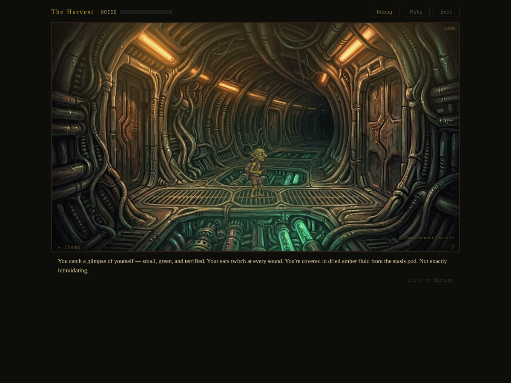
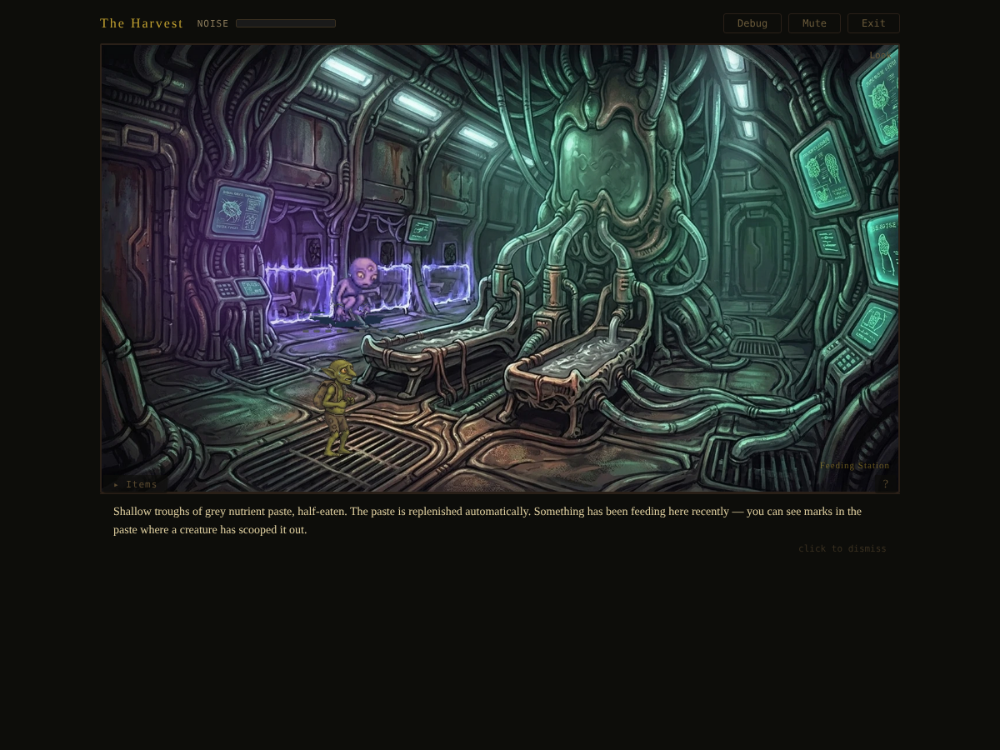
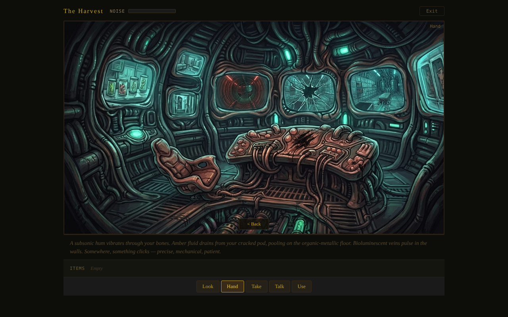
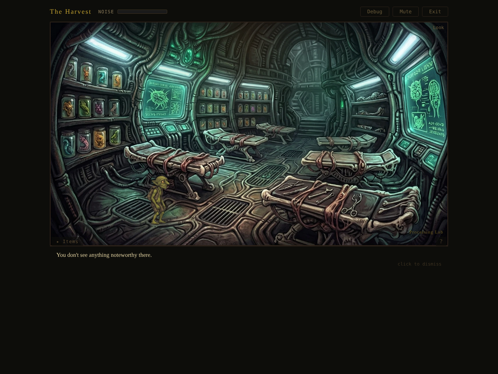
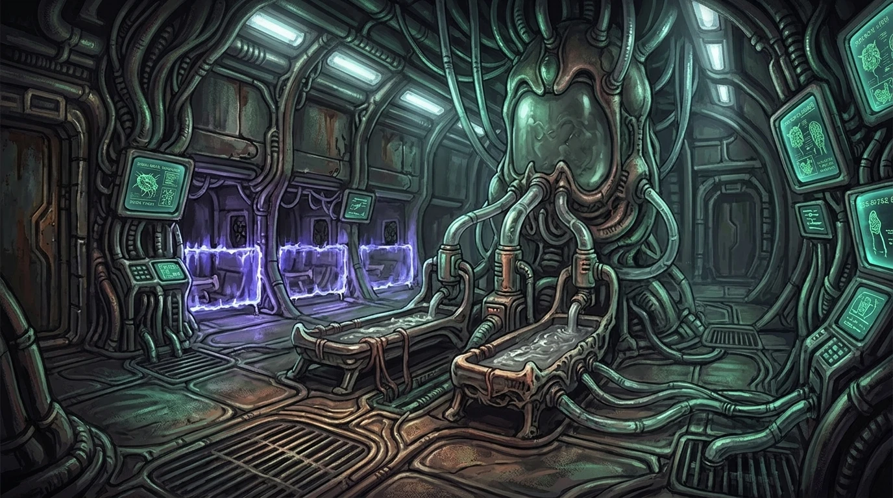
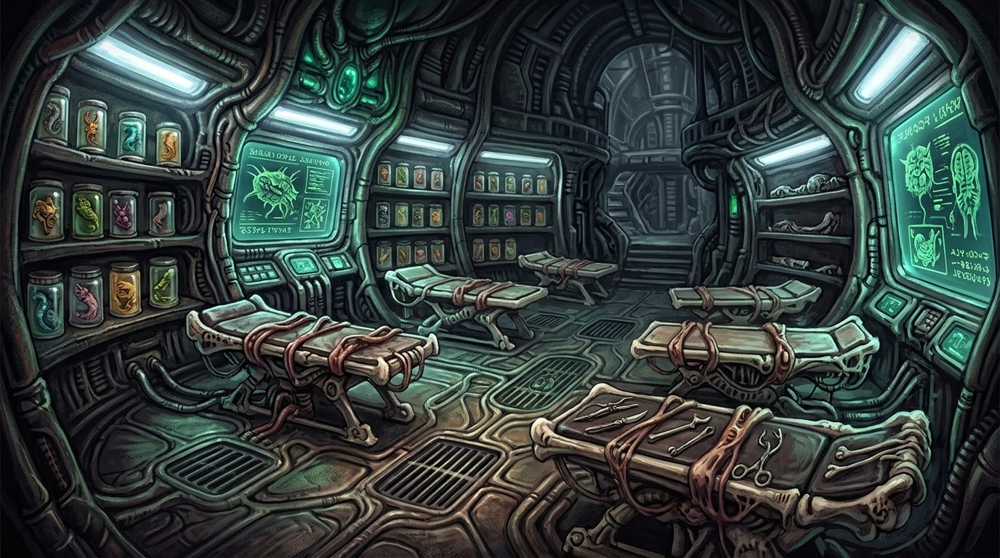
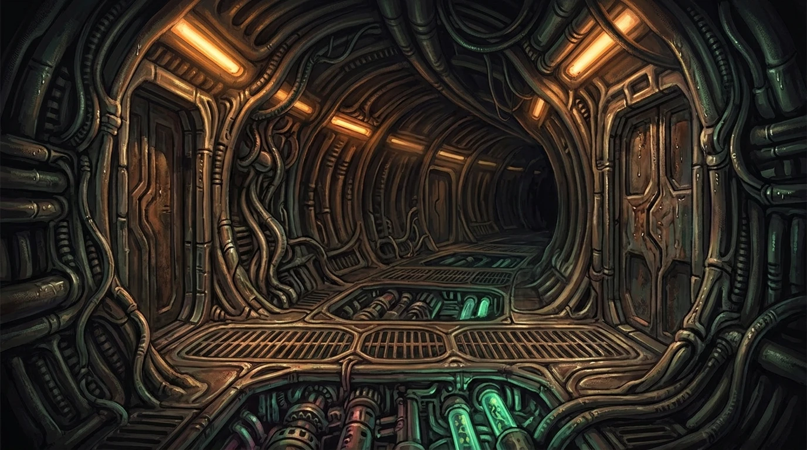

# Adventure Engine

**A JSON-driven point-and-click adventure game engine — no code required.**

Drop a scenario JSON, background art, and audio into a folder. The engine renders a fully playable Sierra-style adventure game in the browser. Every interaction, puzzle, item, and narrative beat is defined in JSON. The engine has zero scenario-specific code.

<p align="center">
  
  <br />
  <em>The Harvest — waking beside a shattered stasis pod aboard an alien harvester ship</em>
</p>

---

## Quick Start

```bash
cd client
npm install
npm run dev
```

Open `http://localhost:5173` and play. The Harvest loads automatically — you wake in a stasis pod and start exploring.

---

## What Is Adventure Engine?

Adventure Engine is a **no-code adventure game builder** inspired by the golden age of Sierra On-Line and LucasArts. You author a single JSON file describing rooms, objects, puzzles, items, and story — pair it with painted background art — and the engine turns it into a playable point-and-click adventure.

The engine is completely generic. It reads your JSON, builds the game state, renders backgrounds with interactive hotspots, and resolves every player action through a condition-and-effect system. There is no scenario-specific code anywhere in the engine. All game logic lives in the JSON.

---

## Gameplay Showcase

<p align="center">
  
  <br />
  <em>Containment Corridor — the central hub with five branching passages</em>
</p>

<p align="center">
  
  <br />
  <em>Feeding Station — animated prisoner NPC paces behind an energy barrier</em>
</p>

<p align="center">
  
  <br />
  <em>Closeup overlay — examining the cataloguer robot's specimen tanks reveals a section code</em>
</p>

<p align="center">
  
  
  <br />
  <em>Security Hub and Processing Lab — interconnected puzzle rooms</em>
</p>

---

## The Developer Ecosystem

Adventure Engine is designed as a **platform for scenario authors**. Third-party developers create self-contained **scenario packages** — a folder containing a JSON definition, background images, audio files, and item icons — and the engine plays them without modification.

The vision: a community of creators building adventures across every genre — horror, mystery, sci-fi, fantasy, kids, comedy — all sharing the same engine, the same schema, and the same tooling. One format, infinite stories.

**Want to build a scenario?** See [**ADVENTURE_BUILDER.md**](ADVENTURE_BUILDER.md) for the complete guide to creating scenario packages.

---

## How a Scenario Package Works

Every scenario is a self-contained folder:

```
my-scenario/
  scenario.json              # All game logic — views, objects, puzzles, narrative
  backgrounds/               # Painted background art for each view
    main_room.webp
    closet.webp
  closeups/                  # Detail images for zoom-in interactions (optional)
    mechanism_detail.webp
  sprites/                   # Character and object sprite sheets (optional)
    walk.png
    npc_idle.png
  audio/                     # Ambient audio tracks (optional)
    ambient_music.mp3
  design.md                  # Story notes, puzzle flow, image prompts (optional)
```

The `scenario.json` is the entire game. It defines:
- **Views** — rooms/locations, each with a background image and list of interactive objects
- **Objects** — clickable hotspots with position, size, appearance, state, and interactions
- **Interactions** — verb + conditions &rarr; effects ("if player uses key on door AND door is locked, THEN unlock door and show message")
- **Items** — inventory objects that can be used on the world or combined with each other
- **Flags** — key-value pairs tracking game progress
- **Dialogue choices** — branching conversation trees with conditional branches
- **Win/Lose Conditions** — state checks that end the game
- **Hints** — progressive per-view hints that guide stuck players

Object positions use a **960&times;720 coordinate space** (origin at top-left). Background images can be any resolution (1920&times;1080 recommended); the engine scales to fit.

For the full authoring guide, see [**ADVENTURE_BUILDER.md**](ADVENTURE_BUILDER.md). For the complete JSON schema reference, see [`docs/SCENARIO_SCHEMA.md`](docs/SCENARIO_SCHEMA.md).

---

## The Four Verbs

Every interaction uses one of four verbs — inherited from the Sierra and LucasArts classics:

| Verb | What It Does |
|------|-------------|
| **Look** | Examine visually. Always safe. The discovery verb. |
| **Move** | Navigate between rooms and views. The exploration verb. |
| **Hand** | Touch, push, pull, open, close, take. All physical manipulation. |
| **Talk** | Speak, listen, read aloud. The dialogue verb. |

**Using inventory items**: Select an item from the inventory panel, then click a world object. The engine calls `use_item` internally — no separate "use" verb button needed. This matches the King's Quest V/VI flow where items are dragged onto the world.

Every click produces feedback, even when nothing happens — KQ5-style messages like *"You can't do anything useful with that right now"* or *"Talking to the door doesn't accomplish anything."* The player always knows their click registered.

Interactions are gated by **conditions** (what must be true) and produce **effects** (what changes):

```json
{
  "verb": "use_item",
  "item": "wire_cutters",
  "when": [
    { "type": "object_state", "object": "window", "state": "mesh_intact" }
  ],
  "then": [
    { "type": "message", "text": "You cut through the wire mesh. Cold air rushes in." },
    { "type": "set_state", "object": "window", "state": "mesh_cut" },
    { "type": "add_noise", "amount": 25 }
  ]
}
```

---

## What You Can Build

The schema supports **30+ proven design patterns** drawn from classic adventures, horror, immersive sims, puzzle games, stealth, escape rooms, and narrative games:

**Puzzle Mechanics** — Lock-and-key, combination locks, keypads, toggle panels, dials, sliders, sequence memory, multi-step item crafting, transformation chains, state-dependent puzzles, environmental puzzles (noise, timing).

**Narrative Systems** — Branching dialogue with conditional choices, multiple solution paths, progressive per-room hints, win/lose conditions with custom endings, phase-based story progression, ambient text and audio, closeup detail images.

**Character & NPC Systems** — Sierra-style sprite sheet characters with animated walk cycles and static poses, object sprites for animated world entities (pacing prisoners, spinning holograms, scanning robots), per-view character placement, dynamic sprite changes via effects.

**Advanced Features** — AI antagonist (patrol timers, noise thresholds, evidence awareness, personality), stealth system (hiding spots, noise tracking, detection), timed events, hotspot animations (glimmer, pulse), ambient audio layers, 14 condition types with composites (`any_of`, `all_of`), 20+ effect types.

---

## Included Scenarios

15 scenario designs spanning genres from cozy kids adventures to psychological horror. 13 have complete JSON definitions ready to play:

| Scenario | Genre | Views | Difficulty |
|----------|-------|-------|-----------|
| [The Wizard's Apprentice](scenarios/the-wizards-apprentice/) | Kids / Cozy | 8 | Easy |
| [The Lighthouse Keeper](scenarios/the-lighthouse-keeper/) | Atmospheric | 3 | Medium |
| [The Last Signal](scenarios/the-last-signal/) | Sci-Fi | 3 | Medium |
| [Pressure Point](scenarios/pressure-point/) | Thriller | 4 | Medium |
| [The Seance Room](scenarios/the-seance-room/) | Gothic | 3 | Medium |
| [The Memory Dealer](scenarios/the-memory-dealer/) | Sci-Fi Noir | 3 | Medium |
| [The Abandoned Ward](scenarios/the-abandoned-ward/) | Medical Horror | 5 | Hard |
| [The Defector's Gambit](scenarios/the-defectors-gambit/) | Cold War Espionage | 4 | Hard |
| [The Taxidermist](scenarios/the-taxidermist/) | Southern Gothic | 4 | Hard |
| [The Butcher's Debt](scenarios/the-butchers-debt/) | Horror | 4 | Hard |
| [The Dollmaker's Workshop](scenarios/the-dollmakers-workshop/) | Psychological Horror | 5 | Hard |
| [The Pharaoh's Architect](scenarios/the-pharaohs-architect/) | Historical | 24 | Hard |
| **[The Harvest](scenarios/the-harvest/)** | **Sci-Fi Epic** | **49** | **Epic** |
| [Blackwood Manor](scenarios/blackwood-manor/) | Gothic Mystery | -- | *Design only* |
| [The Clockmaker's Secret](scenarios/the-clockmakers-secret/) | Steampunk | -- | *Design only* |

### The Harvest (Flagship)

A full-length adventure spanning **5 acts, 49 views, and 7 possible endings** including a hidden ending that rewards empathy across the entire game. The player wakes in a stasis pod aboard an alien harvester ship, escapes containment, navigates the ship, descends to a dying planet, explores a dead city, and confronts the parasitic Convergence in its nexus.

**Act 1 is fully playable** with:
- **9 rooms** — Stasis Hold, Containment Corridor, Processing Lab, Security Hub, Feeding Station, Morgue, Specimen Archive, Ventilation Shaft, Airlock Bay
- **9 collectible items** — pod glass shard, stasis fluid vial, specimen tag, surgical probe, containment key card, nutrient paste tube, severed neural tendril, personal log crystal, ventilation map
- **Animated NPC** — caged prisoner with 4-frame pacing animation behind an energy barrier
- **Branching dialogue** — 4-way conversation choices that set different bond values affecting future acts
- **Puzzle chains** — cataloguer code → lab sequence → security override → vent access → airlock
- **Closeup interactions** — specimen tanks, holographic displays
- **Complete walkthrough** at [`scenarios/the-harvest/walkthrough.md`](scenarios/the-harvest/walkthrough.md)

<p align="center">
  
  
  <br />
  
  
</p>

---

## Engine Features

### Immersive HUD
Messages overlay on the game viewport with a semi-transparent backdrop instead of a dedicated panel. Inventory is a collapsible drawer with a toggle tab. Progressive hints float at the corner. Room names appear subtly in gold text. No UI elements below the viewport — full immersion.

### Character Sprites
Sierra-style sprite sheet rendering on top of backgrounds. Walk cycles, static poses, per-view placement, dynamic state changes. Characters are positioned in the 960&times;720 coordinate space and rendered with `image-rendering: pixelated` for crisp pixel art.

### Object Sprites
Animated sprite sheets on world objects — pacing prisoners, spinning holograms, scanning robots. Defined via `sprite` field in object JSON with frame dimensions, animation rate, and scale. Bottom-center anchored for natural grounding.

### Closeup Overlays
Detail images displayed in a dismissable framed overlay for examining objects up close. The cataloguer robot in The Harvest shows a three-tank specimen closeup with data plates revealing the section code needed for the processing lab keypad.

### Dialogue Choices
Branching conversation system via `show_dialogue` effect. Each choice has a label, optional visibility conditions, and its own chain of effects. The prisoner in The Harvest's feeding station offers 4 dialogue paths that set different `prisoner_bond` values affecting all subsequent interactions.

### Progressive Hints
Per-view hint arrays in the scenario JSON. The engine evaluates conditions and returns the most specific matching hint. A floating "?" button shows hints as a message overlay. Players can never softlock — hints always point toward the next step.

---

## Tech Stack

| Layer | Technology | Notes |
|-------|-----------|-------|
| Frontend | React 19 + TypeScript + Vite 8 | Pure React rendering (no canvas) |
| Engine | TypeScript `ScenarioEngine` | Pure state machine — no rendering, no side effects |
| Rendering | React components + CSS positioning | Objects as positioned divs on painted backgrounds |
| Backend | Spring Boot 3.3.5 + Java 21 + Maven | Future: validation, tooling, save sync |
| Future Rendering | Phaser 3.80 (in deps) | For animations, sprites, canvas effects |
| Image Generation | Google Gemini (Imagen 3) | Background art in Sierra KQ5/KQ6 style |

**Architecture**: Thick client. The TypeScript `ScenarioEngine` runs entirely in the browser — loads scenario JSON, manages all game state, evaluates conditions, applies effects. React renders the view. No server needed for gameplay.

---

## Art Direction

All background art follows the **Sierra King's Quest V/VI aesthetic** — 2D gouache illustration with visible brushstrokes, soft color gradients, dramatic lighting. NOT photorealistic, NOT 3D rendered.

The player character is a small goblin-sized creature at knee-height. Backgrounds are painted from this low camera angle, looking UP at furniture and architecture.

<p align="center">
  
  
  <br />
  
  
</p>

---

## Documentation

| Document | What It Covers |
|----------|---------------|
| [**ADVENTURE_BUILDER.md**](ADVENTURE_BUILDER.md) | How to create scenario packages — the third-party developer guide |
| [**TECHNICAL_DEEP_DIVE.md**](TECHNICAL_DEEP_DIVE.md) | Engine internals and architecture — how the engine works under the hood |
| [**docs/SCENARIO_SCHEMA.md**](docs/SCENARIO_SCHEMA.md) | Complete JSON schema reference (1700+ lines, 30 design patterns) |
| [**docs/ARCHITECTURE.md**](docs/ARCHITECTURE.md) | ScenarioEngine class walkthrough, condition/effect system, rendering pipeline |
| [**CLAUDE.md**](CLAUDE.md) | Project context and conventions for AI agents contributing to this repo |

---

## Repository Structure

```
adventure-engine/
|
+-- client/                           React + TypeScript + Vite
|   +-- src/
|       +-- engine/                   ScenarioEngine — pure TypeScript state machine
|       |   +-- types.ts              TypeScript types matching the schema
|       |   +-- ScenarioEngine.ts     Core: load JSON, manage state, resolve interactions
|       +-- components/               React UI components
|           +-- ScenarioPlayer.tsx    Main game orchestrator
|           +-- GameView.tsx          Background + hotspot rendering + animations
|           +-- CharacterSprite.tsx   Sierra-style sprite sheet character renderer
|           +-- SpriteObject.tsx      Animated sprite sheets on world objects
|           +-- DialogueOverlay.tsx   Branching conversation choice modal
|           +-- VerbBar.tsx           Verb selection (look, move, hand, talk)
|           +-- InventoryPanel.tsx    Item display and selection
|           +-- NoiseIndicator.tsx    Noise level meter
|
+-- server/                           Spring Boot 3 + Java 21 + Maven
|   +-- src/main/java/com/kq/        Future: validation, tooling, save sync
|
+-- scenarios/                        ALL scenario content (self-contained packages)
|   +-- the-lighthouse-keeper/        Each scenario is a self-contained folder
|   |   +-- scenario.json             The scenario definition
|   |   +-- design.md                 Design document (story, prompts, patterns)
|   |   +-- backgrounds/              Background images for this scenario
|   |   +-- audio/                    Ambient audio tracks (optional)
|   |   +-- items/                    Item icon images (optional)
|   +-- the-harvest/                  Flagship: 5 acts, 49 views, 7 endings
|   +-- ... (15 scenarios total)
|
+-- docs/                             Engine-level documentation
|   +-- ARCHITECTURE.md               Engine internals deep dive
|   +-- SCENARIO_SCHEMA.md            THE schema spec (1700+ lines, 30 design patterns)
|   +-- SPATIAL_MOVEMENT_DESIGN.md    Future: click-to-move system
|   +-- images/                       Screenshots and diagrams
|
+-- ADVENTURE_BUILDER.md              Third-party developer guide
+-- TECHNICAL_DEEP_DIVE.md            Engine architecture reference
+-- CLAUDE.md                         AI agent project context
+-- README.md                         You are here
```

---

## Roadmap

- [x] Scenario schema specification (30 design patterns, 4 verbs, condition/effect system)
- [x] 13 complete scenario JSONs across genres
- [x] Flagship scenario deep design (The Harvest — 5 acts, 7 endings)
- [x] Background art for Act 1 of The Harvest (11 views at 1920x1080)
- [x] ScenarioEngine — pure TypeScript state machine with all condition/effect types
- [x] Scenario loader and player UI
- [x] Background image rendering with object hotspots
- [x] Ambient audio system (layered tracks per scenario)
- [x] Hotspot animations (glimmer, pulse via JSON visual config)
- [x] KQ5-style verb feedback on every click
- [x] Closeup overlay system for detail images
- [x] Character sprite system (Sierra-style sprite sheets)
- [x] Object sprite system (animated world entities)
- [x] Branching dialogue choice system
- [x] Progressive per-room hint system
- [x] Immersive HUD (overlay messages, collapsible inventory, ambient text)
- [x] Room name labels in viewport
- [x] Back navigation for closeup views
- [x] Act 1 of The Harvest fully solvable (9 rooms, 9 items, walkthrough)
- [ ] Item icon images in inventory panel
- [ ] Events system (timed/conditional narrative beats)
- [ ] Puzzle widget UI components
- [ ] Killer AI state machine
- [ ] Scenario validation tooling (Spring Boot)
- [ ] Spatial movement system (click-to-move, walkable areas)
- [ ] Multiplayer mode

---

## Attribution

### Audio

- **Item pickup chime** (`item_pickup.wav`): [Synth glockenspiel bell item money gold coin pick up.wav](https://freesound.org/s/531175/) by ryusa — License: [Attribution 4.0](https://creativecommons.org/licenses/by/4.0/)
- **Door open/close** (`door_open_close.wav`): [door_open_close](https://freesound.org/s/156507/) by primeval_polypod — License: [Attribution NonCommercial 3.0](https://creativecommons.org/licenses/by-nc/3.0/)
- **Lab ambience** (`ambient_lab.mp3`): [Sci-fi Laboratory Ambience](https://freesound.org/s/212025/) by qubodup — License: [Attribution 4.0](https://creativecommons.org/licenses/by/4.0/)
- **Ship ambience** (`ambient_ship.mp3`) — composed from:
  - [control_room.wav](https://freesound.org/s/211683/) by Diboz — License: [Creative Commons 0](https://creativecommons.org/publicdomain/zero/1.0/)
  - [Kaiju Lab Interior Ambience #1.wav](https://freesound.org/s/191852/) by Vortex4 — License: [Creative Commons 0](https://creativecommons.org/publicdomain/zero/1.0/)
  - [Cinematic Deep Rumble](https://freesound.org/s/184313/) by swiftoid — License: [Creative Commons 0](https://creativecommons.org/publicdomain/zero/1.0/)

---

## License

TBD
