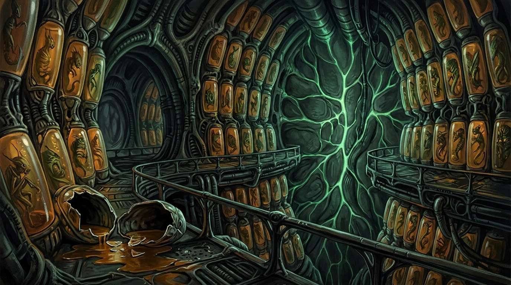
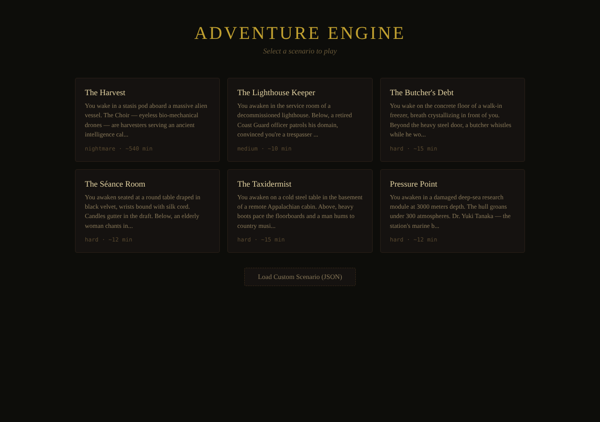
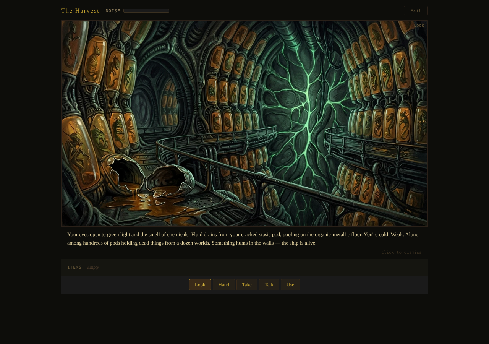
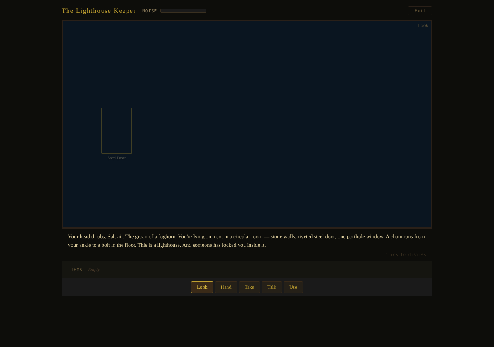
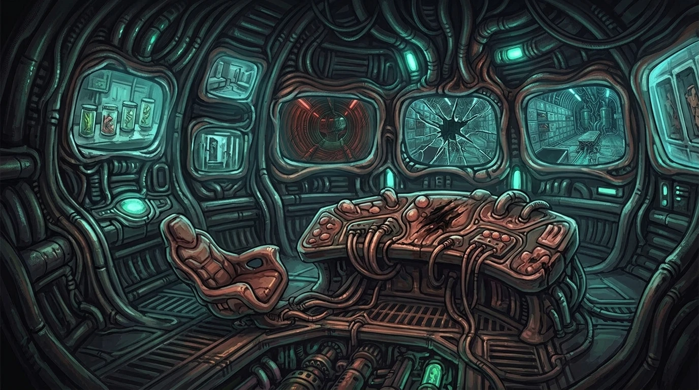
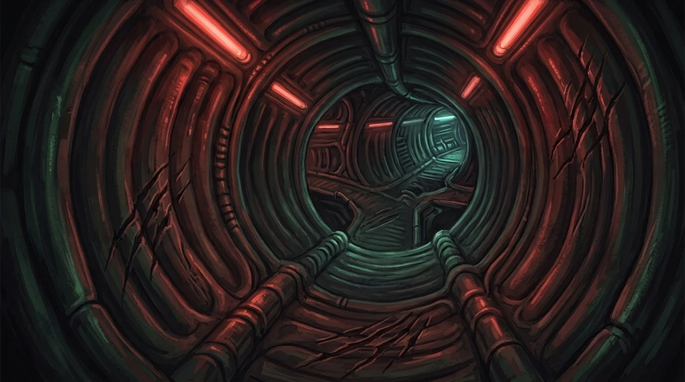

# Adventure Engine

**A JSON-driven point-and-click adventure game engine inspired by the golden age of Sierra and LucasArts.**

Define an entire adventure — views, puzzles, items, narrative, and an optional AI antagonist — in a single JSON file with background art. No code required. Drop in JSON, drop in art, play.

<p align="center">
  
  <br />
  <em>Act 1 of "The Harvest" — a flagship scenario spanning 5 acts and 7 endings</em>
</p>

---

## How It Works

1. Write a scenario JSON following the [schema spec](docs/SCENARIO_SCHEMA.md)
2. Paint or generate background art for each view
3. Drop both into a `scenarios/` folder
4. The engine reads the JSON and renders a fully playable point-and-click adventure

The engine is completely generic — it has no scenario-specific code. All game logic lives in the JSON: conditions gate when interactions fire, effects change the world, and the player solves puzzles through a five-verb interface inherited from the classics.

<p align="center">
  
  <br />
  <em>Choose from 13 playable scenarios across genres — or load your own JSON</em>
</p>

---

## In Action

<p align="center">
  
  <br />
  <em>The Harvest — painted gouache backgrounds with interactive object hotspots</em>
</p>

<p align="center">
  
  <br />
  <em>Hovering an object reveals its label — click to interact with the active verb</em>
</p>

---

## Quick Start

### Prerequisites

- **Node.js 18+** (client)
- **Java 21** + **Maven 3.9+** (server — not needed for the scenario engine)

### Run the Client

```bash
cd client
npm install
npm run dev
```

Open `http://localhost:5173`, select a scenario, and play.

### Type Check

```bash
cd client
npx tsc --noEmit
```

---

## Creating a Scenario

Create an entire point-and-click adventure with nothing but JSON and images:

1. **Create a folder** in `scenarios/` with your scenario ID (e.g., `scenarios/my-escape-room/`)
2. **Write `scenario.json`** following the [schema spec](docs/SCENARIO_SCHEMA.md)
3. **Add background images** in a `backgrounds/` subfolder — any resolution (1920x1080 recommended), the engine scales to fit
4. **Write `design.md`** documenting the story, puzzle flow, and image generation prompts
5. **Add your scenario ID** to the `SCENARIOS` array in `client/src/components/ScenarioLoader.tsx`

Object positions use a **960x720 coordinate space** (origin at top-left). The engine maps this to the rendered viewport. For details on how the coordinate system works, see the [Architecture Deep Dive](docs/ARCHITECTURE.md#coordinate-system).

### Minimal Scenario Example

A complete (tiny) scenario has this structure:

```json
{
  "metadata": {
    "id": "my-escape-room",
    "title": "My Escape Room",
    "description": "You wake up in a locked room."
  },
  "setting": {
    "initial_view": "room",
    "ambient_text": "The room is cold and silent.",
    "room_style": { "background_color": "#1a1a2e" }
  },
  "views": [
    {
      "id": "room",
      "background": "A dimly lit stone room.",
      "background_file": "backgrounds/room.webp",
      "objects": ["door", "key"]
    }
  ],
  "flags": {},
  "items": [
    { "id": "rusty_key", "name": "Rusty Key", "description": "An old iron key." }
  ],
  "objects": [
    {
      "id": "key",
      "name": "Rusty Key",
      "description": "A key lies on the floor.",
      "position": { "x": 700, "y": 550 },
      "size": { "width": 60, "height": 40 },
      "visual": { "color": "#c0a030", "label": "Key" },
      "initial_state": "on_floor",
      "initially_visible": true,
      "interactions": [
        {
          "verb": "take",
          "when": [{ "type": "object_state", "object": "key", "state": "on_floor" }],
          "then": [
            { "type": "message", "text": "You pick up the rusty key." },
            { "type": "add_item", "item": "rusty_key" },
            { "type": "hide_object", "object": "key" }
          ]
        }
      ]
    },
    {
      "id": "door",
      "name": "Heavy Door",
      "description": "A heavy iron door. Locked.",
      "position": { "x": 200, "y": 200 },
      "size": { "width": 120, "height": 250 },
      "visual": { "color": "#4a3a2a", "label": "Door" },
      "initial_state": "locked",
      "initially_visible": true,
      "interactions": [
        {
          "verb": "use_item",
          "item": "rusty_key",
          "when": [{ "type": "object_state", "object": "door", "state": "locked" }],
          "then": [
            { "type": "message", "text": "The key turns. The door swings open." },
            { "type": "game_over", "result": "win", "reason": "You escaped!" }
          ]
        },
        {
          "verb": "hand",
          "when": [{ "type": "object_state", "object": "door", "state": "locked" }],
          "then": [
            { "type": "message", "text": "It won't budge. You need a key." }
          ]
        }
      ]
    }
  ]
}
```

That's a complete, playable adventure. The [schema spec](docs/SCENARIO_SCHEMA.md) documents every available condition type, effect type, and the 30 design patterns that make complex puzzles possible.

---

## The Five Verbs

Every interaction uses one of five verbs — the same interface Sierra and LucasArts used:

| Verb | What It Does |
|------|-------------|
| **Look** | Examine visually. Always safe. The discovery verb. |
| **Hand** | Touch, push, pull, open, close, manipulate physically. |
| **Take** | Pick up an object and add it to inventory. |
| **Talk** | Speak, listen, read aloud, whisper, shout. |
| **Use** | Apply an inventory item to a world object. The puzzle verb. |

Interactions are gated by **conditions** (what must be true) and produce **effects** (what changes). The engine supports 14 condition types with composites (`any_of`, `all_of`) and 20+ effect types including conditional branching and timed delays. See the [schema spec](docs/SCENARIO_SCHEMA.md) for the full reference.

---

## What the Engine Can Do

The JSON format is the product. Here's what it supports:

| Capability | Details |
|-----------|---------|
| **14 condition types** | Flag checks, item checks, object state, noise levels, phase, killer state, composites |
| **20+ effect types** | Messages, items, state changes, visibility, noise, phases, game over, hiding, timed delays, conditional branching |
| **Puzzle widgets** | Combination locks, keypads, toggle panels, dials, sliders, sequence memory |
| **AI antagonist** | Patrol timers, noise thresholds, search thoroughness, evidence awareness, personality dialogue |
| **30 design patterns** | Proven puzzle structures from classic adventures, horror, immersive sims, stealth, escape rooms |
| **Progressive hints** | Timer-based, condition-gated help system |
| **Multiple endings** | Condition-driven win/lose states with custom text |
| **Solution paths** | Documented paths for automated validation and playtesting |

> **30 patterns, infinite possibilities.** The schema includes documented patterns like Environmental Gating, Stealth Thresholds, Timed Pressure, Multi-State Mechanisms, Evidence Assembly, Red Herring Placement, and 24 more. Each pattern is a reusable puzzle structure that authors can combine freely. See [`docs/SCENARIO_SCHEMA.md`](docs/SCENARIO_SCHEMA.md) for the complete catalog.

---

## Scenarios

15 scenario designs spanning genres from cozy kids adventures to psychological horror. 13 have complete JSON definitions ready to play:

| Scenario | Genre | Views | Difficulty |
|----------|-------|-------|-----------|
| [The Wizard's Apprentice](scenarios/the-wizards-apprentice/) | Kids / Cozy | 8 | Easy |
| [The Lighthouse Keeper](scenarios/the-lighthouse-keeper/) | Atmospheric | 3 | Medium |
| [The Last Signal](scenarios/the-last-signal/) | Sci-Fi | 3 | Medium |
| [Pressure Point](scenarios/pressure-point/) | Thriller | 4 | Medium |
| [The Seance Room](scenarios/the-seance-room/) | Gothic | 3 | Medium |
| [The Memory Dealer](scenarios/the-memory-dealer/) | Sci-Fi Noir | 3 | Medium |
| [The Abandoned Ward](scenarios/the-abandoned-ward/) | Medical Horror | 5 | Hard |
| [The Defector's Gambit](scenarios/the-defectors-gambit/) | Cold War Espionage | 4 | Hard |
| [The Taxidermist](scenarios/the-taxidermist/) | Southern Gothic | 4 | Hard |
| [The Butcher's Debt](scenarios/the-butchers-debt/) | Horror | 4 | Hard |
| [The Dollmaker's Workshop](scenarios/the-dollmakers-workshop/) | Psychological Horror | 5 | Hard |
| [The Pharaoh's Architect](scenarios/the-pharaohs-architect/) | Historical | 24 | Hard |
| [The Harvest](scenarios/the-harvest/) | Sci-Fi Epic | 50 | Epic |
| [Blackwood Manor](scenarios/blackwood-manor/) | Gothic Mystery | — | *Design only* |
| [The Clockmaker's Secret](scenarios/the-clockmakers-secret/) | Steampunk | — | *Design only* |

### The Harvest (Flagship)

A full-length adventure spanning **5 acts, 50 views, and 7 possible endings** including a hidden ending that rewards empathy across the entire game. The player wakes in a stasis pod aboard an alien vessel, escapes containment, navigates the ship, descends to a dying planet, explores a dead city, and confronts the parasitic Convergence in its nexus.

<p align="center">
  
  
  <br />
  
  
</p>

---

## Repository Structure

```
adventure-engine/
|
+-- client/                           React + TypeScript + Vite
|   +-- src/
|       +-- engine/                   ScenarioEngine — pure TypeScript state machine
|       +-- components/               React UI components (7 components)
|
+-- server/                           Spring Boot 3 + Java 21 + Maven
|   +-- src/main/java/com/kq/        Future: tooling, validation, save sync
|
+-- scenarios/                        ALL scenario content (self-contained folders)
|   +-- the-lighthouse-keeper/        scenario.json + design.md + backgrounds/
|   +-- the-harvest/                  Flagship: 50 views, 11 painted backgrounds
|   +-- ... (15 scenarios total)
|
+-- docs/                             Engine documentation
|   +-- SCENARIO_SCHEMA.md            THE schema spec (1700+ lines, 30 patterns)
|   +-- ARCHITECTURE.md              Engine internals deep dive
|   +-- SPATIAL_MOVEMENT_DESIGN.md    Future: click-to-move system
```

Each scenario folder is self-contained: JSON definition, design document, and background images all in one place. See the [Architecture Deep Dive](docs/ARCHITECTURE.md) for how the engine processes these files.

---

## Art Direction

All background art follows the **Sierra King's Quest V/VI aesthetic** — 2D gouache illustration with visible brushstrokes, soft color gradients, dramatic lighting. NOT photorealistic, NOT 3D rendered.

The player character is a small goblin-sized creature at knee-height to environment inhabitants. Backgrounds are painted from this low camera angle, looking UP at furniture and architecture.

---

## Tech Stack

| Layer | Technology | Notes |
|-------|-----------|-------|
| Frontend | React 19 + TypeScript + Vite 8 | Pure React rendering (no canvas) |
| Engine | TypeScript `ScenarioEngine` | Pure state machine — no rendering, no side effects |
| Rendering | React components + CSS positioning | Objects as positioned divs on painted backgrounds |
| Backend | Spring Boot 3.3.5 + Java 21 + Maven | Future: validation, tooling, save sync |
| Future Rendering | Phaser 3.80 (in deps) | For animations, sprites, canvas effects — post-POC |
| Image Generation | Google Gemini (Imagen 3) | Background art in Sierra KQ5/KQ6 style |

---

## Architecture

The engine is a **pure client-side state machine**. No server needed for gameplay.

```
scenario.json → ScenarioEngine (TypeScript) → React components → playable game
```

The `ScenarioEngine` manages all game state — flags, object states, inventory, noise level, view navigation — and exposes it through getter methods. React components read this state and render the UI. User actions (click object, select verb) call engine methods, which evaluate conditions, apply effects, and update state. React re-renders.

For the full technical deep dive — interaction resolution flow, condition/effect system details, data flow diagrams, coordinate scaling math, and rendering pipeline — see **[docs/ARCHITECTURE.md](docs/ARCHITECTURE.md)**.

---

## Roadmap

- [x] Scenario schema specification (30 design patterns, 5 verbs, condition/effect system)
- [x] 13 complete scenario JSONs across genres
- [x] Flagship scenario deep design (The Harvest — 5 acts, 7 endings)
- [x] Background art for Act 1 of The Harvest (11 views at 1920x1080)
- [x] ScenarioEngine (TypeScript state machine)
- [x] Scenario loader and player UI
- [x] Background image rendering
- [x] `all_of` condition + missing condition/effect types
- [ ] Events system (timed/conditional narrative beats)
- [ ] Puzzle widget UI components
- [ ] Killer AI state machine
- [ ] Scenario validation tooling
- [ ] Sound/music system
- [ ] Spatial movement system (click-to-move, walkable areas)
- [ ] Multiplayer mode

---

## License

TBD
