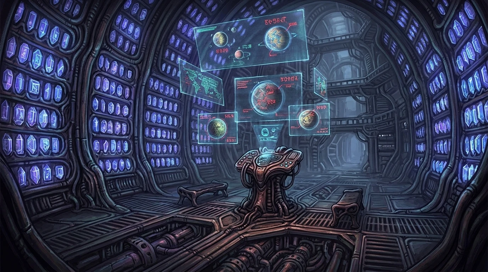
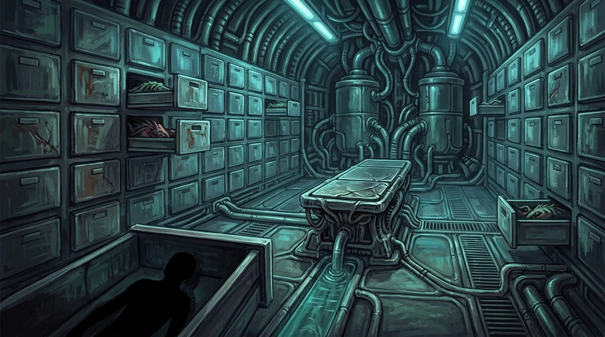

# Adventure Engine

**A JSON-driven game engine inspired by the golden age of point-and-click adventure games.**

Define an entire adventure — puzzles, narrative, branching outcomes, and optionally an AI antagonist — as a single JSON file and a set of background images. No code changes. No plugins. No scripting language. Drop in JSON, drop in art, play.

<p align="center">
  
  <br />
  <em>Act 1 of "The Harvest" — a flagship scenario spanning 5 acts and 7 endings</em>
</p>

---

## What Is This?

Adventure Engine is a browser-based point-and-click adventure game engine where:

- **Every scenario is pure data** — one JSON file defines all game logic, interactions, puzzles, narrative, and (optionally) antagonist behavior
- **Any genre works** — horror escape rooms with an AI antagonist, cozy wizard puzzles, sci-fi exploration, pure adventure with no threat at all
- **Size as a mechanic** — you play as a small goblin-like creature in a world built for beings 3x your height. Crawl under furniture, squeeze through vents, hide in spaces captors can't reach — but can't access high shelves or move heavy objects without creative solutions
- **Background art is human-created** — painted scenes in the style of Sierra's King's Quest V/VI, rendered at 1920x1080
- **The engine is generic** — it reads any valid scenario JSON and runs it without scenario-specific code
- **Scenarios can be AI-generated** — give an LLM the [schema spec](docs/SCENARIO_SCHEMA.md) and a theme, get a playable level
- **Ambient animation** — Canvas2D overlays bring static backgrounds to life with KQ5/KQ6-style effects (glow pulses, dust motes, light rays, film grain)

### Design Lineage

The interaction model draws from the best of classic adventure gaming:

| Source | What We Took |
|--------|-------------|
| **King's Quest V/VI** | Verb icons (look, hand, talk), inventory puzzles, multi-step chains, dual-purpose items |
| **Monkey Island** | Item combinations, dialogue-as-puzzle, no-dead-ends philosophy, alternate solutions |
| **Myst** | Environmental manipulation, code/pattern input, observation puzzles, power routing |
| **The Room** | Nested examination layers — object within object within object |
| **Resident Evil** | Noise-as-risk, hiding mechanics, evidence the antagonist notices on patrol (optional) |
| **Outer Wilds** | Knowledge-as-key — information gates progress, not just items |

---

## A Small Creature in a Big World

You play as a small goblin-like creature — roughly knee-height to the beings who built these environments. This isn't flavor text; **size is a core puzzle mechanic** that gives every scene two layers of interaction.

### What Being Small Lets You Do

| Advantage | Example |
|-----------|---------|
| **Crawl under furniture** | Check beneath examination tables, benches, consoles — hidden objects, passages, floor drains |
| **Fit through small gaps** | Vents, cracked walls, gaps between bars, drain pipes — routes captors can't follow |
| **Hide anywhere** | Inside cabinets, behind equipment, under consoles, in spaces captors wouldn't think to check |
| **Access machinery internals** | Climb inside devices through maintenance panels, reach components from the inside |
| **See what others miss** | Floor-level markings, objects kicked under furniture, scratches at ankle height |

### What Being Small Prevents

| Limitation | Puzzle It Creates |
|------------|-------------------|
| **Can't reach high surfaces** | Stack crates, climb shelves, use a tool with reach, or lure someone tall into helping |
| **Can't move heavy objects** | Find a lever, redirect machinery, trick a larger creature into pushing it |
| **Can't operate oversized controls** | Jam a tool into a giant lever, throw something at a distant button, rewire from inside the panel |
| **Scale hazards** | Puddles are waist-deep, gaps that are steps to captors are chasms to you |

Every background scene works on two levels: the **surface layer** (tabletops, shelves, consoles — built for large beings, requires creativity to reach) and the **floor layer** (under-table passages, floor drains, kicked-aside objects — your domain). A single room becomes twice as rich.

---

## Project Structure

```
adventure-engine/
├── server/                          # Java 21 + Spring Boot 3.3.5 + Maven
│   └── src/main/java/com/kq/
│       ├── model/                   # Game state, scene objects, player state
│       ├── session/                 # Game session management
│       ├── message/                 # WebSocket message types
│       ├── websocket/               # WebSocket handler
│       └── config/                  # Spring config
│
├── client/                          # React + TypeScript + Vite + Phaser 3
│   └── src/
│       ├── game/scenes/             # Phaser room renderer
│       ├── hud/                     # Inventory bar, verb selector (planned)
│       ├── lobby/                   # Title screen / scenario selector
│       ├── network/                 # WebSocket client
│       └── types/                   # Shared message types
│
├── docs/
│   ├── SCENARIO_SCHEMA.md           # Full schema specification
│   ├── SPATIAL_MOVEMENT_DESIGN.md   # Future: click-to-move system (post-MVP)
│   └── scenarios/                   # Scenario design documents
│       ├── the-harvest.md           # Flagship scenario — 5 acts, 50 views
│       ├── the-harvest-deep-design.md # Decision trees, level maps, puzzle evals
│       ├── the-wizards-apprentice.md  # Kids scenario (ages 6-8)
│       └── ... (14 scenario designs)
│
├── examples/                        # Playable scenario JSON files
│   ├── the-wizards-apprentice.json  # Complete — cozy wizard tower escape
│   ├── the-butchers-debt.json       # Horror — meat locker nightmare
│   ├── the-memory-dealer.json       # Sci-fi noir — black market memories
│   └── ... (12 scenarios total)
│
├── assets/
│   └── act1-backgrounds/            # Hand-painted 1920x1080 backgrounds
│       ├── act1_stasis_hold.webp
│       ├── act1_pod_cluster.webp
│       ├── act1_processing_lab.webp
│       ├── act1_containment_corridor.webp
│       ├── act1_morgue.webp
│       ├── act1_feeding_station.webp
│       ├── act1_ventilation_shaft.webp
│       ├── act1_security_hub.webp
│       ├── act1_specimen_archive.webp
│       ├── act1_airlock_bay.webp
│       └── act1_airlock_bay_alt.webp
│
└── PLAN.md                          # Living design document
```

---

## The Scenario Schema

A complete scenario is **one JSON file + background images**. The schema is expressive enough to represent the most complex classic adventure game puzzles purely through structured data.

### Five Verbs

Every interaction in the game uses one of five verbs — the same icons Sierra and LucasArts used:

| Verb | Icon | What It Does |
|------|------|-------------|
| `look` | Eye | Examine visually. Always safe. The discovery verb. |
| `hand` | Hand | Touch, push, pull, open, close, manipulate. |
| `take` | Grab | Pick up an object and add it to inventory. |
| `talk` | Mouth | Speak, listen, read aloud, whisper, shout. |
| `use_item` | Item | Apply an inventory item to a world object. The puzzle verb. |

### Conditions & Effects

Interactions are gated by **conditions** (what must be true) and produce **effects** (what changes):

```jsonc
// Example: Using a glass shard on a ventilation grate
{
  "verb": "use_item",
  "required_item": "pod_glass_shard",
  "conditions": [
    { "type": "object_state", "object": "ceiling_vent", "state": "bolts_loosened" }
  ],
  "effects": [
    { "type": "message", "text": "You pry the grate free. A rush of stale air hits your face." },
    { "type": "set_state", "object": "ceiling_vent", "state": "open" },
    { "type": "add_noise", "amount": 5 },
    { "type": "show_object", "object": "vent_entrance" }
  ]
}
```

### Puzzle Widgets

For Myst-style interactive elements, the schema defines **puzzle widgets** — pre-built UI components parameterized by JSON:

- `combination_lock` — N-digit dials
- `toggle_panel` — Switch patterns
- `sequence_puzzle` — Ordered steps
- `keypad` — Numeric code entry
- `dial` — Rotational input

### Antagonist AI (Optional)

Scenarios can optionally include an AI-controlled antagonist — patrol timing, noise thresholds, search thoroughness, evidence awareness, personality dialogue, and phase-based behavior escalation. The antagonist is a server-side state machine that reacts to player actions in real time. Omit it entirely for a pure point-and-click adventure with no threat mechanic.

### 30 Design Patterns

The schema supports [30 proven puzzle design patterns](PLAN.md#design-patterns-for-ai-scenario-generation) drawn from classic adventures, horror games, immersive sims, puzzle games, stealth games, and real escape rooms. A typical scenario uses 8-12 patterns — `C(30,10) = 30 million+` unique pattern combinations before accounting for theme and narrative.

> Full schema specification: **[docs/SCENARIO_SCHEMA.md](docs/SCENARIO_SCHEMA.md)**

---

## Example Scenarios

Twelve scenario JSON files ship in [`examples/`](examples/), spanning genres from cozy kids adventures to psychological horror:

| Scenario | Genre | Difficulty | Patterns |
|----------|-------|-----------|----------|
| [The Wizard's Apprentice](examples/the-wizards-apprentice.json) | Kids / Cozy | Easy | Gateway, Fork, Knowledge Gate |
| [The Butcher's Debt](examples/the-butchers-debt.json) | Horror | Hard | Evidence Gamble, Decay Clock, Bait & Punish |
| [The Memory Dealer](examples/the-memory-dealer.json) | Sci-Fi Noir | Medium | Nested Secret, Cross-Reference, Rule Subversion |
| [Pressure Point](examples/pressure-point.json) | Thriller | Medium | Noise Tradeoff, Distraction Window, Ticking Clock |
| [The Seance Room](examples/the-seance-room.json) | Gothic | Medium | Perspective Alignment, Echo, Myst Machine |
| [The Pharaoh's Architect](examples/the-pharaohs-architect.json) | Historical | Hard | Power Routing, Sequence, Transformation Chain |
| [The Lighthouse Keeper](examples/the-lighthouse-keeper.json) | Atmospheric | Medium | Progressive Reveal, Dual-Purpose Item |
| [The Dollmaker's Workshop](examples/the-dollmakers-workshop.json) | Psychological Horror | Hard | Camouflage, Accomplice, Moral Fork |
| [The Defector's Gambit](examples/the-defectors-gambit.json) | Cold War Espionage | Hard | Sound Masking, Trap Setting, Point of No Return |
| [The Last Signal](examples/the-last-signal.json) | Sci-Fi | Medium | Revelation Tool, Progressive Reveal |
| [The Taxidermist](examples/the-taxidermist.json) | Southern Gothic | Hard | Evidence Gamble, Nested Secret |
| [The Abandoned Ward](examples/the-abandoned-ward.json) | Medical Horror | Hard | Decay Clock, Multi-Path Solution |

### The Harvest (Flagship)

"The Harvest" is the flagship scenario — a full-length adventure spanning **5 acts, 50 views, and 7 possible endings** (including a hidden ending that rewards empathy across the entire game). The player wakes in a stasis pod aboard an alien vessel, escapes containment, navigates the ship, descends to a dying planet, explores a dead city, and confronts the parasitic Convergence in its nexus.

- **Design document**: [docs/scenarios/the-harvest.md](docs/scenarios/the-harvest.md) — story, image prompts, structural overview
- **Deep design**: [docs/scenarios/the-harvest-deep-design.md](docs/scenarios/the-harvest-deep-design.md) — branching decision trees, level maps, view-by-view breakdowns, puzzle evaluations, pacing analysis
- **Act 1 backgrounds**: [assets/act1-backgrounds/](assets/act1-backgrounds/) — 10 hand-painted views at 1920x1080

<p align="center">
  
  
  <br />
  
  
</p>

---

## Getting Started

### Prerequisites

- **Java 21** (server)
- **Node.js 18+** (client)
- **Maven 3.9+** (server build)

### Build & Run

```bash
# Server
cd server
mvn clean compile
mvn spring-boot:run
```

```bash
# Client (separate terminal)
cd client
npm install
npm run dev
```

The client runs at `http://localhost:5173` and connects to the Spring Boot WebSocket server at `ws://localhost:8080/ws/game`.

---

## Creating a Scenario

Anyone can create a new scenario. No code changes required — just JSON and art.

### 1. Write the JSON

Start from an existing example or from scratch using the [schema spec](docs/SCENARIO_SCHEMA.md). A minimal scenario needs:

```jsonc
{
  "schema_version": "1.0",
  "metadata": {
    "id": "my-escape-room",
    "title": "My Escape Room",
    "difficulty": "medium",
    "estimated_minutes": 30
  },
  "setting": {
    "initial_view": "main_room"
  },
  "views": [
    {
      "id": "main_room",
      "background_file": "backgrounds/main_room.png",
      "objects": ["door"]
    }
  ],
  "objects": [
    {
      "id": "door",
      "name": "Heavy door",
      "position": { "x": 0.8, "y": 0.3, "width": 0.15, "height": 0.6 },
      "interactions": [
        {
          "verb": "hand",
          "conditions": [{ "type": "has_item", "item": "key" }],
          "effects": [
            { "type": "message", "text": "The lock clicks open. Freedom." },
            { "type": "game_over", "result": "win" }
          ]
        }
      ]
    }
  ],
  "items": [{ "id": "key", "name": "Rusty key" }],
  "win_conditions": [{ "type": "flag_is", "flag": "escaped", "value": true }]
}
```

### 2. Create the Art

Background images are 1920x1080 PNGs or WebPs. Objects are invisible hotspot regions overlaid on the art — the visual IS the painted background. Position coordinates in the JSON are normalized (0.0-1.0).

### 3. Validate

The engine validates scenarios on load:
- All referenced IDs (items, objects, flags) must exist
- At least one win path must be completable from the initial state
- No dead ends (consumed items required downstream)
- Puzzle widgets have valid solutions
- Noise values stay within 0-100

### 4. Play

Drop your JSON into `examples/` and your backgrounds into `assets/`. Select your scenario from the title screen.

---

## Contributing

### Scenario Contributions

The fastest way to contribute is to **write a new scenario**. Fork the repo, create your JSON in `examples/`, and open a PR. Include:

1. The scenario JSON file (validated against the schema)
2. A design document in `docs/scenarios/` describing the narrative, puzzle flow, and design patterns used
3. Background image prompts (or the images themselves) at 1920x1080

### Engine Contributions

The engine is built in two halves:

**Server** (Java 21 + Spring Boot 3.3.5 + Maven):
- `com.kq.model` — Game state POJOs
- `com.kq.session` — Session management and game logic
- `com.kq.websocket` — WebSocket transport

**Client** (React + TypeScript + Vite + Phaser 3):
- `src/game/` — Phaser scene rendering
- `src/hud/` — React overlay UI (inventory, verbs, puzzle widgets)
- `src/network/` — WebSocket client

### Development Priorities

See [PLAN.md](PLAN.md) for the full implementation roadmap. Current focus:

1. **Scenario engine** — Generic condition/effect interpreter that runs any valid JSON
2. **Antagonist AI (optional)** — Server-side state machine with configurable behavior per scenario
3. **Verb UI** — Classic point-and-click verb selector (look, hand, take, talk, use item)
4. **Puzzle widgets** — Pre-built interactive components (locks, keypads, panels)
5. **Scene navigation** — Point-and-click transitions between connected views

---

## Art Direction

All background art follows the **Sierra King's Quest V/VI aesthetic** — hand-painted scenes with rich detail, dramatic lighting, and an atmosphere that rewards careful observation. Images are generated at **1920x1080** using detailed prompts that specify composition, lighting, color palette, and interactive elements.

The [`assets/act1-backgrounds/`](assets/act1-backgrounds/) directory contains the first complete set — 10 views for Act 1 of "The Harvest", covering an alien containment deck:

| View | Description |
|------|-------------|
| Stasis Hold | Amber pods covering walls, broken pod with spilled fluid, glowing neural patterns |
| Pod Cluster | Seven amber pods in flower arrangement, green-glowing central hub |
| Processing Lab | Surgery tables with restraints, specimen jars, diagnostic screens |
| Containment Corridor | Organic pipe tunnels, orange ceiling lights, junction passages |
| Morgue | Body drawers with specimens, cyan fluorescent lighting, autopsy table |
| Feeding Station | Purple energy barriers, hanging organic mass, holographic screens |
| Ventilation Shaft | Circular red-lit tunnel, claw marks on walls, green light ahead |
| Security Hub | Multiple monitors showing other rooms, control console, broken screen |
| Specimen Archive | Purple/blue crystal walls, holographic planetary displays, central pedestal |
| Airlock Bay | Observation viewport to space, empty docking clamps, emergency suit |

---

## Ambient Animation System

Static backgrounds come alive through a **Canvas2D overlay system** inspired by King's Quest V/VI. Seven composited layers run at 60fps:

| Layer | Effect |
|-------|--------|
| Glow Pulse | Localized light sources breathe with sinusoidal intensity |
| Dust Motes | Floating particles drift through the scene |
| Ambient Flicker | Subtle screen-wide luminance variation |
| Viewport Shimmer | Gentle wave distortion in highlight areas |
| Light Rays | Directional god-rays from light sources |
| Film Grain | Subtle noise texture for atmosphere |
| Vignette | Darkened edges focusing attention |

Each view defines its animation preset in the scenario JSON — glow zone positions, particle behavior, color palettes. Five mood presets demonstrate how the same effect layers produce completely different atmospheres:

- **Sci-Fi** — Cool blues, floating dust, steady glow
- **Bio-Organic** — Green pulses, upward particle drift, warm flicker
- **Emergency** — Red/amber warnings, fast pulse, heavy grain
- **Derelict** — Dim cyan, slow particles, deep vignette
- **Alien Energy** — Purple/magenta, energetic rays, shimmer

---

## Roadmap

- [x] Scenario schema specification (30 design patterns, 5 verbs, condition/effect system)
- [x] 12 example scenario JSON files across genres
- [x] Flagship scenario deep design (The Harvest — 5 acts, 7 endings, full decision trees)
- [x] Act 1 background art (10 views at 1920x1080)
- [x] Act 1 level map with spatial connectivity and navigation hotspots
- [x] Ambient animation system (Canvas2D, 7 layers, 5 mood presets)
- [ ] Scenario engine (generic JSON interpreter) — **next**
- [ ] Antagonist AI state machine (optional per scenario)
- [ ] Verb selector UI
- [ ] Puzzle widget components
- [ ] Point-and-click scene navigation
- [ ] Act 1 playable POC (The Harvest)
- [ ] Scenario validation tooling
- [ ] Sound/music system
- [ ] Scenario browser / title screen
- [ ] Multiplayer mode (co-op or second player as antagonist)
- [ ] Community scenario marketplace

---

## License

TBD
