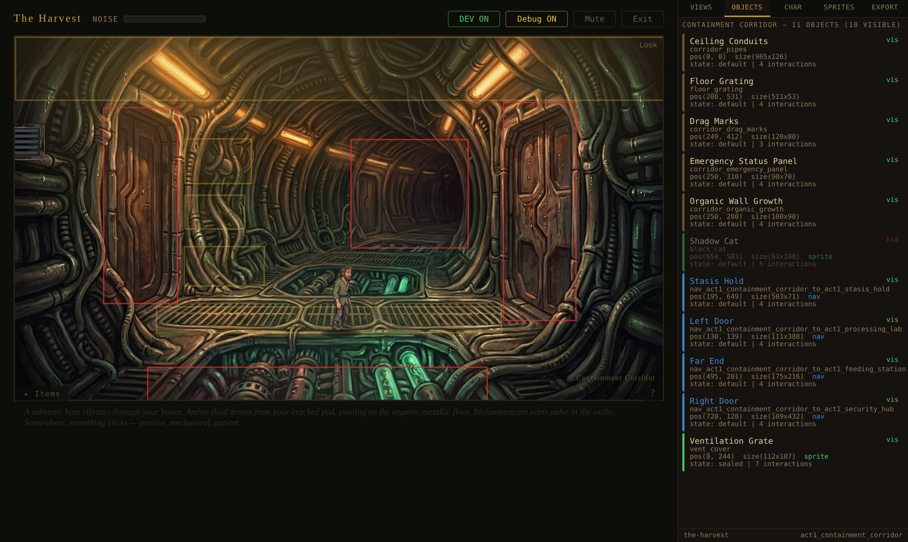

# Technical Deep Dive — Adventure Engine Internals

> For engine contributors, not scenario authors. How the engine works from JSON to pixels.
>
> For the JSON authoring specification, see [`docs/SCENARIO_SCHEMA.md`](docs/SCENARIO_SCHEMA.md).
> For how to build a scenario package, see [`ADVENTURE_BUILDER.md`](ADVENTURE_BUILDER.md).
> For the project overview, see the [`README`](README.md).

<p align="center">
  
  <br />
  <em>Engine internals exposed: debug hitbox overlays, object state inspector, interaction counts, and sprite metadata — all driven by the scenario JSON.</em>
</p>

---

## Table of Contents

- [Architecture Overview](#architecture-overview)
- [The ScenarioEngine Class](#the-scenarioengine-class)
- [Condition System](#condition-system)
- [Effect System](#effect-system)
- [Interaction Resolution](#interaction-resolution)
- [The React Layer](#the-react-layer)
- [Coordinate System](#coordinate-system)
- [Audio System](#audio-system)
- [Hotspot Animation System](#hotspot-animation-system)
- [Vite Configuration and Asset Serving](#vite-configuration-and-asset-serving)
- [Scenario Loading Pipeline](#scenario-loading-pipeline)
- [Implementation Status](#implementation-status)
- [Tech Stack](#tech-stack)
- [Development Guide](#development-guide)
- [Extending the Engine](#extending-the-engine)
- [Future Systems](#future-systems)

---

## Architecture Overview

The Adventure Engine is a **pure client-side state machine**. No server is required for gameplay. The entire pipeline is:

```
scenario.json + assets  →  ScenarioEngine (TypeScript)  →  React components  →  playable game
```

### Three-Layer Model

| Layer | Responsibility | Side Effects |
|-------|---------------|--------------|
| **Scenario JSON + Assets** | Define the entire game — views, objects, puzzles, narrative, backgrounds, audio, item icons | Static data |
| **ScenarioEngine** | State management, condition evaluation, effect application | None (pure state machine, except `setTimeout` for `delay_then`) |
| **React Components** | Render engine state as interactive UI | DOM updates only |

This separation is strict and intentional:

- **The engine never calls React.** React polls the engine through getter methods after each interaction.
- **React never mutates engine state directly.** All mutations go through engine methods like `interact()`, `navigateBack()`, `combineItems()`.
- **The engine has no DOM access.** It can be tested in Node.js without a browser.
- **Scenarios can be validated without rendering.** Load JSON, construct engine, call methods, assert state.
- **The renderer can be swapped.** React → Phaser → terminal — without touching game logic.

### Re-render Pattern

The React layer uses a "bump" pattern to avoid converting engine state into React state objects:

```typescript
// ScenarioPlayer.tsx
const engineRef = useRef<ScenarioEngine>(new ScenarioEngine(scenario));
const [, setVersion] = useState(0);
const bump = useCallback(() => setVersion(v => v + 1), []);

// After every engine call:
engine.interact(objectId, verb);
bump(); // forces re-render, components read fresh state from engine getters
```

This keeps the engine as the single source of truth. Components call `engine.getMessages()`, `engine.getVisibleObjects()`, etc. on every render.

---

## The ScenarioEngine Class

**File:** `client/src/engine/ScenarioEngine.ts` (~880 lines)

The heart of the system — a single TypeScript class with no rendering logic, no DOM access, and no external dependencies.

### Constructor and Initialization

When a scenario JSON is loaded, the constructor:

1. **Sets the initial view** from `scenario.setting.initial_view`
2. **Copies initial flags** as a shallow copy (so mutations don't affect the source JSON)
3. **Builds O(1) lookup indexes** — `Map<string, ScenarioObject>` and `Map<string, Item>` for instant access by ID
4. **Records initial state** — each object's `initial_state` and `initially_visible` go into fast-lookup dictionaries
5. **Sets the initial phase** — first entry in `scenario.phases`, if any
6. **Applies first phase effects** — runs `on_enter` effects for the initial phase (typically the opening narrative)

```typescript
constructor(scenario: Scenario) {
  this._currentViewId = scenario.setting.initial_view;
  this.flags = { ...scenario.flags };

  this.objectIndex = new Map();
  for (const obj of scenario.objects) {
    this.objectIndex.set(obj.id, obj);
    this.objectStates[obj.id] = obj.initial_state;
    this.objectVisibility[obj.id] = obj.initially_visible;
  }

  this.itemIndex = new Map();
  for (const item of scenario.items) {
    this.itemIndex.set(item.id, item);
  }

  if (this._currentPhaseId && scenario.phases?.[0]?.on_enter) {
    this.applyEffects(scenario.phases[0].on_enter);
  }
}
```

### State Fields

| Field | Type | Purpose |
|-------|------|---------|
| `_currentViewId` | `string` | Which view (screen/room) the player is in |
| `flags` | `Record<string, string>` | Key-value pairs tracking game progress |
| `objectStates` | `Record<string, string>` | Current state of each object (e.g., `"locked"`, `"open"`) |
| `objectVisibility` | `Record<string, boolean>` | Whether each object is visible in its view |
| `inventory` | `string[]` | IDs of items the player carries |
| `_noiseLevel` | `number` | 0-100 noise meter (triggers killer attention) |
| `_messages` | `string[]` | Current messages to display |
| `viewHistory` | `string[]` | Stack of previous view IDs for back-navigation |
| `_gameOver` | `GameOverResult \| null` | Win/lose state |
| `_currentPhaseId` | `string \| null` | Current game phase |
| `_isHiding` | `boolean` | Whether the player is hiding from the killer |
| `objectIndex` | `Map<string, ScenarioObject>` | O(1) lookup for objects by ID |
| `itemIndex` | `Map<string, Item>` | O(1) lookup for items by ID |

All state is exposed through read-only getter methods. The engine never hands out mutable references — arrays are returned as copies via spread (`[...this.inventory]`).

### Key Public Methods

| Method | Signature | Purpose |
|--------|-----------|---------|
| `interact` | `(objectId, verb, itemId?) → InteractionResult` | Primary game action — resolve verb + object + conditions → effects |
| `navigateToView` | `(viewId) → void` | Push current view to stack and move to new view |
| `getWalkArea` / `getApproach` / `isExit` | `() → WalkArea \| null`, `(objectId) → StandPoint \| null`, `(objectId) → boolean` | Click-to-walk queries (see Walking) |
| `setCharacterPosition` | `(pos \| null) → void` | Where the character stands in the current view after a walk |
| `navigateBack` | `() → void` | Pop view stack and return to previous view |
| `combineItems` | `(itemA, itemB) → InteractionResult` | Attempt to combine two inventory items |
| `examineItem` | `(itemId, verb?) → InteractionResult` | Use a verb on an inventory item |
| `getVisibleObjects` | `() → ScenarioObject[]` | Return objects in the current view whose visibility is `true` |
| `getAvailableVerbs` | `(objectId) → string[]` | Scan interactions to find which verbs have satisfied conditions |
| `getUsableItems` | `(objectId) → string[]` | Find which inventory items have valid `use_item` interactions on this object |
| `showMessage` | `(text) → void` | Display an arbitrary message |
| `dismissMessages` | `() → void` | Clear the current message queue |
| `decayNoise` | `(amount) → void` | Reduce noise level (used by killer AI timing) |
| `getMessages` | `() → string[]` | Copy of current message queue |
| `getInventory` | `() → Item[]` | Full Item objects for items in inventory |
| `getNoiseLevel` | `() → number` | Current noise level 0-100 |
| `getGameOverResult` | `() → GameOverResult \| null` | Win/lose state if game is over |
| `getAmbientText` | `() → string` | Phase-aware ambient text (falls back to setting) |
| `canGoBack` | `() → boolean` | Whether the view history stack has entries |
| `getBackLabel` | `() → string \| undefined` | Custom back button text for close-up views |
| `getHint` | `() → string \| null` | Last matching entry of the current view's `hints` array |
| `getCharacterPlacement` / `setCharacterOverride` | | Current view's character placement, merged with any `set_character` override |
| `getCloseupImage` / `dismissCloseup` | | Image set by `show_closeup` |
| `getDialogue` / `selectDialogueChoice` / `dismissDialogue` | | Branching dialogue opened by `show_dialogue` |
| `getActiveWidget` / `pressWidgetKey` / `submitWidget` / `closeWidget` / `isWidgetSolved` | | Puzzle widget overlay opened by `open_widget` (see [Puzzle Widgets](#puzzle-widgets-keypad-overlay)) |
| `getPendingSounds` / `clearPendingSounds` | | Sounds queued by `play_sound`, played by `ScenarioPlayer` |

---

## Condition System

Conditions are the gating mechanism. Every interaction has a `when` array of conditions. **All must be true** (implicit AND) for the interaction to fire.

```typescript
private evaluateConditions(conditions: Condition[]): boolean {
  if (conditions.length === 0) return true;  // empty = always matches
  for (const c of conditions) {
    if (!this.evaluateCondition(c)) return false;
  }
  return true;
}
```

An empty `when` array always passes — unconditional interactions fire regardless of game state.

### All Condition Types

| Type | Tests | Fields | Status |
|------|-------|--------|--------|
| `flag_is` | A flag equals a specific value | `flag`, `value` | Implemented |
| `flag_not` | A flag does NOT equal a value | `flag`, `value` | Implemented |
| `object_state` | An object is in a specific state | `object`, `state` | Implemented |
| `has_item` | Player has an item in inventory | `item` | Implemented |
| `not_has_item` | Player does NOT have an item | `item` | Implemented |
| `view_is` | Player is in a specific view | `view` | Implemented |
| `not_in_view` | Player is NOT in a specific view | `view` | Implemented |
| `phase_is` | Game is in a specific phase | `phase` | Implemented |
| `is_hiding` | Player is currently hiding | *(none)* | Implemented |
| `not_hiding` | Player is NOT hiding | *(none)* | Implemented |
| `noise_above` | Noise level exceeds threshold | `threshold` | Implemented |
| `noise_below` | Noise level is below threshold | `threshold` | Implemented |
| `item_count` | Player has at least N items | `count` | Implemented |
| `all_of` | Logical AND — all sub-conditions must pass | `conditions[]` | Implemented |
| `any_of` | Logical OR — at least one sub-condition must pass | `conditions[]` | Implemented |
| `widget_solved` | A puzzle widget has been solved | `widget` | Implemented |
| `killer_is` | Killer AI is in a specific state | *(stub)* | **Stub — returns `false`** |
| `time_after` / `time_before` | Game clock past / before a time | *(not read)* | **Not implemented** (unknown types fall through to `true`) |

### Composite Conditions

`all_of` and `any_of` nest arbitrarily deep:

```json
{
  "type": "all_of",
  "conditions": [
    { "type": "has_item", "item": "keycard" },
    {
      "type": "any_of",
      "conditions": [
        { "type": "flag_is", "flag": "hacked_terminal", "value": "true" },
        { "type": "object_state", "object": "door_panel", "state": "overridden" }
      ]
    }
  ]
}
```

*"Player has the keycard AND (has hacked the terminal OR overridden the door panel)."*

Since the top-level `when` array is an implicit AND, `all_of` is mainly useful inside `any_of` for nested logic.

### Default Behavior

Unknown condition types return `true` — the engine fails open, preventing undefined future condition types from breaking existing scenarios.

---

## Effect System

Effects mutate game state. When an interaction matches, its `then[]` array executes in order. The `applyEffects` method returns an array of message strings for display.

### All Effect Types

**Narrative:**

| Type | Fields | Action | Status |
|------|--------|--------|--------|
| `message` | `text` | Display a message to the player | Implemented |
| `random_message` | `messages[]` | Pick and display a random message from the list | Implemented |

**State Mutation:**

| Type | Fields | Action | Status |
|------|--------|--------|--------|
| `set_flag` | `flag`, `value` | Set a progress flag (defaults to `"true"`) | Implemented |
| `set_state` | `object`, `state` | Change an object's state string | Implemented |
| `add_item` | `item` | Add item to inventory (no duplicates) | Implemented |
| `remove_item` | `item` | Remove item from inventory | Implemented |
| `show_object` | `object` | Make an object visible in its view | Implemented |
| `hide_object` | `object` | Make an object invisible | Implemented |
| `transform_item` | `item`, `into` | Replace one inventory item with another in-place | Implemented |
| `equip_item` / `unequip_item` | `item` | Put a held item with a `wearable` definition into (or take it out of) its slot; `CharacterSprite` draws equipped overlays. `add_item` auto-equips when `wearable.auto_equip` is set, and `remove_item` unequips. Not used by The Harvest, which swaps whole sprite sets with `set_character` instead | Implemented |

**Navigation:**

| Type | Fields | Action | Status |
|------|--------|--------|--------|
| `set_view` | `view` | Navigate to a different view (pushes current to history stack) | Implemented |
| `set_character` | `x`, `y`, `facing`, `sprite_set`, `frame`, `flip_h` | Override the character placement for the rest of the session (e.g. swap to a helmet sprite set) | Implemented |

**Noise:**

| Type | Fields | Action | Status |
|------|--------|--------|--------|
| `add_noise` | `amount` | Increase noise level (clamped to 100) | Implemented |
| `set_noise` | `amount` | Set noise level to an exact value (clamped 0-100) | Implemented |

**Game Flow:**

| Type | Fields | Action | Status |
|------|--------|--------|--------|
| `game_over` | `result` (win/lose), `reason` | End the game with a message | Implemented |
| `advance_phase` | `phase` | Move to a new phase, run its `on_enter` effects | Implemented |
| `start_hiding` | *(none)* | Player enters hiding | Implemented |
| `stop_hiding` | *(none)* | Player exits hiding | Implemented |

**Presentation:**

| Type | Fields | Action | Status |
|------|--------|--------|--------|
| `set_animation` | `object`, `value` | Change or clear (`""`) an object's `visual.animation` | Implemented |
| `show_closeup` | `image` | Show a detail image in a dismissable overlay | Implemented |
| `show_dialogue` | `prompt`, `choices[]` | Open a branching dialogue | Implemented |
| `open_widget` | `widget` | Open a puzzle widget overlay (only `keypad` is rendered) | Implemented |
| `play_sound` | `sound` | Queue a sound: a key of `setting.sounds`, or a path in the scenario folder | Implemented |

**Temporal and Conditional:**

| Type | Fields | Action | Status |
|------|--------|--------|--------|
| `delay_then` | `seconds`, `effects[]` | Run nested effects after a delay via `setTimeout` | Implemented |
| `conditional_effect` | `when[]`, `then[]`, `else[]` | If/else branching on runtime conditions | Implemented |

**Stub (no-op, pending implementation):**

| Type | Purpose | Status |
|------|---------|--------|
| `visual_cue` | Screen effects (flicker, shake) | No-op |
| `trigger_event` | Activate a scenario event | No-op (condition-triggered events run automatically) |

### Recursive Effects

Several effect types are recursive — they call `applyEffects` internally:

- **`advance_phase`** — after setting `_currentPhaseId`, runs the new phase's `on_enter` effects
- **`conditional_effect`** — evaluates `when` conditions, then runs either `then` or `else` effects
- **`delay_then`** — schedules nested effects via `setTimeout`, which calls `applyEffects` and then `checkGameEndConditions`

This recursion is safe because all three eventually reach leaf effects (`message`, `set_flag`, etc.). There is no cycle detection — scenario authors must ensure no infinite loops.

### The `delay_then` Caveat

`delay_then` is the engine's only side effect beyond internal state mutation. It uses `setTimeout`, which means:

- Delayed effects run **asynchronously** — the interaction that triggered them has already returned
- Delayed effects push messages directly to `_messages` — but React won't see them until the next `bump()`
- The engine re-checks win/lose conditions after each delayed batch
- There is currently no mechanism to cancel scheduled delays (e.g., on game restart)

### Item Consumption Is Never Implicit

`interact(objectId, 'use_item', itemId)` only selects and runs an interaction; it never touches the inventory on its own. An item leaves the inventory only through a `remove_item` / `transform_item` effect, or through `combineItems()` when the combination has `consumes: true` (which filters *both* inputs out, then pushes `result` if it isn't already held). This is why one item can be a kept tool in one interaction and a spent ingredient in another. Schema-level guidance: [SCENARIO_SCHEMA.md → Item Consumption](docs/SCENARIO_SCHEMA.md#item-consumption-tools-vs-ingredients).

Two engine behaviours scenario tooling must mirror exactly:

- **Visibility defaults to visible.** The constructor copies `initially_visible` as-is, so an object without the field stores `undefined`, and `getVisibleObjects()` hides only objects whose visibility is strictly `false`.
- **First match wins.** `findMatchingInteraction` returns the first interaction whose verb (and item) match and whose `when` passes, so flags read by an earlier, purely cosmetic interaction still decide whether a later, substantive one fires.

### Puzzle Widgets (keypad overlay)

Engine state: `_activeWidgetId`, `widgetAttempts: Record<id, number>`, `solvedWidgets: Record<id, boolean>`.

- **`open_widget`** sets `_activeWidgetId`.
- **`getActiveWidget()`** returns the widget definition, and `ScenarioPlayer` renders `KeypadWidget` for it.
- **The component** keeps the in-progress entry locally, and calls `pressWidgetKey()` per key, which applies `noise_per_interaction`.
- **`submitWidget(entry)`** runs when the entry reaches `code_length`:
  - **Correct:** clears `_activeWidgetId`, marks the widget solved, runs `on_solve`, and puts its messages in `_messages`.
  - **Wrong:** runs `on_fail`, increments the attempt count, runs `on_max_fail` every `max_attempts` and resets the count, and returns the next `fail_text` line for in-widget feedback.
- **`closeWidget()`** dismisses without side effects.
- **`widget_solved`** reads `solvedWidgets`.

The soft-lock search models an open widget with three actions: the correct entry, one wrong entry, and close.

### Scenario Validator (`tools/validate-scenario.mjs`)

Static checks for mistakes that parse fine but silently break play. It scans for duplicate keys with its own tokenizer, because `JSON.parse` keeps the last duplicate. It also flags `use_item` interactions with no `item` (because of the first-match rule above they can never fire), object IDs used where item IDs belong, unknown item/object/view references, ambient lights missing numeric fields, missing asset files, and off-canvas hotspots and sprite anchors. `--views <prefix>` scopes the object checks to one act.

### Soft-Lock Search (`tools/softlock-search.mjs`)

Bundles this engine with esbuild and runs a breadth-first search over every reachable game state, using the real `interact` / `combineItems` / `selectDialogueChoice` / `navigateBack` methods. To keep the state space tractable it tracks only the goal's **cone of influence**: starting from the goal variable, it repeatedly adds every flag, object state, item and visibility read by an interaction group that writes a cone variable or changes the view. Interactions that only touch out-of-cone variables (lore flags, flavour text) are skipped. That projection is sound for reachability, because dropped variables can't change which goal-relevant effects fire. It then computes reverse reachability from goal states and reports every reachable non-terminal state that can no longer win, plus the action that doomed it and a path to it.

```bash
node tools/softlock-search.mjs scenarios/the-harvest/scenario.json --views act1 --goal "state:airlock_override_panel!=locked"
```

---

## Interaction Resolution

This is the core game loop — what happens when the player clicks an object with a verb selected.

### The `interact()` Method

```typescript
interact(objectId: string, verb: string, itemId?: string): InteractionResult
```

**Step 1: Guard checks**
- If the game is over, return early with "The game is over."
- Clear the message queue
- Look up the object by ID from `objectIndex`

**Step 2: Verb translation**
- If `verb === 'use'` and an `itemId` is provided, translate to `'use_item'`

**Step 3: Find a matching interaction**
- Search the object's `interactions` array with `findMatchingInteraction`
- Interactions are checked **in order** — first match wins

**Step 4: Hand→take fallback**
- If no match was found and verb is `'hand'`, retry with `'take'`
- This provides backwards compatibility with older scenario JSONs that used `take` instead of `hand`

**Step 5: No match — default feedback**
- If verb is `'look'` and no look interaction matched: show the object's `description` field (always succeeds)
- For any other verb: show a KQ5-style default failure message

**Step 6: Response shorthand**
- If the matched interaction has a `response` string but no `then` effects array (or an empty one), display the response directly
- This supports a compact format for simple look interactions: `{ "verb": "look", "response": "A heavy wooden door." }`

**Step 7: Apply effects**
- Run `applyEffects(matched.then)` to mutate game state and collect messages
- Add any `noise` from the interaction
- Check win/lose conditions

### `findMatchingInteraction`

```typescript
private findMatchingInteraction(interactions, verb, itemId?): Interaction | null {
  for (const interaction of interactions) {
    if (interaction.verb !== verb) continue;
    if (verb === 'use_item' && interaction.item !== itemId) continue;
    if (this.evaluateConditions(interaction.when)) {
      return interaction;
    }
  }
  return null;
}
```

**Order matters** — scenario authors must list more specific interactions before general fallbacks. The first one whose verb matches, whose item matches (for `use_item`), and whose conditions all pass is selected.

### Default Failure Messages (KQ5-style)

Every verb produces feedback, even when nothing happens:

| Verb | Default Message |
|------|----------------|
| `look` | Returns the object's `description` field (always succeeds) |
| `move` | "You can't go that way." |
| `hand` | "You can't do anything useful with {name} right now." |
| `take` | "You can't take {name}." |
| `talk` | "Talking to {name} doesn't accomplish anything." |
| `use` / `use_item` | "That doesn't seem to work." |
| *(unknown)* | "Nothing happens." |

### Win/Lose Checking

After every interaction and delayed effect batch, the engine scans `win_conditions` then `lose_conditions`:

```typescript
private checkGameEndConditions(): void {
  if (this._gameOver) return;
  for (const wc of this.scenario.win_conditions ?? []) {
    if (wc.conditions && this.evaluateConditions(wc.conditions)) {
      this._gameOver = { won: true, conditionId: wc.id, text: wc.description };
      return;
    }
  }
  // same for lose_conditions with won: false
}
```

Win conditions are checked first — if both a win and lose condition are true simultaneously, the player wins.

---

## The React Layer

`ScenarioPlayer` orchestrates a set of small components. `VerbBar.tsx` and `MessagePanel.tsx` still exist in `components/` but are no longer rendered: verbs are chosen with the cursor and messages are drawn by `ScenarioPlayer` itself.

### Component Tree

```
App
├── ScenarioLoader (reads scenarios/manifest.json; auto-launches a single scenario)
└── ScenarioPlayer (game orchestrator)
    ├── IntroSequence (paged setting.intro_text, before play)
    ├── Title Bar
    │   ├── Scenario Title + NoiseIndicator
    │   ├── DEV toggle (?dev only), Debug toggle
    │   ├── Mute Button (when any ambient_audio is present)
    │   └── Exit Button
    ├── Game Area (960px wide)
    │   ├── GameView (960x540 viewport)
    │   │   ├── Background Image (view.background_fit, default cover)
    │   │   ├── AmbientCanvas (view.ambient_lighting glow)
    │   │   ├── CharacterSprite (per-view placement + set_character override + shadow)
    │   │   ├── Cursor Label (active verb / "Use {item} on...")
    │   │   ├── Back Button (top-left, views with back_label)
    │   │   ├── SpriteObject / hotspot divs (with glimmer/pulse animations)
    │   │   └── Room Name Label (bottom-right)
    │   ├── Hint "?" button (bottom-right)
    │   └── EyeOpenTransition (fade from black, with the stand-up animation)
    ├── Below the viewport: "Items" toggle → InventoryPanel (ItemIcon / icon_file), then messages or ambient text
    ├── CloseupOverlay (show_closeup)
    ├── DialogueOverlay (show_dialogue)
    ├── KeypadWidget (open_widget, keypad type)
    ├── Game Over Overlay
    └── DevPanel (?dev, side-by-side)
```

### Walking (click-to-walk)

Views with a `walk_area` let the character walk (spec: `docs/SCENARIO_SCHEMA.md` → Walkable Areas; design: `docs/WALKABLE_AREAS.md`). Three layers, each testable on its own:

- **`engine/walkable.ts`** (pure geometry): `isOnFloor`, `nearestFloorPoint`, `segmentOnFloor`, `findPath` (exact shortest path in a polygon with holes: a visibility graph over the outline corners, searched with Dijkstra; vertex-to-vertex visibility is cached per area), `pointAlong`, `depthScaleAt`, `facingFromDelta`, `resolveFacing` (maps a wanted facing onto the rows a sprite set has: `left` mirrors `right`, a missing `up` falls back to sideways), `outlineProblems`. Points on an outline count as floor. Tests: `walkable.test.ts` (hand-built cases with exact answers, 10,000 random routes checked to stay on the floor, 750 compared with a brute-force grid search).
- **Engine** (`ScenarioEngine`): `getWalkArea()`, `setCharacterPosition()` / `getCharacterPosition()` (per view; reset on `set_view` unless it has `at`, reset by `navigateToView`, and restored by `navigateBack` from a position stack kept beside the view history, so leaving a close-up puts him back where he stood), `getApproach(objectId)` (stand point from `walk_to` or the floor point nearest the object's bottom-centre, plus a facing toward it), `isExit(objectId)` (any Move interaction that can `set_view` or `game_over`), `getObjectFocus()`. `getCharacterPlacement()` merges view placement, `set_character` override and the walked position. Tests: `ScenarioEngine.walk.test.ts`.
- **UI** (`ScenarioPlayer` + `GameView`): `GameView` reports every click's position in 960x720 space (`onClickPoint`, in the capture phase) and passes empty clicks with their point. `ScenarioPlayer` routes clicks: Look/Talk turn in place and run; Move on a non-exit walks to the click; Hand, items and Move on exits walk to `getApproach()` and run on arrival. The walk controller animates along `findPath()` with `requestAnimationFrame` (speed × depth scale, facing per leg, the sprite set's `walk` set), commits the end position to the engine, then runs the pending interaction; a view change cancels it. In walking views `GameView` draws sprite objects and the character in one layer (`z-index` 4) whose children are sorted by base y; the character only takes clicks when his placement's `object_id` names a real object.

Browser test: `scenarios/the-harvest/scripts/playthrough/walk.cjs` walks to random floor points in every Act 1 walking view (checking the end point and that every animation frame is on the floor) and checks the behaviours above.

### ScenarioPlayer — The Orchestrator

**File:** `client/src/components/ScenarioPlayer.tsx`

Owns all game state coordination:

- `useRef<ScenarioEngine>` — engine instance, stable across renders
- `activeVerb` — which verb is selected (`'look'` default)
- `selectedItem` — which inventory item is selected for use
- `muted` — audio mute state
- `audioRefs` — array of `HTMLAudioElement` references for ambient audio
- URL parameters: `?dev` (dev panel + debug + skip intro), `?debug`, `?skipIntro`, `?view=<id>` (start in a view, skipping the intro)

**Key event handlers:**

| Handler | What It Does |
|---------|-------------|
| `handleObjectClick` | If item selected → `use_item`. Otherwise → active verb. Plays pending sounds, then `bump()`. |
| `handleCycleVerb` | Right-click on the viewport cycles look → move → hand → talk and clears the selected item |
| `handleNavigateBack` | `engine.navigateBack()`, then `bump()` |
| `handleEmptyClick` | Dismisses messages and shows a verb-specific "nothing there" line. If an item is selected, says it can't be used there and deselects it. |
| `handleItemSelect` | If different item selected → `combineItems()`. Same item → deselect. No item → select it and show its `description`. |
| `handleItemExamine` | `engine.examineItem(itemId, 'look')` |
| `handleHint` | Shows `engine.getHint()` as a message |
| `handleDismiss` | `engine.dismissMessages()` |
| `handleWidgetKey` / `handleWidgetSubmit` / `handleWidgetClose` | Forward keypad input to `pressWidgetKey()` / `submitWidget()` / `closeWidget()` |
| `handleRestart` | Constructs a new `ScenarioEngine` from the same scenario |

**Intro stand-up convention:** if `character.sprite_sets` contains a set named exactly `standup`, the player is shown in that set (from frame 0) while the eye-open fade plays, and once it has run (`columns / frame_rate` seconds) the override switches to the set named `idle`. Without a `standup` set the character simply appears in its per-view placement.

### GameView — Background and Hotspots

**File:** `client/src/components/GameView.tsx`

Renders the 960x540 viewport:

1. **Background image** — loaded via `resolveAsset(scenarioId, background_file)` with `object-fit: cover` (or `view.background_fit`). An `onError` handler hides broken images, falling back to the scenario's `room_style.background_color`.
2. **Ambient lighting** — `AmbientCanvas` draws the view's `ambient_lighting` lights on a canvas over the background.
3. **Object hotspots** — positioned `<div>` elements at scaled coordinates, fully transparent outside debug mode. Objects with a `sprite` are drawn by `SpriteObject` (bottom-center anchored) and are their own click target.
4. **Navigation vs. regular hotspots** — objects with IDs starting with `nav_` get a higher z-index (2 vs. 1). In debug mode they are outlined red (regular objects gold), with a blue (`#4a90d9`) or gold (`#c0a030`) border on hover.
5. **Animations** — objects with `visual.animation` get a glint or glow indicator (see [Hotspot Animation System](#hotspot-animation-system)).
6. **Cursor** — each verb has its own SVG cursor (eye, footprints, hand, speech bubble); a selected item shows a star cursor. A label at the top right names the active verb or "Use {item} on...".
7. **Back button** — top-left, shown when the view has a `back_label`.
8. **Room name** — the view's `name` in gold at the bottom right.
9. **Empty click detection** — clicks that don't hit a hotspot or the back button go to `onEmptyClick`; right-clicks go to `onCycleVerb`.

### InventoryPanel

**File:** `client/src/components/InventoryPanel.tsx`

Horizontal scrolling row of inventory items in a collapsible tray below the viewport (the "Items" tab toggles it; it opens automatically on pickup). Each item shows its `icon_file` image if it has one, otherwise an `ItemIcon` SVG glyph chosen by the item's `icon` keyword, followed by its name.

- **Click** — selects item for use (highlight it, then click a world object)
- **Click another item while one is selected** — combines them
- **Double-click / right-click** — examines the item (calls `onItemExamine`)
- **Selected item** gets a gold border and brighter text
- **Empty inventory** shows italic "No items yet"

### Messages

Rendered by `ScenarioPlayer` under the inventory tray:

- When messages are present: shows them in gold serif text with a "click to dismiss" hint.
- When no messages: shows `engine.getAmbientText()` (phase-aware) in muted italic text.
- Clicking the message area dismisses messages.

### Overlays

- **`CloseupOverlay`** — the framed image from `show_closeup`; click to dismiss.
- **`DialogueOverlay`** — the prompt and visible choices from `show_dialogue`; selecting one calls `selectDialogueChoice()`.
- **`KeypadWidget`** — the keypad overlay for an `open_widget` effect (see [Puzzle Widgets](#puzzle-widgets-keypad-overlay)).

### NoiseIndicator

**File:** `client/src/components/NoiseIndicator.tsx`

A color-coded progress bar showing noise level 0-100:

| Level | Color | Meaning |
|-------|-------|---------|
| 0-30 | Green `#44aa44` | Safe |
| 31-60 | Yellow `#ccaa22` | Caution |
| 61-80 | Orange `#cc6622` | Danger |
| 81-100 | Red `#cc2222` | Killer alerted |

### ScenarioLoader

**File:** `client/src/components/ScenarioLoader.tsx`

The main menu:

1. Fetches `scenarios/manifest.json` (a list of scenario folder IDs), then each scenario's metadata
2. **Play**: a card per scenario with title, description, difficulty and estimated time; clicking one fetches the full `scenario.json` and calls `onLoad(scenario)`
3. **Steam Workshop**: three placeholder cards (browse, subscribed, publish), marked "Coming soon", where the Workshop integration will go
4. **Your own adventure**: a file input that loads any `.json` scenario (the only option if there is no manifest)
5. On the first visit only, `?play=<id>` starts that scenario directly, and the developer parameters `?dev`, `?skipIntro` and `?view` start the first scenario (the test harness relies on this). Leaving a game always returns to the menu.

**Undo last move.** `ScenarioEngine.snapshot()` returns every piece of state a player action can change as plain data, and `restore(snap)` puts it back (delayed `delay_then` effects scheduled before the undo are dropped through an epoch counter). `ScenarioPlayer` takes a snapshot before each interaction, combination, dialogue choice and keypad entry. A lose screen offers **Undo last move** (unless `setting.allow_undo` is false), **Restart** and **Main menu**; a win screen offers **Play again** and **Main menu**. Tests: `ScenarioEngine.undo.test.ts`.

### Data Flow Summary

```
User clicks object
  → ScenarioPlayer.handleObjectClick()
    → engine.interact(objectId, verb, itemId?)
      → findMatchingInteraction()
        → evaluateConditions() for each candidate
      → applyEffects(matched.then)
        → mutates flags, objectStates, inventory, noiseLevel, messages, etc.
      → checkGameEndConditions()
    ← InteractionResult { success, messages, noiseGenerated }
  → bump()  // force re-render
  → Components read fresh state from engine getters
```

---

## Coordinate System

Scenario authors place objects in a **960x720 coordinate space** (origin at top-left). The engine renders into a **960x540 pixel viewport**. Object positions are the **top-left corner** of the hotspot box, not the center.

### Scaling Constants

```typescript
// GameView.tsx
const VIEW_WIDTH = 960;
const VIEW_HEIGHT = 540;
const COORD_SPACE_W = 960;
const COORD_SPACE_H = 720;
const SCALE_X = VIEW_WIDTH / COORD_SPACE_W;   // = 1.0 (no horizontal scaling)
const SCALE_Y = VIEW_HEIGHT / COORD_SPACE_H;  // = 0.75 (vertical compression)
```

### Position Mapping

An object at JSON position `(480, 360)` renders at viewport pixel `(480, 270)`. Position is the **top-left corner** of the hotspot div:

```typescript
function objectHotspotStyle(x, y, w, h, ...): CSSProperties {
  return {
    left: `${x * SCALE_X}px`,   // x × 1.0 — no horizontal change
    top: `${y * SCALE_Y}px`,    // y × 0.75 — vertical compression
    width: `${w * SCALE_X}px`,  // w × 1.0
    height: `${h * SCALE_Y}px`, // h × 0.75
  };
}
```

### Background Image Rendering Pipeline

Background images are rendered as an `` element inside the 960x540 viewport div:

```typescript
// GameView.tsx — background rendering

```

`object-fit: cover` means the image scales to completely fill the 960x540 viewport, potentially cropping edges if the aspect ratio doesn't match 16:9. For near-16:9 images (e.g., 1376x768 ≈ 1.79:1), cropping is negligible.

### Image-to-Coordinate Conversion

To convert a pixel position in the source background image to JSON coordinates:

```
json_x = img_pixel_x × (960 / image_width)
json_y = img_pixel_y × (720 / image_height)
json_w = img_pixel_w × (960 / image_width)
json_h = img_pixel_h × (720 / image_height)
```

**Current Harvest backgrounds (1376×768)**:
- X factor: `960 / 1376 ≈ 0.698`
- Y factor: `720 / 768  ≈ 0.9375`

**1920×1080 images**:
- X factor: `960 / 1920 = 0.5`
- Y factor: `720 / 1080 ≈ 0.667`

### Why 960x720

- **Horizontal resolution matches the viewport** — no X scaling needed, positions are pixel-accurate horizontally
- **4:3 authoring ratio** is more natural for placing objects than 16:9
- **The 0.75 Y scale** compresses gracefully without distorting hit targets
- **Background images** use `object-fit: cover` so any resolution works (1376x768 and 1920x1080 most common)
- **Matches real scenario data** — coordinate ranges across all 13 scenarios span x: 50-950, y: 30-720

### Hotspot Rendering and Debug Mode

Hotspots are absolutely-positioned `<div>` elements layered over the background:

**With a background image (normal gameplay)**:
- **Normal**: fully transparent — invisible overlay on the painted art. Only animation indicators (glimmer/pulse) are visible.
- **Hovered (debug off)**: no visual change (cursor icon is the only feedback)
- **Hovered (debug on)**: border and label tooltip appear

**Debug mode** (toggled via the Debug button in the title bar, or `?debug` / `?dev` in the URL):
- **Nav objects** (`id.startsWith('nav_')`) — red outline, red tint background, z-index 2
- **Regular objects** — gold outline, gold tint background, z-index 1
- **On hover** — label showing `visual.label` text below the hotspot

Debug mode is the primary tool for verifying hotspot alignment against background art. The rendering in `GameView.tsx` (`objectHotspotStyle` function) applies debug borders unconditionally when `debugMode` is true.

### Position Validation Checklist (for engine contributors and AI agents)

When reviewing or generating object positions:

1. **Position is top-left corner** — the hotspot box starts at `(x, y)`, it is not centered there
2. **Bounds check**: `position.x + size.width ≤ 960` and `position.y + size.height ≤ 720`
3. **Image resolution awareness** — check actual file dimensions before converting; don't assume 1920x1080
4. **Y-axis compression** — visual position in the viewport is `y × 0.75`, which catches people off guard
5. **Overlap detection** — objects in the same view shouldn't have hotspots that significantly overlap (z-index only distinguishes nav from non-nav)
6. **Nav sizing** — doorways and passages typically need generous hotspots (80-200px wide) since players need to find and click them easily
7. **Minimum clickable size** — hotspots smaller than ~25×20 in the coordinate space become frustrating to click in the compressed viewport

---

## Audio System

Ambient audio is entirely schema-driven. The system supports two levels of audio configuration:

**Scenario-level default** — applies to all views unless overridden:

```json
{
  "setting": {
    "ambient_audio": "audio/ambient_ship.mp3"
  }
}
```

Or multiple layered tracks:

```json
{
  "setting": {
    "ambient_audio": ["audio/ambient_ship.mp3", "audio/ambient_lab.mp3"]
  }
}
```

**Per-view overrides** — each view can specify its own `ambient_audio` that replaces the scenario default when the player enters that room:

```json
{
  "id": "morgue",
  "ambient_audio": [],
  "background_key": "morgue"
}
```

An empty array `[]` means dead silence. When navigating between views with different audio, the engine crossfades — stopping the old tracks and starting the new ones. Views without an `ambient_audio` field inherit the scenario-level default.

**Sound effects** — optional `setting.sounds` object with paths for `room_transition`, `item_pickup`, `intro_voice`, `noise` (any noise jump of 3+) and `combine` (a successful combination; defaults to `item_pickup`). The engine plays these on the corresponding events:

```json
{
  "setting": {
    "sounds": {
      "room_transition": "audio/door_open_close.wav",
      "item_pickup": "audio/item_pickup.wav"
    }
  }
}
```

### Implementation (ScenarioPlayer.tsx)

Audio elements are created and managed in `useEffect` hooks. The ambient audio effect reacts to view changes, comparing the current view's track list against the previous one:

- **Per-view switching**: when the player navigates to a view with different `ambient_audio`, the old tracks are paused and new ones start
- **Looping**: all ambient tracks loop continuously
- **Volume**: 0.35 (35%) — ambient, not dominant
- **Mute toggle**: a Mute/Unmute button appears when any `ambient_audio` is defined
- **Cleanup**: on unmount, all audio elements are paused and their `src` is cleared
- **Autoplay**: `.play().catch(() => {})` silently handles browsers that block autoplay
- **Asset resolution**: all audio paths route through `resolveAsset()` for CDN portability

### Asset Serving

Audio files are served by the Vite middleware plugin from `scenarios/{id}/audio/`. See [Vite Configuration](#vite-configuration-and-asset-serving).

---

## Hotspot Animation System

Objects can have a `visual.animation` property that draws a small animated indicator inside their hotspot div. This is fully schema-driven — any scenario author can add it to any object. (It applies to plain hotspots; objects drawn with a `sprite` don't show it.)

### Supported Animations

| Value | Effect | Duration | Use Case |
|-------|--------|----------|----------|
| `"glimmer"` | A four-point white star glint that flashes twice per cycle (`glint-flash` keyframes), placed 30% down / 40% across the hotspot | 8s | Items that glint (glass, metal, crystals) |
| `"pulse"` | A small green-white glow dot at the hotspot's center whose opacity oscillates 0.3 → 0.7 (`screen-glow` keyframes) | 4s | Electronic displays, holographic screens |

### Schema Usage

```json
{
  "visual": {
    "color": "#2a4a3a",
    "label": "Broken Pod",
    "animation": "glimmer"
  }
}
```

### Implementation (GameView.tsx)

CSS keyframes live in one module-level `ANIMATION_KEYFRAMES` string (`glint-flash`, `screen-glow`, plus `room-fade-in` and the dev-panel walkthrough highlight keyframes) and are injected once into `<head>`:

```typescript
let stylesInjected = false;
function injectAnimationStyles() {
  if (stylesInjected) return;
  stylesInjected = true;
  const el = document.createElement('style');
  el.textContent = ANIMATION_KEYFRAMES;
  document.head.appendChild(el);
}
```

Animations **pause on hover** — the indicator is only rendered when `!isHovered`. The `set_animation` effect changes or clears `visual.animation` at runtime, which is how solved objects stop drawing attention.

### Adding New Hotspot Animations

1. Add the `@keyframes` rule to `ANIMATION_KEYFRAMES` in `GameView.tsx`
2. Add the animation name to the conditional in the hotspot rendering loop
3. Update `docs/SCENARIO_SCHEMA.md` and `ADVENTURE_BUILDER.md` with the new animation name
4. Scenario authors can now use it via `visual.animation`

## Ambient Lighting System

Views can have an `ambient_lighting` object that `AmbientCanvas.tsx` draws as soft, pulsing radial glows on a `<canvas>` between the background and the hotspots, giving static backgrounds life. (This replaced the earlier CSS `room_animation` overlays; `room_animation` is still in `types.ts` and in some Harvest views but is no longer rendered.)

### Schema Usage

```json
{
  "id": "act1_security_hub",
  "ambient_lighting": {
    "lights": [
      { "x": 0.35, "y": 0.3, "radius": 0.2, "color": [60, 180, 200], "pulse_speed": 0.7, "pulse_amount": 0.35, "alpha": 0.28, "phase": 0 }
    ]
  }
}
```

`x`/`y` are 0-1 fractions of the viewport, `radius` is a fraction of the viewport's larger side, `color` is `[r, g, b]`, `alpha` is the base opacity, `pulse_speed` (cycles per second) and `pulse_amount` (0-1) shape the breathing, and `phase` offsets lights from one another. `flicker: true` adds a slight shared flicker. Every light needs numeric `pulse_speed` and `pulse_amount`; a missing one produces NaN and breaks the canvas (the validator checks this).

### Implementation

`AmbientCanvas` runs a `requestAnimationFrame` loop. For each light it sums two sine waves (`pulse_speed` and 1.7 × `pulse_speed`), scales `alpha` by `pulse_amount`, applies the flicker multiplier, and fills a radial gradient. The canvas has `pointerEvents: 'none'`. Views without `ambient_lighting` render no canvas.

---

## Vite Configuration and Asset Serving

**File:** `client/vite.config.ts`

### The `serveScenarios` Plugin

A custom Vite middleware plugin serves scenario assets (JSON, images, audio) from the `scenarios/` directory at the repository root:

```typescript
function serveScenarios(): Plugin {
  const scenariosDir = path.resolve(__dirname, '../scenarios');
  return {
    name: 'serve-scenarios',
    configureServer(server) {
      server.middlewares.use('/scenarios', (req, res, next) => {
        const filePath = path.join(scenariosDir, decodeURIComponent(req.url || ''));
        if (fs.existsSync(filePath) && fs.statSync(filePath).isFile()) {
          res.setHeader('Access-Control-Allow-Origin', '*');
          const ext = path.extname(filePath).toLowerCase();
          const types: Record<string, string> = {
            '.json': 'application/json',
            '.webp': 'image/webp',
            '.png': 'image/png',
            '.jpg': 'image/jpeg',
            '.mp3': 'audio/mpeg',
            '.wav': 'audio/wav',
            '.ogg': 'audio/ogg',
          };
          if (types[ext]) res.setHeader('Content-Type', types[ext]);
          fs.createReadStream(filePath).pipe(res);
        } else {
          next();
        }
      });
    },
  };
}
```

### Why a Plugin (Not Just a Symlink)

The scenario files live outside the `client/` directory (at `scenarios/` in the repo root). The repo also has a symlink (`client/public/scenarios → ../../scenarios`), which works on macOS/Linux but breaks on Windows. The Vite plugin serves the files directly with proper MIME types, so the dev server works either way.

### URL Mapping

| URL Path | Filesystem Path |
|----------|----------------|
| `/scenarios/the-harvest/scenario.json` | `scenarios/the-harvest/scenario.json` |
| `/scenarios/the-harvest/backgrounds/act1_stasis_hold.webp` | `scenarios/the-harvest/backgrounds/act1_stasis_hold.webp` |
| `/scenarios/the-harvest/audio/ambient_ship.mp3` | `scenarios/the-harvest/audio/ambient_ship.mp3` |

### Production Builds

The plugin only intercepts dev server requests. For production, scenario assets need to be copied to the build output directory (not yet configured — currently dev-only).

---

## Scenario Loading Pipeline

### 1. ScenarioLoader Reads the Manifest

On mount, `ScenarioLoader` fetches `scenarios/manifest.json`, then each listed scenario's `scenario.json` to extract metadata (title, description, difficulty, estimated time). Failures are caught and shown as error cards.

### 2. User Selects a Scenario

If the manifest lists a single scenario, it loads immediately. Otherwise clicking a card fetches the full JSON, parses it as a `Scenario` type, and calls `onLoad(scenario)`.

Alternatively, the "Load Custom Scenario (JSON)" button opens a file picker for user-provided JSON files.

### 3. App Switches to ScenarioPlayer

`App.tsx` holds a `selectedScenario` state. When non-null, it renders `ScenarioPlayer` instead of `ScenarioLoader`.

### 4. ScenarioPlayer Constructs the Engine

The `ScenarioEngine` constructor receives the full scenario JSON object and initializes all state. The engine instance is stored in a `useRef` so it survives re-renders.

### 5. Gameplay Begins

If `setting.intro_text` is set, `IntroSequence` pages through it first; then the viewport fades in from black (with the `standup` sprite set, if the scenario has one). The engine's initial view is rendered. If the first phase has `on_enter` effects, those fire immediately (e.g., opening narrative message).

---

## Implementation Status

### Conditions

| Condition | Implemented | Used By (of 13 scenarios) |
|-----------|-------------|--------------------------|
| `flag_is` | Yes | 13/13 |
| `flag_not` | Yes | 13/13 |
| `object_state` | Yes | 13/13 |
| `has_item` | Yes | 12/13 |
| `not_has_item` | Yes | 11/13 |
| `view_is` | Yes | 6/13 |
| `not_in_view` | Yes | — |
| `phase_is` | Yes | 2/13 |
| `is_hiding` | Yes | 2/13 |
| `not_hiding` | Yes | 5/13 |
| `any_of` | Yes | 11/13 |
| `all_of` | Yes | 13/13 |
| `noise_above` | Yes | 1/13 |
| `noise_below` | Yes | 1/13 |
| `item_count` | Yes | 1/13 |
| `widget_solved` | Yes | — (The Harvest's keypad uses `on_solve` flags instead) |
| `killer_is` | **Stub (returns false)** | 8/13 |
| `time_after` | **Not implemented** | 13/13 (events) |

### Effects

All 20+ effect types have implementations. Remaining no-ops:
- `trigger_event` — needs events system
- `visual_cue` — cosmetic, acceptable for MVP

### Major Unimplemented Systems

| System | Used By | Priority | Notes |
|--------|---------|----------|-------|
| Events system | 13/13 | HIGH | Condition triggers done; timed triggers need a game clock |
| Puzzle widgets | 13/13 | HIGH | `keypad` overlay implemented (`KeypadWidget.tsx`, `open_widget`, `widget_solved`); dials, toggles and sequence puzzles still TODO |
| Killer AI | 13/13 | MEDIUM | Patrol, detection, search, personality |
| `time_after` condition | 13/13 | HIGH (with events) | Needs game clock |

---

## Tech Stack

| Layer | Technology | Version | Notes |
|-------|-----------|---------|-------|
| Frontend | React + TypeScript + Vite | 19 / 5.7 / 6 | React DOM rendering; a `<canvas>` only for ambient lighting |
| Engine | TypeScript `ScenarioEngine` | — | Pure state machine, ~880 lines |
| Rendering | React components + CSS | — | Objects as positioned divs on backgrounds |
| Backend | Spring Boot + Java + Maven | 3.3.5 / 21 | Future: validation, tooling, save sync |
| Future Rendering | Phaser | 3.80 (in deps) | For animations, sprites, canvas effects |
| Image Generation | Google Gemini (Imagen 3) | Free tier | Background art in Sierra KQ5/KQ6 style |

---

## Development Guide

### Commands

```bash
# Frontend dev server
cd client && npm install && npm run dev    # http://localhost:5173

# Type check
cd client && npx tsc -b

# Backend (not needed for gameplay)
cd server && mvn spring-boot:run
```

### File Map

| File | Purpose |
|------|---------|
| `client/src/engine/types.ts` | All TypeScript interfaces matching the JSON schema |
| `client/src/engine/ScenarioEngine.ts` | Core game engine — state machine |
| `client/src/components/ScenarioPlayer.tsx` | Top-level game orchestrator |
| `client/src/components/ScenarioLoader.tsx` | Main menu: play, Steam Workshop placeholders, load your own |
| `client/src/engine/assetResolver.ts` | `resolveAsset()` / `setAssetBase()` — every scenario asset URL |
| `client/src/components/GameView.tsx` | Viewport rendering, hotspots, animations, verb cursors |
| `client/src/components/CharacterSprite.tsx` | Player sprite sheet renderer + shadow + wearable overlays |
| `client/src/components/SpriteObject.tsx` | Animated sprite sheets on world objects |
| `client/src/components/AmbientCanvas.tsx` | Canvas ambient lighting (`ambient_lighting`) |
| `client/src/components/InventoryPanel.tsx` | Inventory item display |
| `client/src/components/ItemIcon.tsx` | Built-in SVG item icons (by `icon` keyword) |
| `client/src/components/CloseupOverlay.tsx` | `show_closeup` image overlay |
| `client/src/components/DialogueOverlay.tsx` | `show_dialogue` choice modal |
| `client/src/components/KeypadWidget.tsx` | Keypad puzzle widget overlay |
| `client/src/components/TutorialCoach.tsx` | First-play tips from `setting.tutorial`; `ScenarioPlayer` advances them via `tutorialEvent(trigger)` from its verb, walk, interaction, inventory and hint handlers |
| `client/src/components/IntroSequence.tsx` | Paged intro text |
| `client/src/components/EyeOpenTransition.tsx` | Fade-from-black on game start |
| `client/src/components/NoiseIndicator.tsx` | Noise level meter |
| `client/src/components/DevPanel.tsx` | In-game developer tools (`?dev`) |
| `client/src/components/VerbBar.tsx`, `MessagePanel.tsx` | Older verb bar and message panel, not currently rendered |
| `client/public/editor.html` | Standalone visual editor (`/editor.html`) |
| `client/src/App.tsx` | Entry point: ScenarioLoader → ScenarioPlayer |
| `client/src/App.css` | Dark theme base styles |
| `client/vite.config.ts` | Vite config + scenario serving plugin |
| `docs/SCENARIO_SCHEMA.md` | Complete JSON schema specification (1700+ lines) |
| `tools/validate-scenario.mjs` | Static scenario lint |
| `tools/softlock-search.mjs` | Exhaustive soft-lock search over the real engine |
| `tools/preview-hotspots.mjs` | Render a view with its hotspots, sprite anchors and character drawn on |

---

## Extending the Engine

### Adding a New Condition Type

1. **Add the type string** to `evaluateCondition()` in `ScenarioEngine.ts`:
   ```typescript
   case 'my_condition':
     return /* your boolean check using this.flags, this.inventory, etc. */;
   ```

2. **Add optional fields** to the `Condition` interface in `types.ts` if your condition needs new parameters.

3. **Document it** in `docs/SCENARIO_SCHEMA.md` under the Conditions section.

4. **Test it** — construct a `ScenarioEngine` with a test scenario that uses the condition, call `interact()`, and assert the result.

### Adding a New Effect Type

1. **Add the case** to `applyEffects()` in `ScenarioEngine.ts`:
   ```typescript
   case 'my_effect':
     // mutate state
     break;
   ```

2. **Add optional fields** to the `Effect` interface in `types.ts` if your effect needs new parameters.

3. **Document it** in `docs/SCENARIO_SCHEMA.md` under the Effects section.

### Adding a New UI Component

1. Create the component in `client/src/components/`
2. Wire it into `ScenarioPlayer.tsx` — read state from engine getters, call engine methods, then `bump()`
3. If it needs new engine state, add getters to `ScenarioEngine`

### Adding a New Hotspot Animation

1. Add the `@keyframes` CSS to `ANIMATION_KEYFRAMES` in `GameView.tsx`
2. Add the animation name check in the hotspot rendering loop
3. Document the animation name in `docs/SCENARIO_SCHEMA.md` under the Visual section

### Adding a New Audio Feature

1. Extend the `Setting` interface in `types.ts` (e.g., `ambient_audio` already supports `string | string[]`)
2. Handle it in `ScenarioPlayer.tsx`'s audio `useEffect`
3. Ensure the Vite plugin serves the file type (add MIME mapping if needed)

---

## Future Systems

### Events System (condition triggers DONE, timers TODO)

`ScenarioEngine.runEvents()` runs at the start of `checkGameEndConditions()`, i.e. after every player action. It evaluates each event's trigger with `evaluateConditions`, fires on a false→true edge (`eventsActive` remembers which triggers were true last time) and records `one_shot` events in `eventsFired`. Effects run through the normal `applyEffect` path, so an event can message, play sounds, set flags, show objects or end the game. Triggers whose type starts with `time_` are skipped (unknown condition types evaluate true, which would fire them at once); they need a game clock and tick loop. `trigger_event` is still a no-op. Tests: `ScenarioEngine.events.test.ts`.

### Puzzle Widgets (HIGH PRIORITY)

Pre-built UI components for physical puzzles: keypads, combination locks, toggle panels, dials, sliders, sequence memory. All 13 scenarios define at least one. The `keypad` overlay is done (`KeypadWidget.tsx`, opened by `open_widget`); the remaining types need their own components.

### Killer AI (MEDIUM PRIORITY)

An optional AI antagonist with patrol timers, noise-based detection, search behaviors, and personality-driven dialogue. Phases modify killer behavior. Currently the `killer_is` condition returns `false`. When implemented, killer AI may run server-side for competitive multiplayer fairness.

### Spatial Movement (POST-MVP)

Click-to-move with walkable area polygons. See `docs/SPATIAL_MOVEMENT_DESIGN.md`. Currently, movement is handled via navigation hotspots with the `move` verb.

### Phaser Canvas Rendering (POST-MVP)

Phaser 3.80 is already in dependencies. The plan is to add a canvas layer for:
- Character movement and item pickup effects (sprite sheets themselves are already rendered with CSS by `CharacterSprite` / `SpriteObject`)
- Particle effects (breaking glass, sparks, ambient particles)
- Smooth transitions between views
- Animated object states (doors opening, screens flickering)

### Multiplayer

The Spring Boot backend is positioned for future multiplayer modes:
- **Competitive** — separate players, shared killer AI, racing to escape
- **Cooperative** — shared world, complementary inventory
- **Asymmetric** — one player controls the killer

The engine's pure state machine with serializable state supports this transition.

---

> **AI Agent Maintenance Rule:** When you modify the engine, add new features, change architecture, or update the tech stack — update this document. A new contributor should be able to read this and understand the entire system.

---

*For the JSON authoring specification, see [`docs/SCENARIO_SCHEMA.md`](docs/SCENARIO_SCHEMA.md).*
*For how to build a scenario package, see [`ADVENTURE_BUILDER.md`](ADVENTURE_BUILDER.md).*
*For the project overview, see the [`README`](README.md).*
