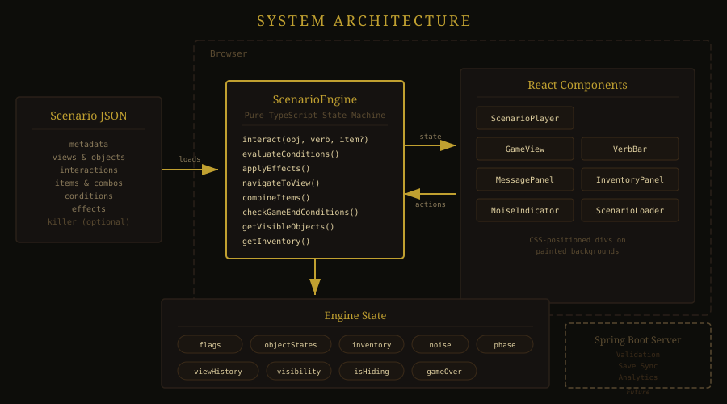
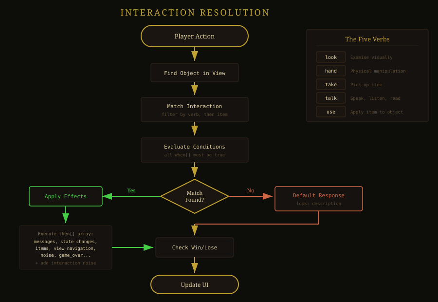
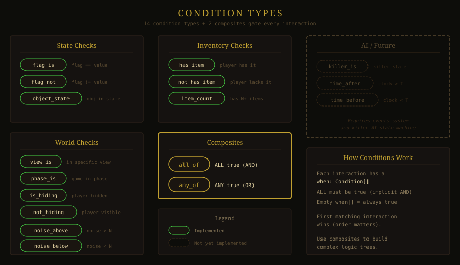
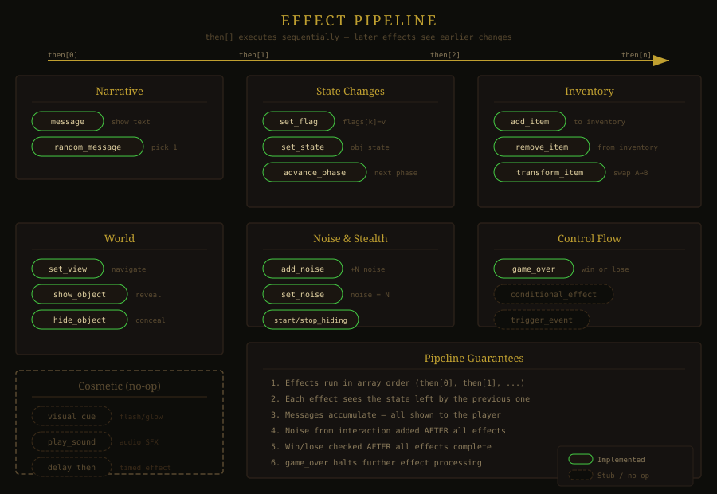
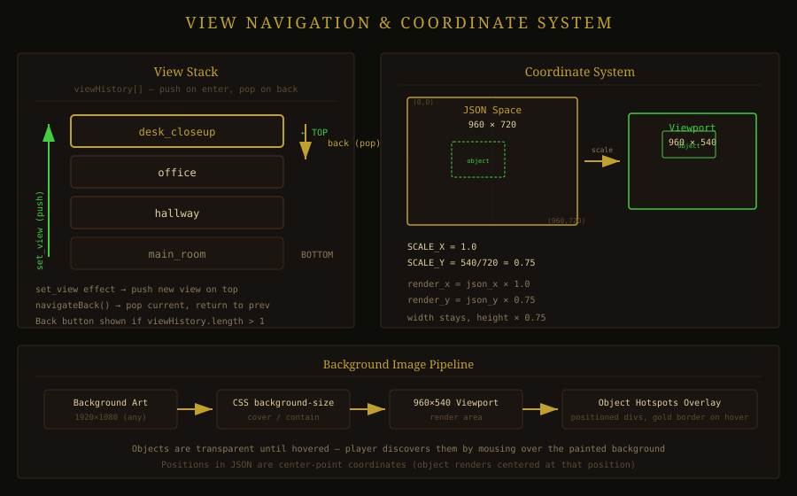
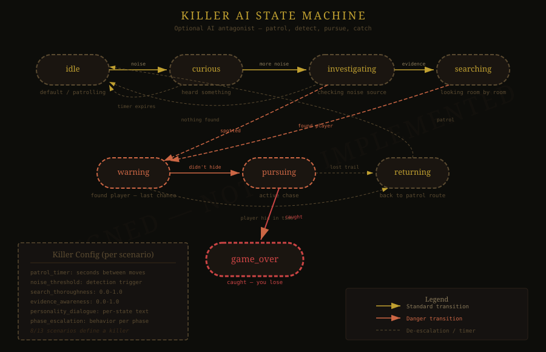

# Architecture Deep Dive

> **How the Adventure Engine works under the hood** — from JSON file to playable game.

Technical reference for developers who want to understand, extend, or contribute to the engine internals. For the JSON authoring specification, see [SCENARIO_SCHEMA.md](SCENARIO_SCHEMA.md). For the project overview, see the [README](../README.md).

---

## Table of Contents

- [System Overview](#system-overview)
- [Architecture Diagram](#architecture-diagram)
- [The Scenario Engine](#the-scenario-engine)
- [Interaction Resolution](#interaction-resolution)
- [The Condition System](#the-condition-system)
- [The Effect System](#the-effect-system)
- [View Navigation](#view-navigation)
- [The Five Verbs](#the-five-verbs)
- [Data Flow](#data-flow)
- [Coordinate System](#coordinate-system)
- [Rendering Pipeline](#rendering-pipeline)
- [Future Architecture](#future-architecture)

---

## System Overview

The Adventure Engine is a **pure client-side state machine**. There is no server required for gameplay. The entire pipeline is:

```
scenario.json + background images → ScenarioEngine (TypeScript) → React components → playable game
```

The engine has three strict layers:

| Layer | Responsibility | Side Effects |
|-------|---------------|--------------|
| **ScenarioEngine** | State management, condition evaluation, effect application | None — pure state machine |
| **React Components** | Render engine state as interactive UI | DOM updates only |
| **Scenario JSON** | Define the entire game — views, objects, puzzles, narrative | Static data |

This separation means the engine can be tested without a browser, scenarios can be validated without rendering, and the renderer can be swapped (React → Phaser) without touching game logic.

---

## Architecture Diagram

<p align="center">
  
</p>

---

## The Scenario Engine

`ScenarioEngine` (`client/src/engine/ScenarioEngine.ts`) is the heart of the system — a pure TypeScript class with no rendering logic, no DOM access, and no side effects beyond internal state mutation.

### Construction

When a scenario JSON is loaded, the constructor:

1. Stores the full scenario definition
2. Sets the initial view from `scenario.setting.initial_view`
3. Copies initial flags from `scenario.flags`
4. Indexes all objects into a `Map<string, ScenarioObject>` for O(1) lookup
5. Indexes all items into a `Map<string, Item>`
6. Records each object's `initial_state` and `initially_visible`
7. Sets the initial phase (first entry in `scenario.phases`, if any)
8. Applies `on_enter` effects for the initial phase

### State Shape

The engine maintains these mutable fields:

```typescript
private _currentViewId: string;          // Which screen the player sees
private flags: Record<string, string>;   // Key-value pairs tracking progress
private objectStates: Record<string, string>; // Per-object state machine
private objectVisibility: Record<string, boolean>; // Which objects are visible
private inventory: string[];             // Item IDs the player carries
private _noiseLevel: number;             // 0-100 stealth meter
private _messages: string[];             // Current message queue
private viewHistory: string[];           // Stack for back navigation
private _gameOver: GameOverResult | null;// Win/lose state
private _currentPhaseId: string | null;  // Current game phase
private _isHiding: boolean;             // Player hiding from killer
```

All state reads go through getter methods. The engine never exposes mutable references — arrays are copied, objects are frozen where appropriate.

### Key Methods

| Method | Purpose |
|--------|---------|
| `interact(objectId, verb, itemId?)` | The main game action — resolve verb + object + conditions → effects |
| `navigateToView(viewId)` | Push current view to stack and move to new view |
| `navigateBack()` | Pop view stack and return to previous view |
| `combineItems(itemA, itemB)` | Attempt to combine two inventory items |
| `examineItem(itemId, verb)` | Use a verb on an inventory item |
| `getVisibleObjects()` | Return objects in the current view that are visible |
| `getAvailableVerbs(objectId)` | Which verbs have valid interactions for this object |
| `getUsableItems(objectId)` | Which inventory items can be used on this object |

---

## Interaction Resolution

This is the core game loop — what happens when the player clicks an object with a verb selected.

### Resolution Flow

<p align="center">
  
</p>

### Interaction Matching

The `findMatchingInteraction` method iterates through an object's interactions in order. For each interaction:

1. Does the `verb` match?
2. If `use_item`, does the `item` match?
3. Do **all** conditions in `when[]` evaluate to true?

The **first** match wins. This means interaction order matters — more specific conditions should come first in the JSON.

### Concrete Example

From The Lighthouse Keeper — cutting the wire mesh on the window:

```json
{
  "verb": "use_item",
  "item": "wire_cutters",
  "when": [
    { "type": "object_state", "object": "window", "state": "mesh_intact" }
  ],
  "then": [
    { "type": "message", "text": "You cut through the wire mesh. Cold air rushes in." },
    { "type": "set_state", "object": "window", "state": "mesh_cut" },
    { "type": "add_noise", "amount": 25 }
  ],
  "noise": 0
}
```

Resolution:
1. Player selects "Use" verb, selects wire_cutters from inventory, clicks window
2. Engine maps `use` + item to `use_item`
3. Checks: Is `window` state `mesh_intact`? → Yes
4. Applies effects: show message, change window state, add 25 noise
5. Window state is now `mesh_cut` — this interaction won't match again
6. Other interactions gated on `mesh_cut` now become available

---

## The Condition System

Conditions are boolean tests against game state. Every interaction has a `when[]` array — all conditions must be true (implicit AND) for the interaction to match.

<p align="center">
  
</p>

### Condition Types

| Type | Tests | Fields |
|------|-------|--------|
| `flag_is` | A flag equals a specific value | `flag`, `value` |
| `flag_not` | A flag does NOT equal a value | `flag`, `value` |
| `object_state` | An object is in a specific state | `object`, `state` |
| `has_item` | Player has an item in inventory | `item` |
| `not_has_item` | Player does NOT have an item | `item` |
| `view_is` | Player is in a specific view | `view` |
| `not_in_view` | Player is NOT in a specific view | `view` |
| `phase_is` | Game is in a specific phase | `phase` |
| `is_hiding` | Player is currently hiding | — |
| `not_hiding` | Player is NOT hiding | — |
| `noise_above` | Noise level exceeds threshold | `threshold` |
| `noise_below` | Noise level is below threshold | `threshold` |
| `item_count` | Player has at least N items | `count` |
| `killer_is` | Killer AI is in a specific state | `state` *(stub — returns false)* |

### Composite Conditions

Two composite types allow complex logic:

| Type | Logic | Evaluation |
|------|-------|------------|
| `all_of` | All sub-conditions must be true | `conditions[].every(c => evaluate(c))` |
| `any_of` | At least one must be true | `conditions[].some(c => evaluate(c))` |

Composites nest arbitrarily, enabling expressions like:

```json
{
  "type": "any_of",
  "conditions": [
    {
      "type": "all_of",
      "conditions": [
        { "type": "has_item", "item": "key" },
        { "type": "object_state", "object": "door", "state": "locked" }
      ]
    },
    { "type": "flag_is", "flag": "door_forced", "value": "true" }
  ]
}
```

*"Either (player has key AND door is locked) OR the door was forced open."*

---

## The Effect System

Effects mutate game state. When an interaction matches, its `then[]` array executes in order.

<p align="center">
  
</p>

### Effect Types

| Type | What It Does | Key Fields |
|------|-------------|------------|
| `message` | Display narrative text | `text` |
| `random_message` | Display one of several texts at random | `messages[]` |
| `set_flag` | Set a flag to a value | `flag`, `value` |
| `set_state` | Change an object's state | `object`, `state` |
| `add_item` | Add item to inventory | `item` |
| `remove_item` | Remove item from inventory | `item` |
| `set_view` | Navigate to a different view | `view` |
| `add_noise` | Increase noise level | `amount` |
| `set_noise` | Set noise to exact level | `amount` |
| `show_object` | Make an object visible | `object` |
| `hide_object` | Make an object invisible | `object` |
| `game_over` | End the game | `result` (win/lose), `reason` |
| `advance_phase` | Move to a new game phase | `phase` |
| `start_hiding` | Player enters hiding | — |
| `stop_hiding` | Player leaves hiding | — |
| `transform_item` | Replace one inventory item with another | `item`, `into` |
| `delay_then` | Apply effects after a delay | `seconds`, `effects[]` |
| `conditional_effect` | Branch effects based on conditions | `when[]`, `then[]`, `else[]` |

### Branching Effects

The `conditional_effect` type enables runtime branching within effect chains:

```json
{
  "type": "conditional_effect",
  "when": [{ "type": "has_item", "item": "flashlight" }],
  "then": [
    { "type": "message", "text": "Your flashlight illuminates a hidden passage." },
    { "type": "show_object", "object": "secret_passage" }
  ],
  "else": [
    { "type": "message", "text": "It's too dark to see anything." }
  ]
}
```

### Deferred Effects

`delay_then` uses `setTimeout` to apply effects after a pause:

```json
{
  "type": "delay_then",
  "seconds": 3,
  "effects": [
    { "type": "message", "text": "You hear footsteps approaching..." },
    { "type": "add_noise", "amount": 10 }
  ]
}
```

---

## View Navigation

Views are the "rooms" or "screens" of the game. Each view defines:

- A list of object IDs visible in that view
- An optional background image file
- An optional back label for return navigation

### View Stack

<p align="center">
  
</p>

The engine maintains a `viewHistory` stack for back navigation:

- `set_view` effect pushes the current view onto the stack and navigates to the target
- `navigateBack()` pops the stack and returns to the previous view
- The Back button appears when the stack is non-empty or the view has a `back_label`

### Closeup Views

Sub-views (like zooming into a desk, opening a drawer) use the same view mechanism. A "look at desk" interaction uses `set_view` to push a closeup view, and the back button returns to the room.

---

## The Five Verbs

The engine supports exactly five verbs, inherited from the Sierra/LucasArts tradition:

| Verb | Engine ID | Cursor | What the Player Does |
|------|-----------|--------|---------------------|
| Look | `look` | `help` | Examine, read, observe |
| Hand | `hand` | `pointer` | Touch, push, pull, open, close |
| Take | `take` | `grab` | Pick up, add to inventory |
| Talk | `talk` | `text` | Speak, listen, read aloud |
| Use | `use` / `use_item` | `cell` | Apply inventory item to object |

### Why Exactly Five

Every physical manipulation (push, pull, open, close, turn, flip) maps to `hand`. The schema analysis across all 13 scenarios confirmed zero usage of `push`, `pull`, `open`, or `close` as separate verbs — authors naturally use `hand` for all physical interaction. Five verbs is the sweet spot: enough expressiveness for complex puzzles, simple enough for intuitive play.

### The Use Verb

"Use" is the puzzle verb. When selected, the player first selects an inventory item, then clicks a world object. The engine internally maps this to a `use_item` interaction with the selected item ID:

```
Player action:  Use verb → select "wrench" → click "bolt"
Engine call:    interact("bolt", "use_item", "wrench")
Interaction:    { verb: "use_item", item: "wrench", when: [...], then: [...] }
```

---

## Data Flow

The complete flow from user action to screen update:

```
User → ScenarioPlayer → ScenarioEngine → Game State
  │         │                  │              │
  │ click   │                  │              │
  ├────────>│ interact()       │              │
  │         ├─────────────────>│ read state   │
  │         │                  ├─────────────>│
  │         │                  │ match + eval │
  │         │                  │<─────────────┤
  │         │                  │ apply effects│
  │         │                  ├─────────────>│
  │         │                  │ check win/lose│
  │         │   {success, messages, noise}    │
  │         │<─────────────────┤              │
  │         │ bump() re-render │              │
  │         │ read fresh state │              │
  │         ├─────────────────>│              │
  │ updated │                  │              │
  │<────────┤                  │              │
```

### The Bump Pattern

`ScenarioPlayer` uses a version counter to trigger React re-renders:

```typescript
const [, setVersion] = useState(0);
const bump = useCallback(() => setVersion(v => v + 1), []);
```

After every engine call, `bump()` increments the counter. React sees the state change and re-renders. On the next render, components read fresh state from the engine's getter methods. This avoids the overhead of converting engine state to React state objects.

---

## Coordinate System

Object positions use a **960x720 coordinate space** with origin at the top-left.

### Scaling

The render viewport is 960x540 pixels. The engine maps coordinates:

```
SCALE_X = 960 / 960 = 1.0    (no horizontal scaling)
SCALE_Y = 540 / 720 = 0.75   (vertical compression)
```

An object at position `(480, 360)` in the coordinate space renders at pixel `(480, 270)` in the viewport.

### Why 960x720

- Matches the actual coordinate ranges found across all 13 scenarios (x: 50–950, y: 30–720)
- 4:3 aspect ratio aligns with the classic adventure game tradition
- Renders into a 16:9 viewport (960x540) by compressing vertically
- Background images (any resolution, 1920x1080 recommended) scale with `object-fit: cover`

### Object Sizing

Each object has a `size` in the same coordinate space:

```json
{
  "position": { "x": 480, "y": 360 },
  "size": { "width": 100, "height": 80 }
}
```

Position is the top-left corner. The rendered hotspot becomes:
- Left: `480 * 1.0 = 480px`
- Top: `360 * 0.75 = 270px`
- Width: `100 * 1.0 = 100px`
- Height: `80 * 0.75 = 60px`

---

## Rendering Pipeline

The UI is built from six React components, all reading from the same `ScenarioEngine` instance:

```
ScenarioPlayer
├── Title Bar + NoiseIndicator
├── GameView
│   ├── Background Image ()
│   ├── Object Hotspots (positioned <div>s)
│   ├── Cursor Label (active verb/item)
│   └── Back Button (when stack > 0)
├── MessagePanel
├── InventoryPanel
├── VerbBar
└── Game Over Overlay (when gameOver ≠ null)
```

### Component Responsibilities

| Component | Renders | Reads From Engine |
|-----------|---------|-------------------|
| **ScenarioPlayer** | Layout container, state orchestration | All getters |
| **GameView** | Background image, object hotspots, cursor label | `getCurrentView()`, `getVisibleObjects()`, `getBackgroundFile()` |
| **VerbBar** | Five verb buttons with active/hover states | — (controlled by parent) |
| **InventoryPanel** | Item list with selection | `getInventory()` |
| **MessagePanel** | Story text with dismiss | `getMessages()` |
| **NoiseIndicator** | Noise level progress bar | `getNoiseLevel()` |

### Object Hotspots

Objects render as positioned `<div>` elements over the background. Each hotspot:

- Is absolutely positioned using scaled coordinates
- Has a transparent background when a background image is present (so the painted art shows through)
- Shows a gold border (`#c0a030`) on hover
- Displays the object's label below on hover
- Uses the active verb's cursor style

### Background Images

When a view has a `background_file`, the image loads from `/scenarios/{scenarioId}/{backgroundFile}`. The `` fills the viewport with `object-fit: cover` and includes an `onError` handler that hides broken images gracefully.

---

## Future Architecture

### Server Integration

The Spring Boot backend (`server/`) is planned for:

- **Scenario Validation** — verify JSON against the schema, check for dead ends, unreachable items
- **Playtesting Simulation** — automated walkthrough verification using `solution_paths`
- **Save/Load** — sync game state across sessions
- **Analytics** — track which puzzles players get stuck on

The game engine stays client-side. The server is a tooling layer, not a runtime dependency.

### Killer AI

<p align="center">
  
</p>

The AI antagonist system (defined in `scenario.killer`) will manage:

- Patrol timers and routes
- Noise threshold detection
- Search behavior when alerted
- Phase-based escalation
- Personality-driven dialogue

Currently stubbed (`killer_is` condition returns false). When implemented, the killer AI may run server-side for competitive multiplayer modes where players shouldn't be able to inspect the killer's state.

### Phaser Rendering

Phaser 3.80 is already in `package.json` for future use. The transition plan:

1. Keep `ScenarioEngine` unchanged — it has no rendering logic
2. Replace React component rendering with Phaser scenes
3. Add sprite animations, particle effects, screen transitions
4. Use Phaser's camera system for the spatial movement system

### Multiplayer

Future competitive mode where one player controls the protagonist and another controls the killer AI. This requires:

- Server-side engine authority (prevent state inspection)
- WebSocket game state sync
- Separate UI for killer player (patrol routes, noise visualization, search commands)

---

*For the complete JSON authoring specification, see [SCENARIO_SCHEMA.md](SCENARIO_SCHEMA.md).*
*For the project overview and getting started guide, see the [README](../README.md).*
