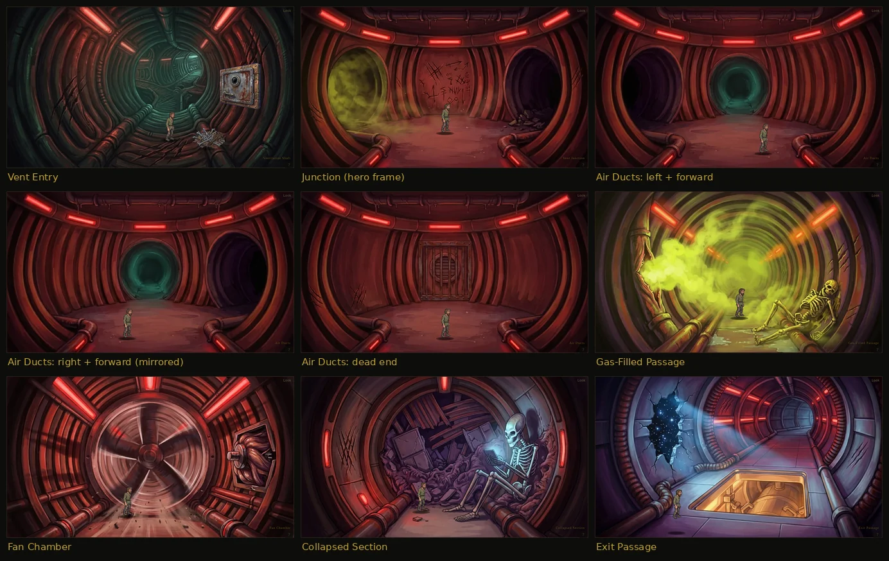

# Art Guide — Generating, Processing, Sizing, and Placing Scenario Art

> **Audience:** scenario authors and AI agents. Everything here was learned building *The Harvest*. Follow it and new art will match the existing look on the first or second try instead of the fifth.

The engine renders two kinds of art on top of each other, and they deliberately use **two different styles**:

| Layer | Style | Why |
|-------|-------|-----|
| **Backgrounds** (`backgrounds/`, `closeups/`) | Painted: 2D gouache, visible brushstrokes, soft gradients (Sierra *King's Quest V/VI* painted backdrops) | Atmosphere, depth, mood |
| **Sprites and item icons** (`sprites/`, `items/`) | **VGA pixel art**: visible hand-placed pixels, limited palette, crisp dark outlines, stepped/dithered shading | Must match the player character, which is pixel art. A smoothly painted prop next to a pixel-art character looks pasted in |

The single most common rejection in review was *"too painterly"* or *"too high fidelity"* for a sprite. **Sprites must match the character's fidelity, not the background's.**

---

## Table of Contents

1. [Background Prompts](#background-prompts)
2. [Sprite and Item Prompts](#sprite-and-item-prompts)
3. [Processing Pipeline](#processing-pipeline)
4. [Sizing](#sizing)
5. [Placement](#placement)
6. [Inventory Icons](#inventory-icons)
7. [Composite and Procedural Sprites](#composite-and-procedural-sprites)
8. [Case Study: The Vent Maze](#case-study-the-vent-maze-rooms-that-belong-together): how to make a set of rooms that belong together
9. [Verifying In-Game](#verifying-in-game)
10. [Checklist](#checklist)

---

## Background Prompts

Generator: Google Gemini image models (Imagen / "Nano Banana"). Output 16:9, 1920×1080 or 1376×768.

Every prompt **opens** with:

```
2D gouache illustration, game background art in the style of 1990s Sierra On-Line King's Quest V and King's Quest VI. Visible brushstrokes, soft color gradients, NOT photorealistic, NOT 3D rendered. 16:9 aspect ratio, 1920x1080.
```

and **closes** with:

```
Low camera angle looking UP from knee-height — [what that means in this scene]. Saturated colors despite the dark mood — [palette-specific color description]. No text, no UI elements, no characters.
```

Rules that matter:

- **No characters, no loose props you will want to interact with.** Anything the player picks up should be a separate sprite (it has to disappear when taken). Fixed scenery the player only looks at can be painted in.
- **Anchor a palette per scenario** and repeat it in every prompt (The Harvest: bioluminescent teal/green, amber stasis fluid, rust, bone).
- **Leave walkable floor** in the lower third where the character stands.
- Describe interactive scenery explicitly ("an open morgue drawer at upper left", "a gap in the walkway with torn railing stubs on both sides") so hotspots have something to sit on.

Full background workflow and more examples: `.claude/skills/scenario-builder/SKILL.md` § 2.

---

## Sprite and Item Prompts

Generator: Gemini image ("Nano Banana 2" worked well). Square 1:1 output (1024×1024).

### The template

```
Single game [prop sprite | inventory item] in the style of 1990s Sierra On-Line King's Quest V VGA pixel art: visible hand-placed pixels, limited 256-color palette, crisp dark outlines, flat shading with stepped dithered gradients. NOT painterly, NOT airbrushed, NOT 3D rendered.
Subject: [what it is, what it's made of, its size relative to a forearm/hand/body, and the one or two details that make it read at small size].
Colors: [3–5 named colors]. [Wear, stains, damage.]
[View angle: "side view, upright, opening to the right" | "three-quarter top-down, lying flat"].
[Scenario aesthetic: "Dark bio-organic alien starship aesthetic, King's Quest meets H.R. Giger."]
One isolated object centered in a square frame with a generous empty margin. Flat solid pure blue (#0000FF) background, no cast shadow, no floor, no text, no other objects. Absolutely no blue tones anywhere on the object itself.
```

Why each clause is there:

| Clause | Reason |
|--------|--------|
| "VGA pixel art … NOT painterly" | Without it Gemini drifts toward smooth digital painting (the rejected look) |
| "flat solid pure blue (#0000FF)" | Chroma key. Pure blue barely overlaps skin, rust, bone, flesh, or green |
| "no blue tones on the object" | Any blue in the object is deleted by the key. If the object *must* be blue, use a green (#00FF00) key and `--color 0,255,0` |
| "no cast shadow, no floor" | The engine draws its own shadow (`shadow` field); a painted shadow doubles up and breaks the key |
| "one object, centered, generous margin" | Clean trim; nothing cut off at the frame edge |
| "the one or two details that read at small size" | Sprites render 20–150px tall. A barb, an eyelet, a buckle survives; fine engraving doesn't |
| explicit view angle | Must match how the object sits in the background (hanging, lying, wall-mounted) |

### Prompts that shipped (The Harvest grappling-line puzzle)

**Carcass hook** (world sprite and icon):
```
Single game prop sprite in the style of 1990s Sierra On-Line King's Quest V VGA pixel art: visible hand-placed pixels, limited 256-color palette, crisp dark outlines, flat shading with stepped dithered gradients. NOT painterly, NOT airbrushed, NOT 3D rendered. Subject: a heavy alien carcass hook used to drag bodies out of morgue drawers. One curved J-shaped hook of dark grown bio-metal, about forearm length, with a ridged bone-like texture like a vertebra or a talon. The tip is wickedly sharp with a small backward barb. At the top of the straight shank is a thick round eyelet ring big enough to tie a rope through. Colors: warm grey-green gunmetal with rust-orange corrosion, pale bone highlights along the ridges, a dried dark-red stain near the point. Shown upright in side view with the hook opening to the right. Dark bio-organic alien starship aesthetic, King's Quest meets H.R. Giger. One isolated object centered in a square frame with a generous empty margin. Flat solid pure blue (#0000FF) background, no cast shadow, no text, no other objects. Absolutely no blue tones anywhere on the object itself.
```

**Restraint strap** (icon only; the world version is painted into the background):
```
Single game inventory item in the style of 1990s Sierra On-Line King's Quest V VGA pixel art: visible hand-placed pixels, limited 256-color palette, crisp dark outlines, flat shading with stepped dithered gradients. NOT painterly, NOT airbrushed, NOT 3D rendered. Subject: one long severed alien restraint strap, a thick leathery band of grown bio-material in muted fleshy red-brown, worn smooth and glossy from struggling, with pale sinew ribbing along its length. One end has a heavy bone-like buckle with extra smaller holes punched crudely near it; the other end is freshly cut, clean and slightly frayed. Lying in a loose S-curve coil, three-quarter top-down view. Dark bio-organic alien starship aesthetic, King's Quest meets H.R. Giger. One isolated object centered in a square frame with a generous empty margin. Flat solid pure blue (#0000FF) background, no cast shadow, no text, no other objects. Absolutely no blue tones anywhere on the object itself.
```

**Combined item** (the crafted result gets its own icon so the combination is visible in inventory):
```
Same style and background rules as before. Subject: the same barbed bio-metal carcass hook with the [line] knotted through its eyelet ring, the line trailing off in two loose loops. Compact composition for an inventory icon, centered, generous margin, flat solid pure blue (#0000FF) background, no shadow, no text.
```
Tip: say "the same [object]" and paste the original subject description again, so the combined icon matches the parts. Gemini will still improvise materials (it drew the strap as a golden rope here), so compare it against the part icons before accepting.

### Animated sprites

Ask for a horizontal strip: *"N frames in a single horizontal row, evenly spaced, identical size and position in each frame, only [the moving part] changes"*. Then process with `--cols N`. Check that the object doesn't drift between frames: the corridor emergency panel jittered because its two frames were 96px apart horizontally. Fix drift by cropping per frame or keeping a single frame.

### Idle animations: one frame plus edits (the black cat)

For a creature or machine that should feel alive but stay in place, don't ask for a multi-frame strip; poses drift between frames, and the old cat even switched from sitting to standing. Instead:

1. **Generate one base frame.**
2. **Generate each motion as an EDIT of the base:** "Keep EVERYTHING identical … change ONLY: the eyes are closed in a slow blink." One small change per edit: a blink, an ear twitch, a tail flick.
3. **Attach the base to every edit, not the previous result.** If Gemini chains edits (the ear frame came back with the blink's closed eyes), you don't need to regenerate. Because the frames are pixel-aligned, transplant just the changed region (the ear box, the tail box) from the edit onto the base. Diff the frames first to find the regions.
4. **Key all frames with ONE shared crop** (the union bounding box). Cropping each frame separately shifts the content between frames and makes the sprite jitter.
5. **Order the sheet for natural rhythm.** Repeat the base frame and drop in each motion once: `base, base, base, ear, base, base, blink, base, base, tail` at 2 fps is a calm 5-second loop with occasional life.

**Dark or bluish subjects need a green key.** A black cat's fur has blue and violet highlights that a blue key would punch holes in. Generate on `#00FF00`, add "no green tones anywhere on the subject", and key green. The cat sheet is `sprites/black-cat.png`: 10 frames of 119×184 at scale 0.19, about 35px tall in the corridor.

### Idle animations for the player character

The same method works on the player, with two extra rules, because a person's colours and proportions are much easier to spoil than a cat's:

- **Make breathing procedurally, not with Gemini.** A "chest rising" edit came back slightly recoloured everywhere, so it flickered against the base. Instead, `scenarios/the-harvest/scripts/build_player_idle.py` lifts the head and shoulders by 2px and stretches the torso band down to the waist with NEAREST resampling. The original pixels are kept, so it reads as a breath and not a redraw. It can't lift a frame whose head already touches the top of the cell (the front-facing frame), so that row only gets the base pose.
- **Take only the changed region from an edit, and colour-match it.** For the head turn, only the head box is transplanted from the Gemini edit, matched to the original by per-channel mean and standard deviation, so there is no seam. Gemini's output is mapped back into frame space by undoing the reference placement (centre crop, ×1/3), keyed, and despilled.
- **Reject edits that redraw the body.** A fist clench grew the hand past the outline, and a weight shift repainted the legs and torso; both flickered and weren't used.

The sheet order is `base, base, breath, base, base, breath, base, look, look, look, base, breath`: 12 columns at 2 fps, a 6-second loop. Row 0 faces right and row 1 faces the camera. The helmeted sheet is built from the same frames, and the helmet rises with each breath.

### When a result is too painterly

Re-prompt first. If the shape is right but the rendering is too smooth, quantize it:

```python
# 3× downscale + 96-color palette + nearest-neighbour upscale ("more KQ5 pixelation")
from PIL import Image; import numpy as np
im = Image.open('sprite.png').convert('RGBA')
small = im.resize((im.width // 3, im.height // 3), Image.BILINEAR)
q = small.convert('RGB').quantize(colors=96, method=Image.Quantize.MEDIANCUT).convert('RGBA')
a = np.array(q); a[:, :, 3] = np.array(small)[:, :, 3]
Image.fromarray(a).resize(im.size, Image.NEAREST).save('sprite.png')
```
2× / 128 colors is subtle; 4× / 64 colors is too blocky (NES look). 3× / 96 matched the character.

Never "pixelate" by blurring down and back up with bilinear filtering. That produces mush, not pixel art.

---

## Processing Pipeline

```bash
# 1. WebP → PNG (node-canvas may not decode WebP)
convert input.webp input.png

# 2. Key out the blue, despill the edges, trim tight
node tools/process-chromakey-sprite.mjs input.png --cols 1 --padding 0 --threshold 110 --out sprites/thing.png
#    --cols N        frames in a horizontal strip (animated sprites)
#    --threshold     colour distance from the key. 80 is default; 110 handles Gemini's
#                    off-pure blues like rgb(4,53,252). Raise if a blue haze remains,
#                    lower if dark-blue outlines are eaten
#    despill is ON by default: pixels within 2px of the removed background get their
#    blue cast neutralised. Without it you get a purple/blue fringe (the old bones sprite)

# 3. Single-frame sprites: make sure the PNG is trimmed (the tool trims; this is a safety net)
convert sprites/thing.png -trim +repage sprites/thing.png
```

**Verify on both a dark and a light backdrop.** Fringe that's invisible on dark teal shows up on white, and the reverse:

```bash
convert sprites/thing.png -background black -flatten /tmp/check_dark.png
convert sprites/thing.png -background white -flatten /tmp/check_light.png
```

Look for: blue/purple fringe, holes punched through the object (blue inside it got keyed), stray specks extending the bounding box, and enclosed regions that should be transparent (inside an eyelet, between rope loops) that stayed blue.

Keep the processed PNG's real dimensions in the JSON: `frame_width` × `frame_height` must equal the trimmed frame size.

---

## Sizing

The viewport is **960×540 screen pixels**. A sprite's on-screen size is:

```
screen_width  = frame_width  × scale
screen_height = frame_height × scale
```

So: `scale = desired_screen_height / frame_height`.

Note: sprite size is in **screen** pixels; positions are in the **960×720 JSON** space. Y positions get multiplied by 0.75, sprite sizes don't.

### Reference: The Harvest, Act 1 (on-screen heights)

| Thing | Screen height | Notes |
|-------|--------------:|-------|
| Player character (frame) | 144px | 410 × 0.35; the visible figure is **~97px** tall. Compare props to this |
| Cataloguer robot | 112px | Large machine, mid-depth |
| Maintenance hatch | 155px | Wall feature, near the camera |
| Emergency cabinet | 93px | Wall cabinet |
| Nutrient dispenser | 89px | Wall-mounted fixture |
| Carcass hook (morgue) | 60px | Oversized Choir hook on a drawer, mid-depth |
| Black cat | 34px | Small animal near the camera |
| Specimen tag | 26px | Hand-sized pickup |
| Neural tendril | 18px | Small pickup on the floor |

Rules of thumb:

- **Hand-held pickups:** 15–35px. Under ~15px nobody can click them; give them the `glimmer` animation so they're findable.
- **Scale with depth.** Objects at the back of the room are smaller than the same object near the camera. Match the painted furniture around them, not an absolute size.
- **Readable beats realistic.** A pickup can be ~1.5× its "true" size if that's what it takes to read. The carcass hook is bigger than a forearm because it's a hook sized for the Choir, who are larger than the player.

---

## Placement

### Anchoring (the #1 source of misplaced sprites)

| Object kind | `position` means | Clickable area |
|-------------|------------------|----------------|
| Plain hotspot (no `sprite`) | **Top-left corner** of the box, in 960×720 space | the `size` box |
| Sprite object (`sprite` set) | **Bottom-center** of the sprite, in 960×720 space | the sprite's rectangle (`size` is only used by the editor) |

So a sprite whose `position.y` sits on the floor line stands on the floor; one whose `position.y` is the underside of a shelf hangs below the shelf.

To place a sprite at a point you measured on the background image:

```
json_x = img_x × (960 / IMG_W)
json_y = img_y × (720 / IMG_H)      ← use the point where the object's BOTTOM-CENTER should touch
```

### Make placement mean something

- **Put it where the story says it is.** The carcass hook hangs from the lip of an open morgue drawer, because it's described as "jammed into the lip of an open drawer".
- **Put it on a surface.** Things rest on floors, shelves, and slabs, or hang from edges. Nothing should float on a wall with no support.
- **Avoid the character's standing spot** and nav hotspots. Overlapping sprites steal clicks.
- **Leave hotspots alone** if the author tuned them in the editor; adjust your sprite instead and note any hotspot you think is off.

---

## Inventory Icons

- File: `items/<item_id>.png`, referenced by the item's `icon_file`.
- Canvas: **326×273 transparent PNG**, object scaled to fit **240×230** and centered. All Harvest icons follow this so they line up in the inventory bar.
- Rendered **28px tall** with smooth (not pixelated) scaling, so silhouette is everything. Pick a view where the shape is unmistakable.
- **Crafted items get their own icon showing the combination** (hook *with* line), so the player can see the state change.

```python
from PIL import Image
im = Image.open('processed.png').convert('RGBA'); im.thumbnail((240, 230), Image.LANCZOS)
c = Image.new('RGBA', (326, 273), (0, 0, 0, 0)); c.paste(im, ((326 - im.width) // 2, (273 - im.height) // 2), im)
c.save('items/my_item.png')
```

A pickup usually needs both: a **world sprite** (`sprites/`, sized for the room) and an **icon** (`items/`). Both can come from the same generated image.

---

## Composite and Procedural Sprites

Some art has to meet exact points in the background, like a line strung between two railing stubs that already exist in the painting. A generated image won't hit those points, so draw it:

1. Measure the anchor points in **screen** space (resize the background to 960×540 and zoom in with a coordinate grid).
2. Draw on a transparent canvas covering just that region at **2× resolution**, so you can use `scale: 0.5`.
3. Reuse processed art where you can (the rigged line reuses the hook sprite, flipped to cup the far railing).
4. Use the object's own palette with a dark outline pass so it matches the pixel-art sprites.
5. `position` = bottom-center of that region: `x = (left + right) / 2`, `y = bottom / 0.75`.

Example: `sprites/grappling_line_rigged.png` in The Harvest. A strap drawn as a quadratic curve from the near railing stump (553, 413) to the hook's eyelet, plus the hook flipped vertically so its curve rests on the far stub (623, 437). The canvas covers screen (538, 392)–(650, 466) at 2×, so `scale: 0.5`, `position: {x: 594, y: 621}`. It starts hidden and appears through `show_object` when the player crosses.

---

## Case Study: The Vent Maze (Rooms That Belong Together)

<p align="center"></p>

These nine screens (and the 13 maze cells built from them) came out right on the **first Gemini attempt each**, slotted onto existing hotspots with small nudges, and read as one continuous place. Nothing about it was luck. This is the exact recipe. Use it for any set of rooms that must feel like the same building: a maze, a corridor run, the decks of a ship, the floors of a tower.

The prompts that shipped are in `scenarios/the-harvest/vent-maze-design.md`, sections "Background Image Prompts" and "Maze Frame Prompts".

### Step 1: Anchor everything to one approved image

Pick an existing background the user already loves (here, `act1_ventilation_shaft.webp`). **Attach it to every prompt as a reference image**, and also describe its look in words, so the model has two anchors:

```
Same environment as the attached reference image: the interior of a cylindrical alien ventilation tube built from concentric ribbed bands of grown bio-metal, oxblood and rust-red with dark umber gaps between the ribs, glowing red emergency strip lights set into the ribs, thick pipes running along the floor edges, faint teal-green light in the far distance, deep shadowy vignette at the frame edges, claw-scratch marks gouged into the ribs. Keep the same brushwork, palette and lighting as the reference.
```

To write that paragraph, **look at the reference image and name what you actually see**: its geometry, materials, the palette as named colors, the light sources and where they sit, and its signature details. A generic "sci-fi vent" description drifts; a literal description of the reference doesn't. Put the paragraph between the standard opening and closing of the background prompt formula.

### Step 2: Write the composition from the hotspots, not the other way round

The rooms already had hotspots, so every prompt placed each feature where its hotspot already sat, expressed as **fractions of the frame**:

```
fraction_across = json_x / 960        fraction_down = json_y / 720
```

`gas_source` at (80,150) 200×350 became *"LEFT wall (left quarter of the frame, from about 20% to 70% down): a thick bio-organic pipe split open lengthwise…"*. Do this for every interactive object, every exit, and **the floor where the character stands** (*"the floor in the lower center is clear"*). Image models follow "from about A% to B% across, C% to D% down" well; they ignore pixel coordinates. Also state the vanishing point and camera ("tunnel recedes to a vanishing point HIGH in the frame, about 15% down"), because that decides where "forward" lands.

### Step 3: Dodge the "no characters" trap

The standard closing says "no characters". Gemini will then quietly drop skeletons and corpses that the scene needs. Replace it with:

```
No text, no UI elements, no people, no living creatures (the skeletal remains described above are part of the scenery).
```

### Step 4: Review the raw image against the hotspots before installing it

```bash
node tools/preview-hotspots.mjs scenarios/the-harvest/scenario.json act1_vent_gas_chamber \
  --image ~/Downloads/gas.webp --out /tmp/gas_preview.png
```

The preview draws the image at the game's 960×540 viewport with every hotspot, sprite anchor, and the character's footprint on top. Then refit to the painting. These are the vent-room fixes, all small:

- **Nudge boxes onto painted features.** The junction's side exits moved inward onto the painted tunnel mouths, and the skeleton box grew to cover skull to feet.
- **Move exits onto what reads as the way forward.** The gas room's forward exit was on the ceiling; it moved to the tunnel's vanishing point.
- **Get the character off hazards and focal points.** In the Exit Passage the character was standing in the hatch hole, so he moved to open floor at lower left. In the fan room he moved left of the hub.
- **Move `ambient_lighting` lights onto painted light sources.** Light `x`/`y` are 0–1 fractions, the same numbers as Step 2. The starlight moved onto the hull crack and the warm glow onto the hatch.

Then screenshot the room in the running game (Step 10) before calling it done.

### Step 5: Generic frames are EDITS of a hero frame, never fresh prompts

For screens that must be interchangeable, pick one **hero frame** (here, the junction) and make every variant by **editing it**. Attach the hero as the reference, and use this pattern:

```
EDIT the attached reference image (the vent T-junction chamber). Keep EVERYTHING identical — the exact camera position and height, the ribbed oxblood-and-rust chamber shape, the curved ceiling with its row of glowing red strip lights and dripping overhead pipe, the rusty floor pipes curving in at the bottom-left and bottom-right corners, the open damp floor in the center, the brushwork, palette and lighting — and change ONLY the following:
1) The flat back wall in the center … is replaced by the dark round mouth of a tunnel continuing STRAIGHT AHEAD … from about 40% to 62% across and 22% to 58% down.
2) The round opening in the LEFT wall stays exactly where it is, but its inside is plain darkness (no yellow-green haze).
3) The RIGHT wall where the right-hand opening was is now solid curved ribbed wall … no opening at all.

Make it look like an ordinary, anonymous stretch of the same duct system: no scratched symbols, arrows or writing anywhere, no debris, no gas or haze, no unique landmarks — it must be indistinguishable from other generic duct screens. …
```

Why it works:
- **Freezing the camera.** "Keep EVERYTHING identical" plus a list of what to keep, naming the hero's own details (the strip lights, the corner pipes), locks camera, lighting and geometry. Fresh prompts never match each other that closely.
- **Numbered changes.** A short numbered list of changes, each tied to a screen region, stops the model "improving" anything else.
- **Clearing the hero's identity.** The hero frame had its own landmarks: scratched symbols and gas haze. The anonymity clause removes them from the variants. If a result adds any landmark (writing, a skeleton, a glowing panel), regenerate it, because landmarks defeat a maze.

### Step 6: Mirror instead of generating

Right-handed variants are horizontal mirrors of left-handed ones: three generations gave five frames.

```python
from PIL import Image, ImageOps
ImageOps.mirror(Image.open('act1_vent_maze_lf.webp').convert('RGB')).save('act1_vent_maze_rf.webp', quality=92, method=6)
```

Mirror the hotspots too: a box spanning `x … x+w` becomes `960−x−w … 960−x`, and mirror the character's `x` (`560` becomes `400`). Never mirror frames that contain text or numbers.

### Step 7: One hotspot geometry for every generic cell

Measure the hero frame once and reuse the same boxes in every cell. That's what makes art and clicks agree across 13 screens:

| Exit | Box (960×720 JSON) | Source |
|------|--------------------|--------|
| Left opening (W) | `(95,187)` 205×347 | junction's painted left mouth |
| Right opening (E) | `(660,187)` 205×347 | mirror of W |
| Forward tunnel (N) | `(380,210)` 220×255, or `(360,210)` on mirrored frames | the edit's forward mouth |
| Back (S) | `(150,660)` 660×60 | bottom edge strip, not painted |

Character at `(560,650)` (`(400,650)` on mirrored frames), clear of the forward mouth so it never covers the exit.

### Step 8: Design the maze for the frames you have

Work in **fixed-compass** terms: the camera always faces north, so left is W, right is E, forward is N and the bottom edge is S. Each cell's frame is determined by which of N/W/E it opens, and S is behind the camera so it needs no art.

| N/W/E openings | Frame |
|----------------|-------|
| N + W | left + forward (generated) |
| N + E | right + forward (mirror) |
| W | left turn (generated) |
| E | right turn (mirror) |
| none | dead end (generated) |

Lay out the grid using **only frame classes you have art for**. The Harvest has no generic T-junction or crossroads, so the only T is the painted junction landmark. Before building:

- every opening must have a matching opening in its neighbour (two-way);
- every cell must be reachable;
- add a loop and a dead end so getting lost is real;
- put the painted special rooms inside the grid as landmarks.

`vent-maze-design.md` has the grid, cell table and checks.

### Step 9: Generate the cells and the map from data

- **`scenarios/the-harvest/scripts/build_vent_maze.py`** turns the grid (`CELLS`) into views and nav objects using the Step 7 geometry, re-routes the special rooms' exits, and writes per-cell hints. The hints come from a breadth-first search toward the gas room, so each one names the right direction. The script is idempotent: change the grid, re-run, and it rebuilds.
- **`scenarios/the-harvest/scripts/draw_vent_map.py`** draws the in-game map from the *same* grid. Anything that must be accurate (a map, a diagram, a code) should be drawn from data, never AI-generated. Technique:
  - multi-scale value noise blended between two rust colors, plus brushed streaks, for the metal plate;
  - a riveted bevel border;
  - engraved strokes (a dark line offset 2px under a light line, three jittered passes) for passages;
  - simple glyphs for landmarks: skull, fan, hatch box, X, gouged bars;
  - yellow chevrons along the true route.

### Step 10: Verify like a player

```bash
node tools/validate-scenario.mjs scenarios/the-harvest/scenario.json --views act1
node --max-old-space-size=6000 tools/softlock-search.mjs scenarios/the-harvest/scenario.json --views act1 --goal "state:airlock_override_panel!=locked"
```

Then walk it in the browser (Playwright recipe in [Verifying In-Game](#verifying-in-game)), covering:
- the true route;
- the loop;
- the dead end;
- a mirrored cell;
- the branch to the optional room;
- the long way round.

Screenshot every frame class next to the character, and check the map hint in several cells.

### What went wrong (so you don't repeat it)

- **Hint order.** `getHint()` returns the *last* matching hint, and several rooms had their always-true hint last, which masked the specific ones. Put unconditional hints first. The validator now warns about this.
- **Stale text.** After re-routing, old text still said "the right tunnel is a dead end". Grep the special rooms' look/hand text whenever routing changes.
- **WebP in node-canvas.** node-canvas can't decode WebP. `preview-hotspots.mjs` falls back to ImageMagick; other tools may need `convert in.webp in.png` first.

## Verifying In-Game

Do not report art as placed until you've seen it in the running game.

1. Before installing, preview a raw image against the existing hotspots: `node tools/preview-hotspots.mjs <scenario.json> <view_id> --image new.webp`.
2. `cd client && npm run dev`, then open `http://localhost:5173/?dev`. Dev mode skips the intro, shows hotspot outlines, and has a **Views** tab to teleport.
3. `/editor.html` lets you drag sprites and hotspots, tune shadows, and export a position patch.
4. For agents: drive the game with Playwright (Chromium is preinstalled in cloud sessions). Gotchas:
   - The game viewport is the 960×540 element. Screen point = `(viewport.x + json_x, viewport.y + json_y × 0.75)`.
   - Click a sprite object at its visual center: `json_y − (frame_height × scale / 2) / 0.75`, not at `position`, which is its bottom edge.
   - There are no verb buttons. Right-click cycles **look → move → hand → talk**, and the default is look.
   - Use an item: click its inventory button (`button[title^="<Item Name> —"]`), dismiss the description message, then click the world object.
   - Messages are dismissed by clicking the panel that contains "click to dismiss".
   - Check: does it sit on a surface, is it the right size next to the ~97px character, does it overlap the character or a nav hotspot, and does the icon read at 28px?

---

## Checklist

- [ ] Prompt uses the template: pixel-art clauses, pure-blue background, no blue in the object, no shadow, one centered object
- [ ] WebP converted to PNG, processed with `process-chromakey-sprite.mjs --padding 0`
- [ ] Checked on dark and light backdrops: no fringe, no holes, no stray specks
- [ ] Looks like the same fidelity as the character (re-prompt or quantize if painterly)
- [ ] `frame_width`/`frame_height` match the trimmed PNG; `scale` from the desired on-screen height
- [ ] `position` is bottom-center for sprites (top-left for plain hotspots)
- [ ] Placed on a surface, consistent with the object's description text
- [ ] Inventory icon on the 326×273 canvas; crafted items have their own combined icon
- [ ] Seen in the running game (screenshot), next to the character
