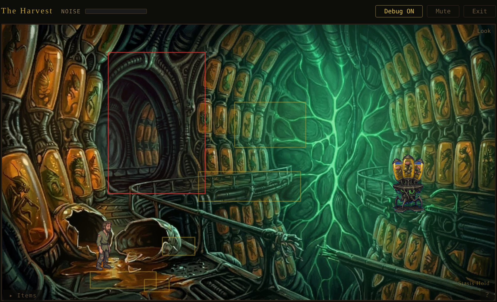
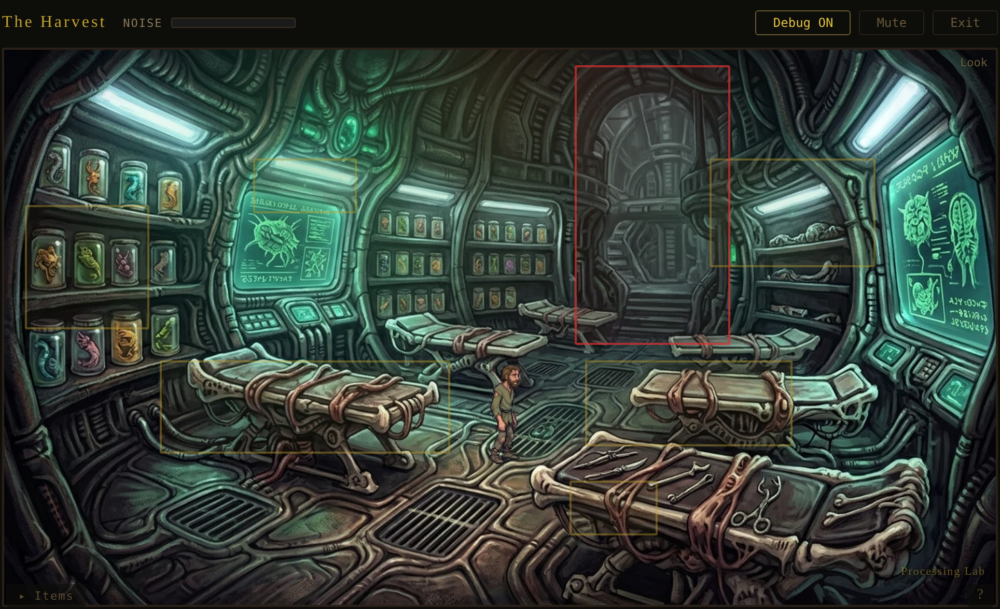
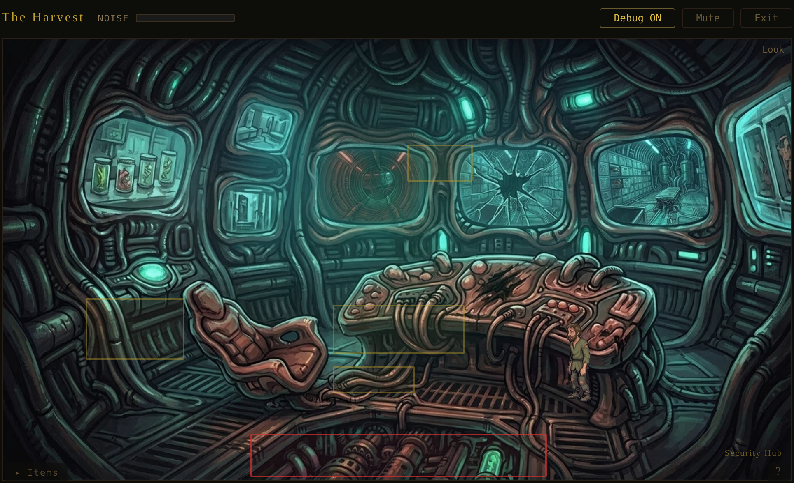
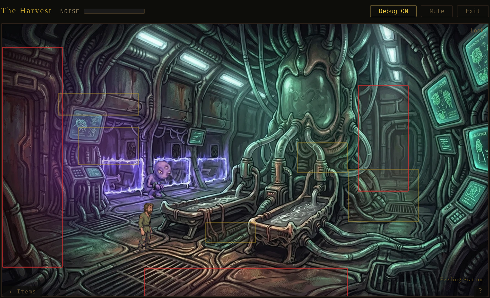
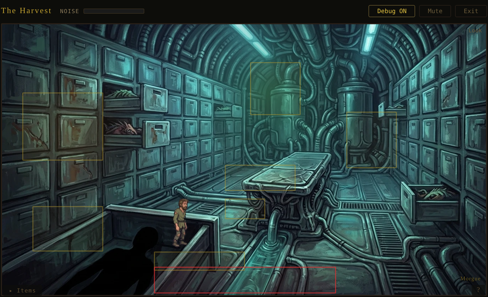
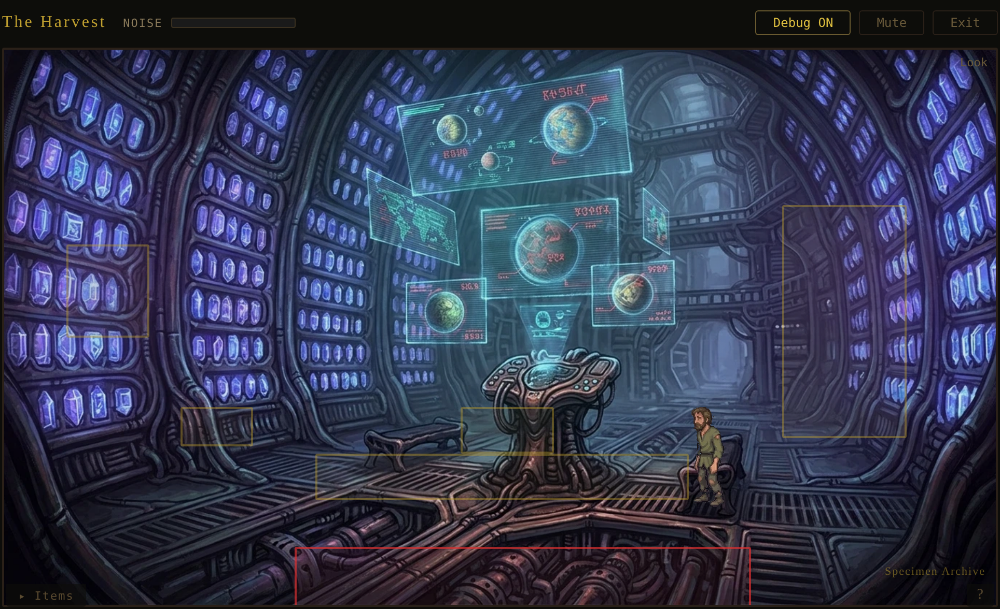
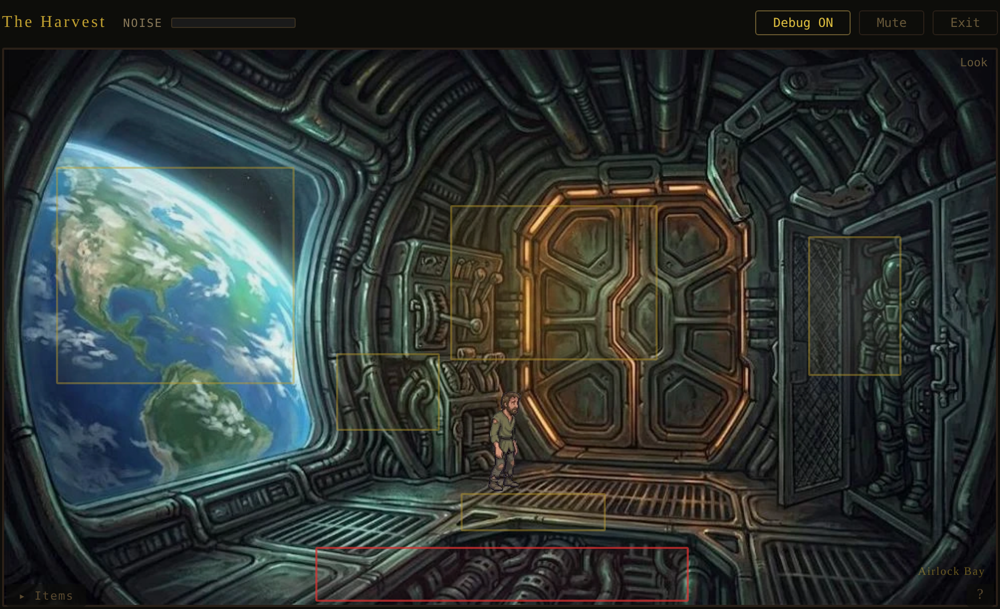

# The Harvest — Act 1 Walkthrough

## Premise

You are a goblin specimen aboard an alien harvester ship belonging to the Choir — a hive-mind species that collects and processes life forms from across the galaxy. You wake in a shattered stasis pod on the containment deck. Your ship, the Outrider, brought you here. Now you need to understand where you are, gather tools and knowledge, and find a way off this deck.

Act 1 takes place entirely on the containment deck: 14 interconnected rooms (including a 6-room ventilation maze) with 11 collectible items, multiple knowledge flags, one branching NPC conversation, and two lethal hazards. The critical path below gets you through every room and sets you up for Act 2.

> **Note**: This walkthrough covers the critical path only. Every room has additional LOOK interactions that build atmosphere and lore — explore freely. You can't softlock yourself; everything is recoverable.

---

## Deck Map

```
                    ┌──────────────┐
                    │ STASIS HOLD  │ ← START (3 items + code 7319)
                    │   ◆◆◆ ✦     │
                    └──────┬───────┘
                           │ Dark Archway
                    ┌──────┴───────┐
      Left Door ┌───│  CONTAINMENT │───┐ Right Door
                │   │  CORRIDOR    │   │
                │   │   (hub)  ✦   │   │
                │   └───┬──┬───────┘   │
                │       │  │ Far End   │
        ┌───────┴────┐  │  │   ┌───────┴──────┐
        │ PROCESSING │  │  │   │ SECURITY     │
        │ LAB        │  │  │   │ HUB          │
        │  ◆ ✧       │  │  │   │  ◆ ✧✧ ✦     │
        └────────────┘  │  │   └──────────────┘
                        │  │
           Floor Vent ──┘  │
          (needs security  │
           override)       │
                    ┌──────┴───────┐
      Left     ┌───│  FEEDING     │───┐ Right
      Passage  │   │  STATION     │   │ Passage
               │   │  ◆ ♦         │   │
               │   └──────────────┘   │
               │                      │
        ┌──────┴───────┐       ┌──────┴──────┐
        │ MORGUE       │       │ SPECIMEN    │
        │  ◆ ✧         │       │ ARCHIVE     │
        └──────────────┘       │  ◆ ✧✧ ✦     │
                               └─────────────┘

                   ┌──────────────┐
                   │ VENT ENTRY   │ ← via corridor vent
                   │  ◆           │
                   └──────┬───────┘
                          │
                   ┌──────┴───────┐
          Left ┌───│ VENT JUNCTION│───┐ Right
               │   └──────────────┘   │
        ┌──────┴───────┐       ┌──────┴──────┐
        │ GAS CHAMBER  │       │ COLLAPSED   │
        │  ☠ (helmet)  │       │ SECTION ◆   │
        └──────┬───────┘       │ (dead end)  │
               │               └─────────────┘
        ┌──────┴───────┐
        │ FAN ROOM     │
        │  ☠ (probe)   │
        └──────┬───────┘
               │
        ┌──────┴───────┐
        │ EXIT PASSAGE │
        │  ✧ (stars!)  │
        └──────┬───────┘
               │
        ┌──────┴───────┐
        │ AIRLOCK BAY  │ ← EXIT
        │  ✧✧ ✦        │
        └──────────────┘

  ◆ = collectible item    ✧ = knowledge flag
  ✦ = puzzle/gate          ♦ = NPC dialogue
  ☠ = hazard (can kill!)
```

## Critical Path (20 Steps)

| # | Room | Action | Result |
|---|------|--------|--------|
| 1 | Stasis Hold | HAND Broken Pod | `pod_glass_shard` |
| 2 | Stasis Hold | HAND Drainage Channel | `stasis_fluid_vial` |
| 3 | Stasis Hold | HAND Specimen Tag Hook | `specimen_tag` |
| 4 | Stasis Hold | HAND Cataloguer Robot | `lab_code_known` (code 7-3-1-9) |
| 5 | Corridor | MOVE Dark Archway | Reach hub |
| 6 | Processing Lab | LOOK Lab Screens | `security_sequence_known` |
| 7 | Processing Lab | HAND Instrument Rack | `surgical_probe` |
| 8 | Security Hub | HAND Console (x2) | `security_hub_accessed`, `security_locks_overridden` (+20 noise) |
| 9 | Security Hub | HAND Key Card Drawer | `containment_key_card` |
| 10 | Feeding Station | HAND Nutrient Dispenser | `nutrient_paste_tube` |
| 11 | Feeding Station | TALK Caged Prisoner | `prisoner_bond` (4 branches) |
| 12 | Morgue | HAND Neural Tendril | `severed_neural_tendril` |
| 13 | Morgue | LOOK Dead Goblin | `dead_goblin_seen` |
| 14 | Specimen Archive | HAND Misplaced Crystal | `data_crystal_personal_log` |
| 15 | Specimen Archive | USE crystal ON Reader | `archive_accessed` |
| 16 | Specimen Archive | LOOK Holographic Display | `convergence_history_known` |
| 17 | Ventilation Entry | HAND Wall Scratches | `ventilation_map` |
| 18 | Vent Junction | GO LEFT | Correct path (map says so) |
| 19 | Gas Chamber | MOVE forward (need helmet!) | Survive gas |
| 20 | Fan Room | USE surgical_probe ON mechanism | Jam fan (probe consumed!) |
| 21 | Fan Room | MOVE through jammed fan | Reach exit |
| 22 | Exit Passage | LOOK crack in wall | Stars! First view outside |
| 23 | Exit Passage | MOVE through hatch | Drop to airlock |
| 24 | Airlock Bay | USE key_card ON Override | Open airlock controls |
| 25 | Airlock Bay | LOOK Viewport + Clamps | `outrider_gone_known`, `airlock_visited` |

---

## Room-by-Room Walkthrough

### 1. Stasis Hold (Starting Room)

You wake here among rows of specimen pods. Three items and a key puzzle clue are within reach.

- **HAND the Broken Pod** — Snap off a curved shard of pod glass. Razor-sharp alien composite. *(Gains: `pod_glass_shard`)*
- **HAND the Pod Drainage Channel** — Scoop amber stasis fluid from the floor channel. *(Gains: `stasis_fluid_vial`)*
- **HAND the Specimen Tag Hook** — Tear your specimen tag from the pod frame. Proof you were cataloged. *(Gains: `specimen_tag`)*
- **HAND the Cataloguer Robot** — Examine the spider-legged drone's specimen jars. Each data plate shows a shared section code: **7-3-1-9**. That's the access code for the processing lab keypad. *(Sets flag: `lab_code_known`)*

> **Easy to miss**: LOOKing at the cataloguer only hints at the codes on the data plates. You must HAND it (lean in and study the plates) to actually memorize the pattern.



**Also in this room**: Occupied Pods, Walkway Railing — LOOK interactions for atmosphere. The Cataloguer Robot also shows a closeup of three preserved specimen tanks when examined.

MOVE through the Dark Archway to reach the **Containment Corridor**.

---

### 2. Containment Corridor (Hub)

The central hallway connecting most of the deck. Five exits lead to: Stasis Hold, Processing Lab, Security Hub, Feeding Station, and the Ventilation Shaft (via a floor grate that's locked until you override security). No items to collect here, but LOOK at the drag marks and emergency panel for story context.

Head to the **Processing Lab** first.

---

### 3. Processing Lab

- **LOOK at the Lab Startup Display** — The screens cycle through processing routines. One shows a startup sequence for the security systems — five-button pattern with specific timing. You memorize it. *(Sets flag: `security_sequence_known`)*
- **HAND the Instrument Rack** — Take the smallest surgical instrument: a probe with a fine, flexible tip. *(Gains: `surgical_probe`)*



**Also here**: Examination Tables, Sample Jars, Anatomy Display, Restraint Straps — all with LOOK flavor text.

Return to the Corridor and head to the **Security Hub**.

---

### 4. Security Hub

This is a two-step interaction. You need the security sequence from the lab (Step 3) before the console will activate.

- **HAND the Security Console** (first time) — Enter the startup sequence. The console hums to life, revealing a full ship layout. *(Sets flags: `security_hub_accessed`, `ship_layout_known`)*
- **HAND the Security Console** (second time) — Trigger the containment lock override. Every sealed door on the deck clicks open. The Curator will notice. *(Sets flag: `security_locks_overridden`; adds 20 noise)*
- **HAND the Key Card Drawer** — Pull out a bio-organic containment key card. *(Gains: `containment_key_card`)*
- **HAND the Emergency Equipment Cabinet** — Smash the cracked glass and grab an alien helmet with universal seals. Too large for you but the atmosphere system works. Essential for surviving the vent maze gas. *(Gains: `emergency_suit_helmet`; sets flag: `emergency_helmet_taken`)*



> **Puzzle chain**: Cataloguer Robot (HAND, for code 7319) → Lab Display (LOOK, for security sequence) → Security Console (HAND twice). If you try the console without the sequence, it just beeps and adds noise.

Return to the Corridor, then head to the **Feeding Station**.

---

### 5. Feeding Station (Secondary Hub)

The feeding station is the second hub with three exits: Morgue, Specimen Archive, and back to the Containment Corridor.

- **HAND the Nutrient Dispenser** — Collect a tube of grey nutrient paste. Disgusting, but Choir drones are attracted to it. *(Gains: `nutrient_paste_tube`)*
- **TALK to the Caged Prisoner** — A four-armed alien creature behind an energy barrier. This triggers the **dialogue choice system** (see branching section below). *(Sets flags: `prisoner_spoken`, `prisoner_bond`, and potentially `airlock_hinted` or `choir_nature_known`)*



---

### 6. Morgue

Accessible from the Feeding Station.

- **HAND the Neural Tendril Sample** — Pick up a severed length of neural tendril. Warm, slightly damp, bio-electric. *(Gains: `severed_neural_tendril`)*
- **LOOK at the Dead Goblin** — A goblin like you, dead in a drawer. Surgical marks cover the body. You are not the first of your kind here. *(Sets flag: `dead_goblin_seen`)*



**Also here**: Morgue Drawers, Autopsy Slab, Recycling Vats, Chemical Cabinet, Drain Channel.

Return to the Feeding Station, then head to the **Specimen Archive**.

---

### 7. Specimen Archive

- **HAND the Personal Log Crystal** — Pocket a data crystal misfiled among specimen records. *(Gains: `data_crystal_personal_log`)*
- **USE the crystal ON the Reading Device** — Select the crystal from your inventory, then click the reading device. Alien text floods the air — diagrams of biological processes, planetary data, convergence timelines. *(Consumes or keeps: `data_crystal_personal_log`)*
- **LOOK at the Holographic Display** — Dozens of miniature planets drift overhead. Almost all marked with the red symbol of the Convergence. The Choir have been doing this to worlds across the galaxy. *(Sets flag: `convergence_history_known`)*



**Also here**: Crystal Rack, Right Crystal Wall, Archive Benches — lore-rich LOOK interactions.

Return to the Feeding Station, then back to the **Containment Corridor**. The ventilation grate in the corridor floor is now unlocked (you overrode security earlier). Head through it to the **Ventilation Shaft**.

---

### 8. Ventilation Shaft Entry

- **HAND the Wall Scratches** — Trace a map scratched into the wall by a previous escapee. The map shows a junction ahead: LEFT (helmet symbol) leads to the airlock, RIGHT is a dead end. *(Gains: `ventilation_map`; sets flag: `ventilation_map_found`)*

**Also here**: Old Remains (bones of a previous escapee), Maintenance Hatch.

Continue forward to the **Vent Junction**.

---

### 9. Vent Junction

A T-shaped intersection. The map (if you have it) guides you: **LEFT is correct** (but hazardous), RIGHT is a dead end.

- **LOOK at the Junction Markings** — With the map, you learn left has a helmet warning and right has dead-end gouges
- **LOOK at the Air Current** — Left smells chemical/dangerous, right smells stale/dead

**Optional detour RIGHT → Collapsed Section**: A dead end with a Choir skeleton holding a glowing datapad. HAND the skeleton to get the **Crew Datapad** (Act 2 lore item). Then return to the junction.

Go LEFT into the **Gas Chamber**.

---

### 10. Gas-Filled Passage ☠

**DANGER**: This room is filled with toxic gas from a cracked bio-pipe. You MUST have the **Emergency Suit Helmet** (from the Security Hub emergency cabinet) to survive.

- Without the helmet: attempting to move forward or touch the corpse = **death**
- With the helmet: you can safely explore and proceed

**MOVE forward** through the gas to reach the **Fan Room**.

---

### 11. Fan Chamber ☠

**DANGER**: A massive spinning fan blocks the passage. Walking into it = **instant death**.

- **LOOK at the Fan** — Blades spinning at lethal speed. No way through while it's running.
- **LOOK at the Fan Mechanism** — Exposed drive mechanism with a narrow gap. Something long, thin, and strong could jam it.
- **USE the Surgical Probe ON the Fan Mechanism** — The probe jams the gears! The fan locks. The probe is destroyed but the blades stop. *(Consumes: `surgical_probe`; sets flag: `fan_jammed`)*
- **MOVE through the jammed Fan** — Squeeze between the stilled blades to the **Exit Passage**.

> **Warning**: The surgical probe is permanently consumed here. Make sure you've used it for anything else you need first (security keypad prying, etc.).

---

### 12. Exit Passage

The final stretch before freedom. A moment of quiet after the maze.

- **LOOK at the Crack in Wall** — Stars! The first view outside the ship. Beautiful and terrifying.

**MOVE through the Exit Hatch** to drop into the **Airlock Bay**.

---

### 13. Airlock Bay

- **USE the Containment Key Card ON the Airlock Override Panel** — The key card interfaces with the lock, opening the override panel. *(Uses: `containment_key_card`)*
- **LOOK at the Empty Docking Clamps** — Your ship, the Outrider, was jettisoned. The docking clamps are empty. There is no easy way home. *(Sets flag: `outrider_gone_known`)*
- **LOOK at the Viewport** — The planet below is beautiful from orbit. But thin energy beams descend from the ship to the surface. The Convergence is already feeding. *(Sets flag: `airlock_visited`)*



---

## Prisoner Dialogue Branching

When you TALK to the caged prisoner, you get four dialogue choices. Each sets a different `prisoner_bond` value and may unlock additional knowledge flags. **You can only choose one per playthrough.**

| Choice | Bond | Extra Flags | What You Learn |
|--------|------|-------------|----------------|
| "We're both prisoners here, aren't we?" | `empathy` | — | Emotional connection. The creature mirrors your gestures. A foundation of trust. |
| "Do you know a way out of here?" | `pragmatic` | `airlock_hinted` | The creature maps the ship layout with gestures, pointing toward the airlock. Practical escape intel. |
| "What are they? The ones who put us here?" | `knowledge` | `choir_nature_known` | The creature reveals the Choir ARE the ship — not just passengers. The vessel is alive. |
| [Say nothing — just nod] | `silent` | — | Respectful silence. The creature nods back. Minimal information, but no missteps. |

The `prisoner_bond` value affects all subsequent interactions with the prisoner and may gate dialogue in later acts.

---

## Inventory Checklist

All 11 collectible items in Act 1:

| # | Item | Source Room | How |
|---|------|-------------|-----|
| 1 | Pod Glass Shard | Stasis Hold | HAND Broken Pod |
| 2 | Stasis Fluid Vial | Stasis Hold | HAND Pod Drainage Channel |
| 3 | Specimen Tag | Stasis Hold | HAND Specimen Tag Hook |
| 4 | Surgical Probe | Processing Lab | HAND Instrument Rack |
| 5 | Containment Key Card | Security Hub | HAND Key Card Drawer |
| 6 | Emergency Suit Helmet | Security Hub | HAND Emergency Cabinet |
| 7 | Nutrient Paste Tube | Feeding Station | HAND Nutrient Dispenser |
| 8 | Severed Neural Tendril | Morgue | HAND Neural Tendril Sample |
| 9 | Personal Log Crystal | Specimen Archive | HAND Personal Log Crystal |
| 10 | Ventilation Map | Vent Entry | HAND Wall Scratches |
| 11 | Crew Datapad (optional) | Collapsed Section | HAND Skeleton |

> **Note**: The surgical probe is consumed when jamming the vent fan (step 20). Make sure you've done everything you need with it first.

---

## Knowledge Flags Checklist

| Flag | How to Set | Required? |
|------|-----------|-----------|
| `lab_code_known` | HAND Cataloguer Robot in Stasis Hold | Section code 7319 for Processing Lab |
| `security_sequence_known` | LOOK Lab Startup Display in Processing Lab | Yes — needed for security console |
| `security_hub_accessed` | HAND Security Console (with sequence) | Yes — unlocks ship layout |
| `security_locks_overridden` | HAND Security Console again (when active) | Yes — opens all doors |
| `ship_layout_known` | Set automatically with security_hub_accessed | Yes |
| `dead_goblin_seen` | LOOK Dead Goblin in Morgue | Story flag |
| `prisoner_spoken` | TALK to Caged Prisoner | Story flag |
| `convergence_history_known` | LOOK Holographic Display in Archive | Story flag |
| `ventilation_map_found` | HAND Wall Scratches in Vent Entry | Yes — maze navigation |
| `fan_jammed` | USE surgical_probe ON Fan Mechanism | Yes — opens vent path |
| `crew_datapad_found` | HAND Skeleton in Collapsed Section | Optional — Act 2 lore |
| `airlock_visited` | LOOK Viewport in Airlock Bay | Story flag |
| `outrider_gone_known` | LOOK Empty Docking Clamps in Airlock Bay | Story flag |
| `airlock_hinted` | Prisoner dialogue: "way out" choice only | Branch-dependent |
| `choir_nature_known` | Prisoner dialogue: "what are they" choice only | Branch-dependent |

---

## Tips for Stuck Players

1. **"The security console won't activate"** — You need the startup sequence from the Processing Lab (LOOK at the Lab Startup Display). Without it, pressing buttons just triggers alarms. The section code from the Cataloguer Robot in Stasis Hold (HAND to study data plates) is separate knowledge for the Processing Lab keypad.

2. **"How do I get the code 7-3-1-9?"** — LOOKing at the Cataloguer Robot only hints at the codes on its data plates. You must HAND it (lean in and study the plates) to actually memorize the pattern.

3. **"How do I use inventory items?"** — Click an item in your inventory to select it (it highlights), then click a world object to USE it on. The engine handles the `use_item` verb automatically. Used for: crystal on reading device, key card on airlock panel.

4. **"I can't reach the Morgue or Archive"** — Both are accessible from the Feeding Station, not the Containment Corridor. The Corridor leads to: Stasis Hold, Processing Lab, Security Hub, and Feeding Station. From the Feeding Station you reach: Morgue, Archive, and back to Corridor.

5. **"I can't get into the ventilation shaft"** — The vent grate is in the Containment Corridor floor, but it's locked by the containment security system. You need to override security first (Security Hub → HAND Console twice to trigger the lock override). Once `security_locks_overridden` is set, the grate opens.

6. **"I keep dying in the vent maze"** — Two hazards: toxic gas (need the Emergency Suit Helmet from the Security Hub cabinet) and a spinning fan (need the Surgical Probe to jam the mechanism). Get both items BEFORE entering the vents. The ventilation map (from Wall Scratches in the vent entry) tells you which path is safe.

7. **"Which way at the vent junction?"** — LEFT leads to the airlock (through gas chamber and fan room). RIGHT is a dead end with an optional lore item. If you have the ventilation map, LOOK at the junction markings for clear directions.

8. **"I used the surgical probe and now I'm stuck"** — The probe is consumed when you jam the fan. If you still need it for something else, reload. But in the normal flow, the fan is the probe's final purpose — you should have already used it at the security keypad.

9. **"The prisoner won't talk to me"** — Make sure you're using the TALK verb, not HAND or LOOK. The dialogue choice modal appears after the initial greeting.

10. **"I explored everything but nothing seems to happen"** — Act 1 is about gathering items and knowledge. There's no timed pressure (the Curator exists but isn't active in this act). Take your time, LOOK at everything, and make sure you've visited all rooms including the vent maze.

---

*This walkthrough was generated from automated Playwright testing of the scenario JSON. All steps verified as completable. Last tested: October 2026.*
