# The Harvest — Act 1 Walkthrough

> You wake in a cracked stasis pod aboard a living alien harvesting ship. Escape the containment deck: cross a broken walkway to learn a code written in alien glyphs, use it to arm the deck's emergency override, crawl through a ventilation maze past poison gas and a giant fan, and reach the Airlock Bay. On the way you'll learn where the ship is heading next.

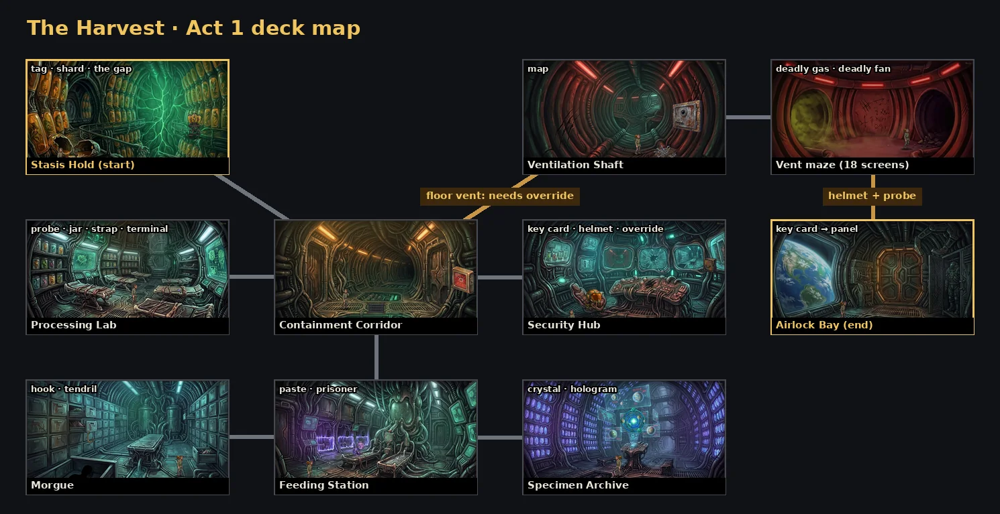

| Act 1 at a glance | |
|---|---|
| Screens | 62: 8 rooms, 3 close-ups, 51 vent screens (shaft, junction, 45 ducts, 4 special chambers) |
| Items | 17 (6 required, 1 strongly recommended, 10 optional) |
| Puzzles | Grappling line (craft), glyph keypad (code), emergency override, vent maze (map), gas (helmet), fan (probe) |
| Deaths | 5 kinds (jump the gap; cross the gas without a helmet; walk into the fan; crawl into one of 3 purge ducts) |
| Shortest win | 40 actions (18 of them in the maze) |
| Soft-locks | None: every reachable state can still finish the act (exhaustive search with the real engine) |

All screenshots on this page come from a scripted playthrough of the current build (`scripts/playthrough/`). Images are rebuilt by `scripts/build_walkthrough_images.py`.

---

## How to play

- **Verbs:** right-click cycles the cursor through **Look**, **Move** (feet), **Hand** and **Talk**; the current verb shows at the top right. Left-click uses it.
- **Items:** open the **Items** tray under the picture, click an item to select it, then click something in the room to use it there. Click two items in a row to combine them.
- **Hints:** the **?** button gives a hint for the room you're in, based on what you've done so far.
- **Dev mode:** add `?dev` to the URL for a room-jump panel, hotspot outlines and intro skip.

---

## The short version

1. **Stasis Hold.** HAND the **Specimen Tag** on your pod and the **Broken Pod** (glass shard). The cataloguer robot is across a torn gap in the walkway. Don't HAND the gap: you'll try to jump and die.
2. **Processing Lab** (Corridor → left door). HAND the **Instrument Rack** (surgical probe) and the **Sample Jars** (empty jar). USE the **probe** ON the **Restraint Straps** to cut one free (you keep the probe).
3. **Security Hub** (Corridor → right door). HAND the **Key Card Drawer** on the right wall (key card) and the **Emergency Cabinet** (helmet).
4. **Morgue** (Corridor → far end → Feeding Station → left). HAND the **Carcass Hook** in the open drawer.
5. **Combine** the **Restraint Strap** and the **Carcass Hook** → **Grappling Line**.
6. **Stasis Hold.** USE the **Grappling Line** ON the gap to rig it, HAND the rigged line to climb across to the cataloguer's ledge, then LOOK at the cataloguer robot. The specimen displays show the code: **fern, double curl, sprouting snake, sprouting snake**.
7. **Processing Lab.** LOOK (or HAND) the screens to reach the terminal. HAND the keypad and press the four glyphs in that order. The terminal reports that the **emergency override is armed**.
8. **Security Hub.** LOOK (or HAND) the console. HAND the glowing red **override button**: every lock on the deck opens.
9. **Corridor.** MOVE into the floor vent. In the shaft, HAND the **wall scratches** (map).
10. **Vent maze.** It's big and it loops. LOOK at the map in your inventory and count your turns from the junction (route below). Never crawl into a scorched duct. The helmet gets you through the gas. USE the **probe** ON the **fan mechanism** to jam the fan, then MOVE through it, then MOVE through the hatch.
11. **Airlock Bay.** USE the **key card** ON the **override panel**: the window shutters open on Earth. Click the view of Earth for the **End of Act 1** screen and your score.

---

## Puzzle dependencies

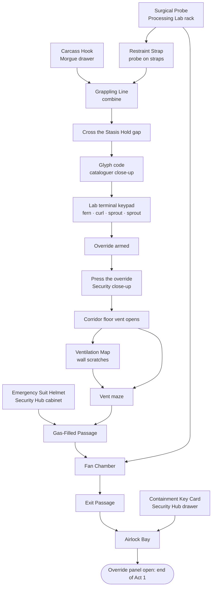

The code is a **knowledge gate**: you can try to brute-force the keypad (4,096 combinations), but wrong entries add noise and every sixth one sets off an alarm. The game nudges you to go and find where the glyphs are written down.

---

## Room by room

### 1. Stasis Hold (start)

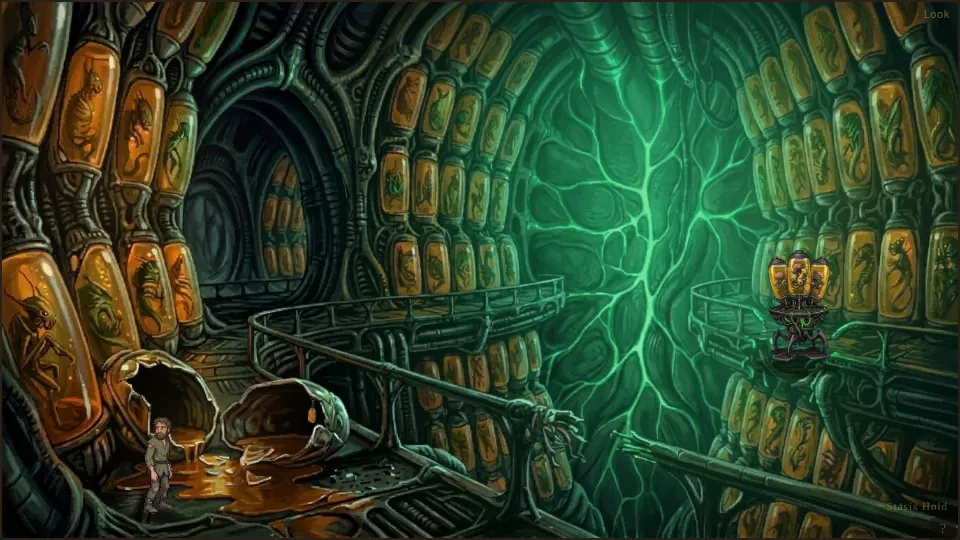

- **HAND Specimen Tag** → *Specimen Tag* (optional lore: use it on the archive reader or the lab terminal's right screen).
- **HAND Broken Pod** → *Pod Glass Shard* (optional: cuts open the growth in the Processing Lab later).
- **The gap.** LOOK tells you the far railing looks solid. HAND kills you. The answer is a grappling line (step 5).
- **Drainage channel.** HAND fails (the fluid slips through your fingers). USE the *Empty Sample Jar* on it for a *Stasis Fluid Vial* (optional).

After you rig the line, the strap stays across the gap. HAND it and you climb across to the robot's ledge (HAND it again to climb back; the exit can't be reached from the ledge):

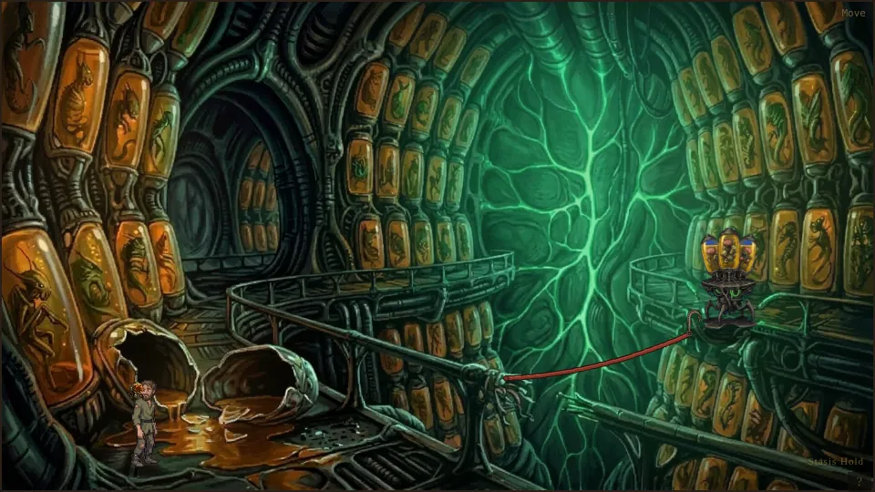

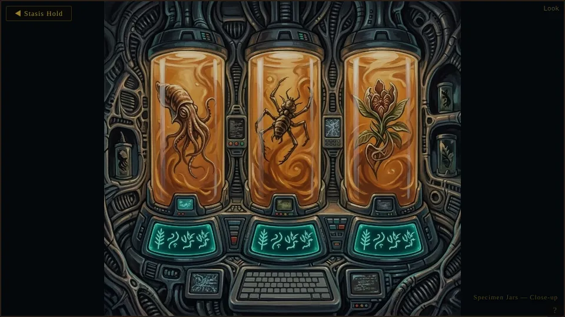

LOOK or HAND the robot to open the **specimen close-up**. Every display shows the same four glyphs in the same order: **fern, double curl, sprouting snake, sprouting snake**.

### 2. Containment Corridor (hub)

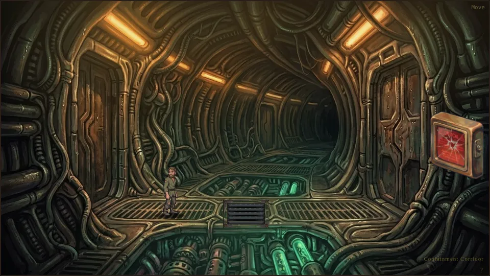

Five exits: Stasis Hold (back), Processing Lab (left), Security Hub (right), Feeding Station (far end) and the **floor vent**, which stays locked until you press the override.

**Come back later:** on your second visit a black cat is sitting near the right wall. HAND it for *Shadow Cat Fur* (optional lore).

### 3. Processing Lab

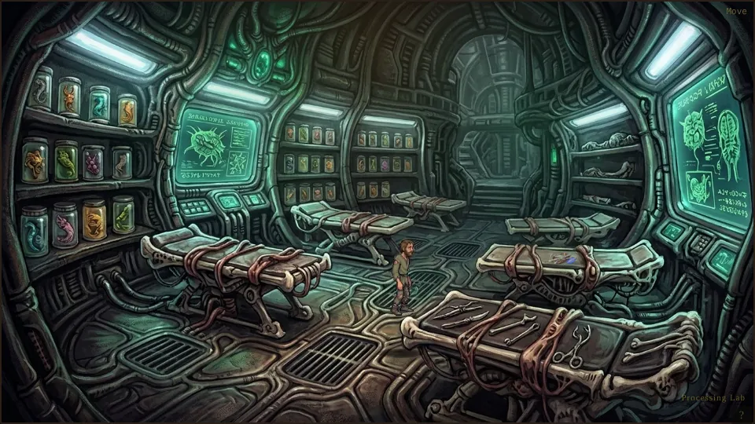

- **HAND Instrument Rack** → *Surgical Probe*. **Required twice**: it cuts the strap (kept) and jams the fan (used up there).
- **HAND Sample Jars** → *Empty Sample Jar*.
- **USE Surgical Probe ON Restraint Straps** → *Restraint Strap*. HAND says they're too strong to tear, and the glass shard skates off them.
- **LOOK or HAND the screens** → the **Lab Terminal close-up**.

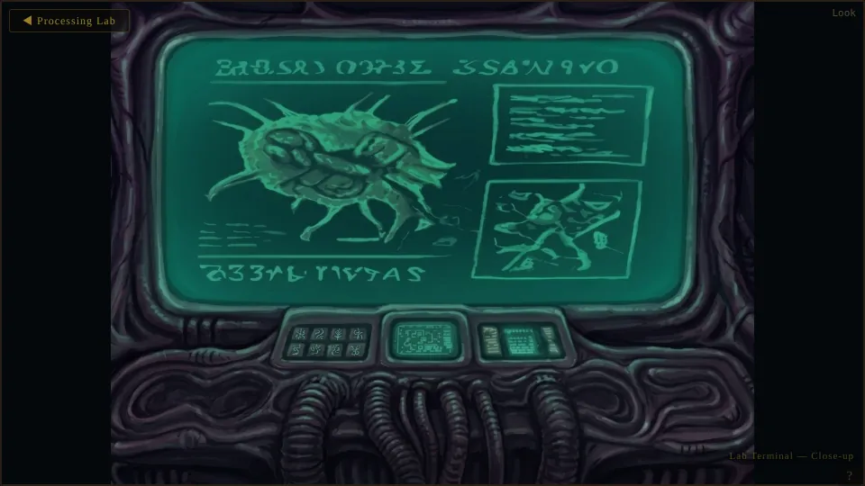

HAND the keypad: eight glyph keys, four slots. A wrong code flashes red and costs a little noise:

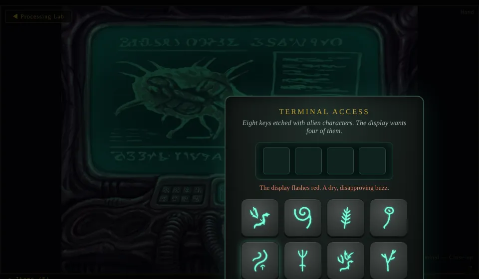

Enter **fern, double curl, sprouting snake, sprouting snake** and the terminal unlocks. A line of red script reports that the emergency override at the security console is **armed**. LOOK at the screen afterwards for the big reveal: the ship's next harvesting stop is Earth.

**Come back later:** the lab changes while you're away. Fresh drag marks appear on your second visit, and a patch of glowing growth on the wall on your third. USE the glass shard on the growth to find a message from a previous prisoner, and USE the cat fur on the examination tables to learn what happened to the cat.

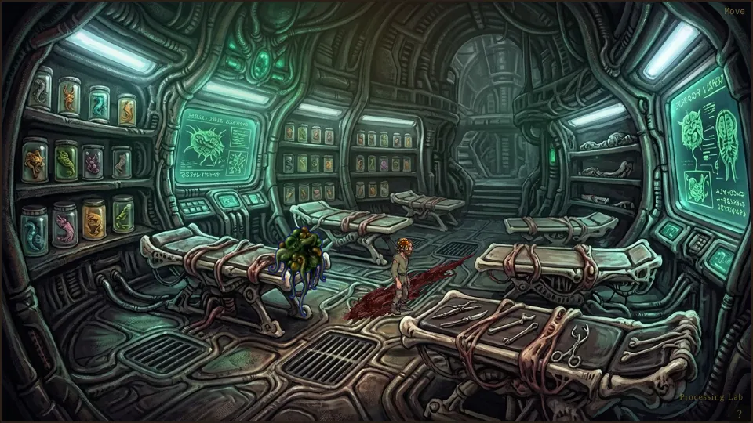

### 4. Security Hub

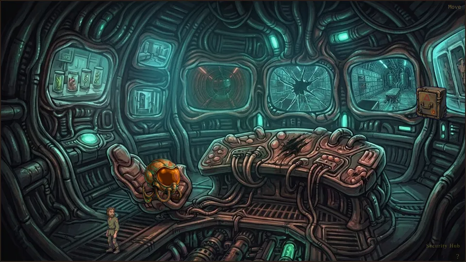

- **HAND Key Card Drawer** (the tan box on the right wall) → *Containment Key Card*. **Required** for the airlock at the end.
- **HAND Emergency Cabinet** → *Emergency Suit Helmet*. **Required** for the gas. Taking it switches your character to the helmeted sprites.
- **LOOK or HAND the console** → the **Security close-up**.

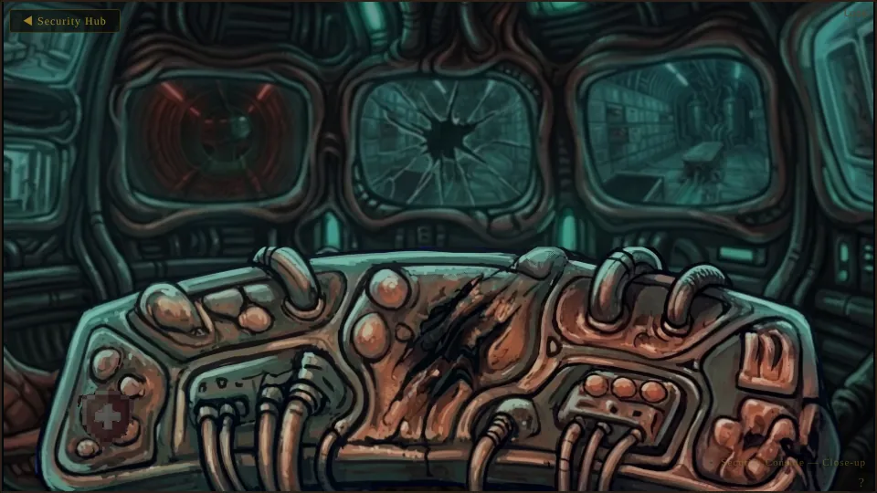

The red **override button** (lower left) is dark until you unlock the lab terminal; pressing it does nothing. The right-hand screen is a live camera feed (LOOK to see the Curator on patrol); the red screen on the left is the deck status.

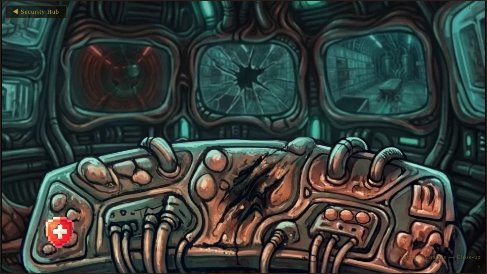

Once armed it glows. HAND it: every containment lock on the deck opens, including the corridor floor vent (+20 noise).

### 5. Feeding Station (second hub)

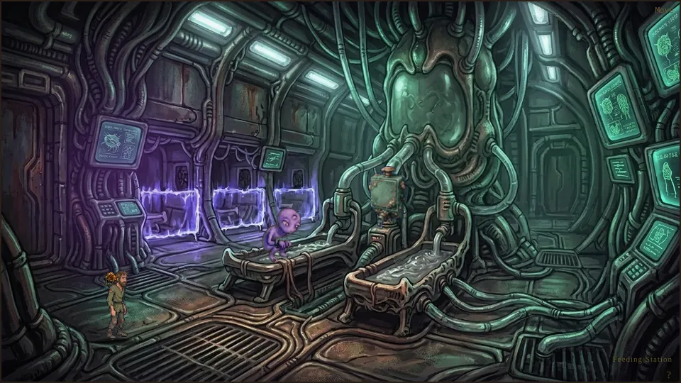

Exits: Morgue (left), Specimen Archive (right), Corridor (back).

- **HAND Nutrient Dispenser** → *Nutrient Paste Tube* (optional; feed it to the prisoner, or keep it for crafting later).
- **TALK to the caged prisoner** → your first answer sets your bond (see Prisoner dialogue below). TALK again for more: ask about the ducts, or **promise to free it**.
- **Come back after pressing the override**: the override drops the energy barriers too, and the prisoner escapes. If you promised to free it (or fed it), it leaves the **safe duct route scratched into its cage floor**. HAND the scratches to copy them, and the hint button in the ducts will tell you every turn.

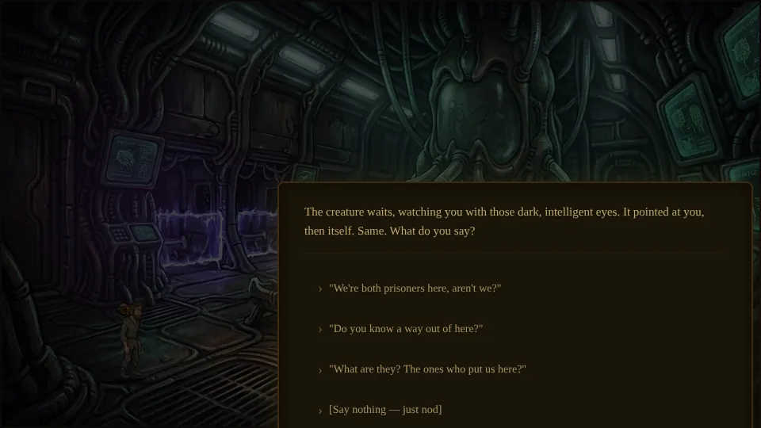

### 6. Morgue

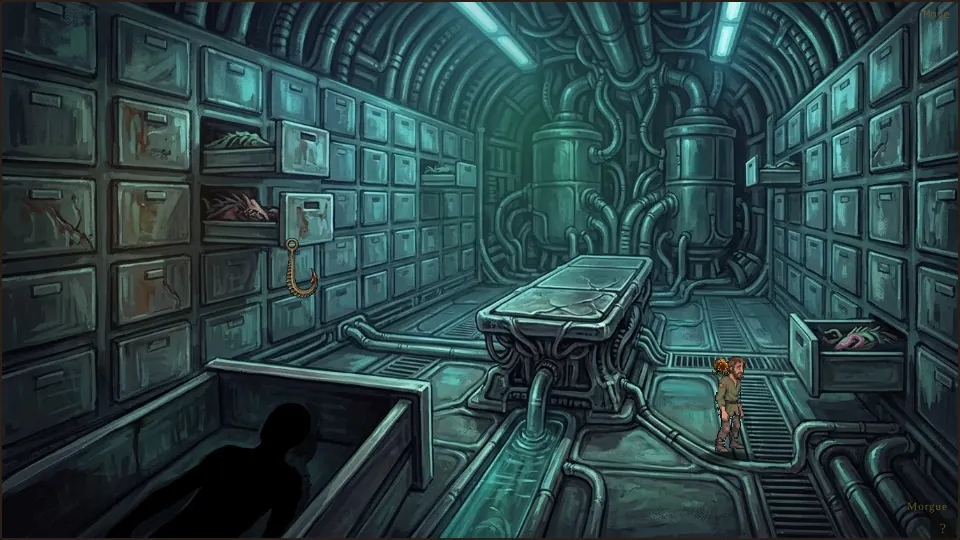

- **HAND Carcass Hook** (in the lip of the open drawer, upper left) → *Carcass Hook*. **Required** for the grappling line.
- **HAND Severed Neural Tendril** → optional, but it pays off in later acts.
- LOOK in the open drawer: you weren't the first specimen to wake up.

### 7. Specimen Archive

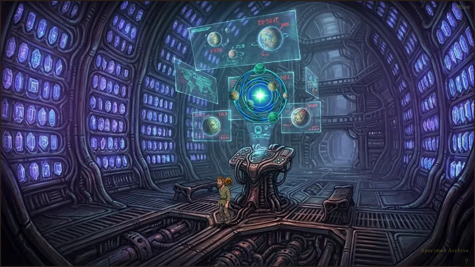

- **HAND the misplaced crystal** on the left rack → *Data Crystal — Personal Log*. USE it on the **reading device** for a Choir officer's journal.
- **LOOK at the hologram** (the spinning globe above the pedestal) for the Convergence's history. USE the tendril on it to see where the ship is going.

### 8. Ventilation Shaft

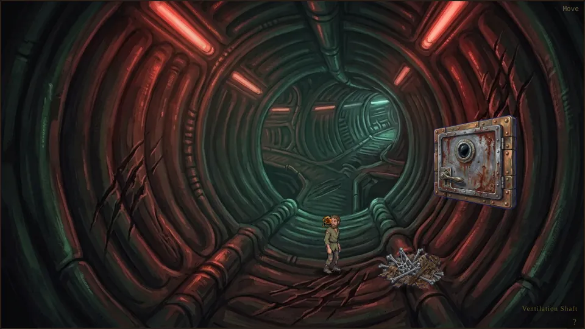

- **HAND the wall scratches** → *Ventilation Map*. LOOK at it in your inventory to see the whole maze. Strongly recommended.
- Forward leads to the junction; back leads up into the corridor.

### 9. The vent maze

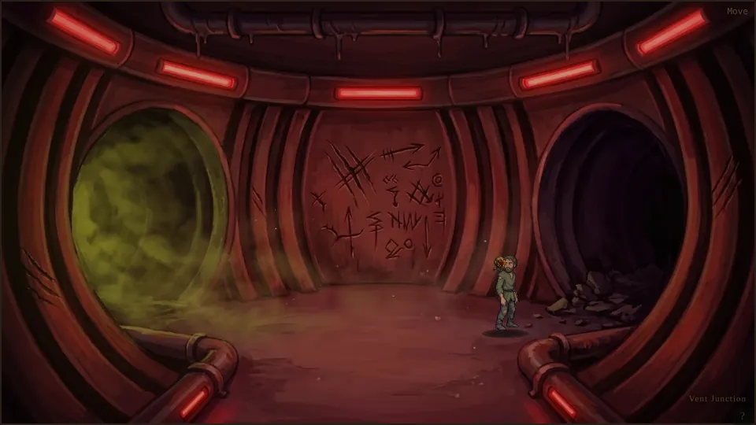

The ducts are a fixed-compass maze: **the camera always faces north**, so the tunnel straight ahead is north, the left opening is west, the right opening is east and the bottom edge (back) is south. There are 45 duct screens that look alike, 6 loops, 6 dead ends and 3 **purge ducts** that kill you. The map from the wall scratches shows the whole grid but not where you are, so keep count of your turns.

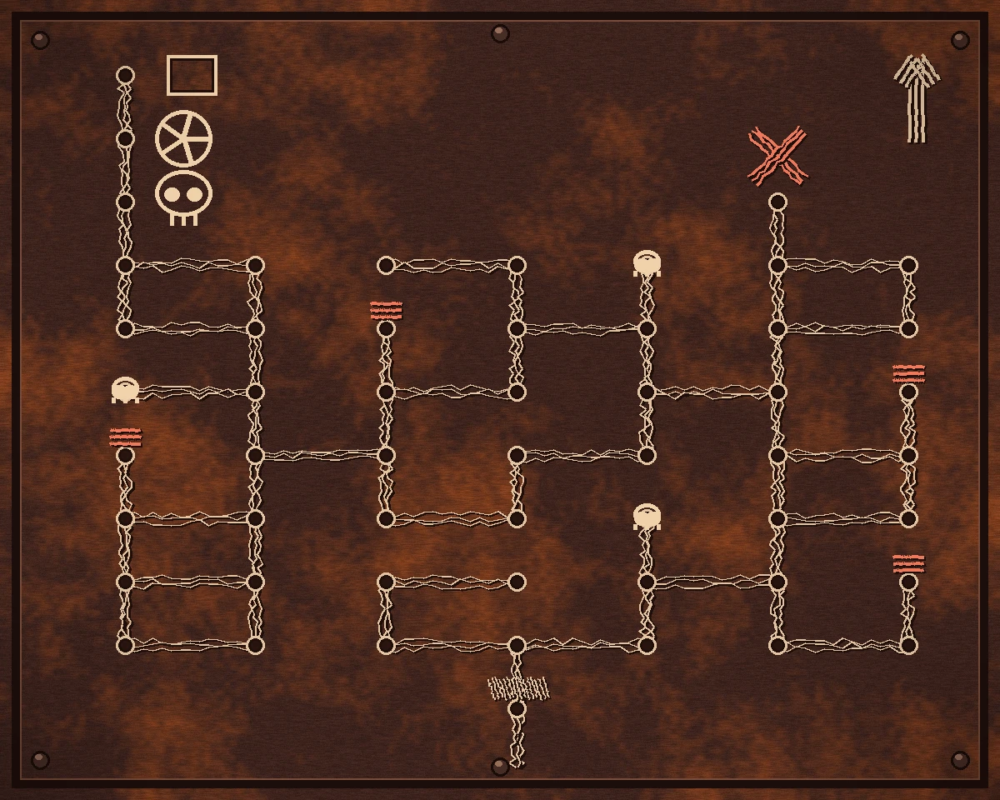

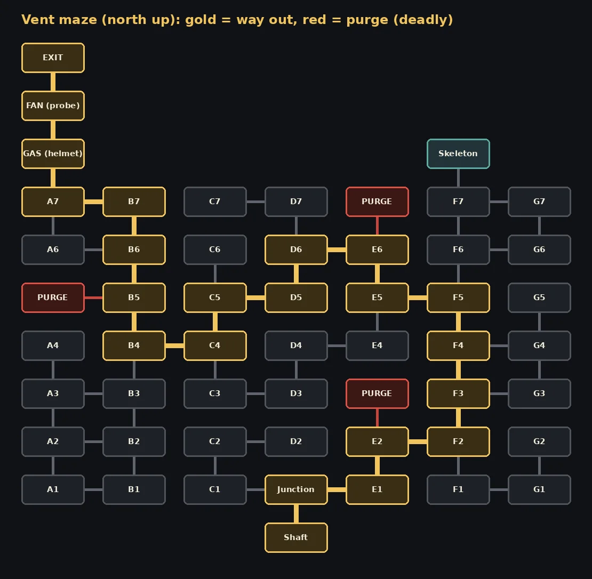

**The way out (gold), 18 moves from the junction:** right (east), ahead, right, ahead, ahead, ahead, left, ahead, left, **back**, left, **back**, left, ahead, ahead, ahead, left, ahead into the gas. (In compass terms: E, N, E, N, N, N, W, N, W, S, W, S, W, N, N, N, W, N.) Yes, it doubles back twice.

**Purge ducts:** if an opening breathes scalding air and its mouth is scorched black (LOOK to check), don't go in. They're the small skulls on the map.

**The skeleton (optional):** right (east), ahead, right, then ahead six times to the Collapsed Section in the north-east. HAND the skeleton for the *Crew Datapad*, and again for the hidden *Choir Access Chip*, which opens the Act 2 Shuttle Bay silently. Come back the same way, reversed.

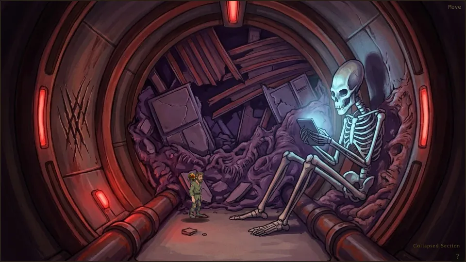

### 10. Gas-Filled Passage

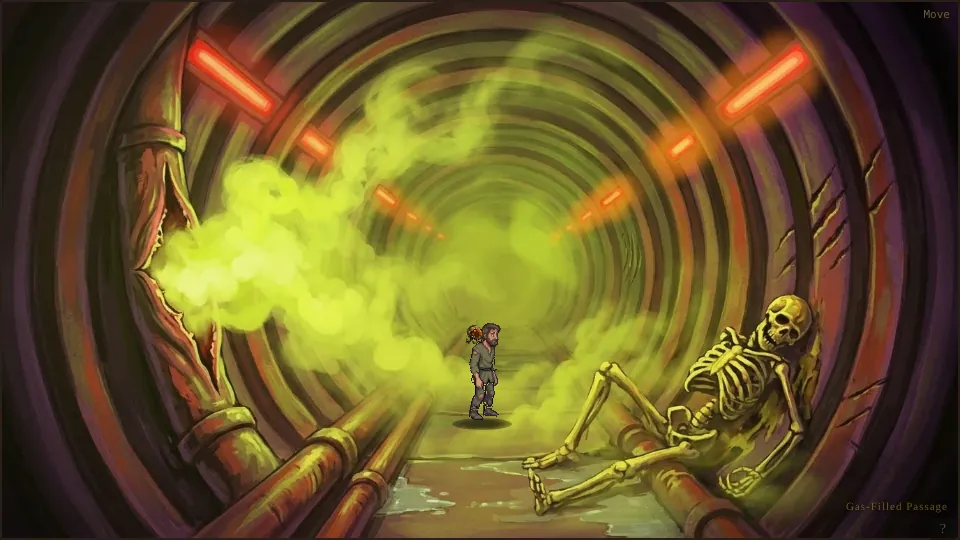

With the helmet, MOVE forward: the visor seals and you walk through. Without it you die (both directions).

### 11. Fan Chamber

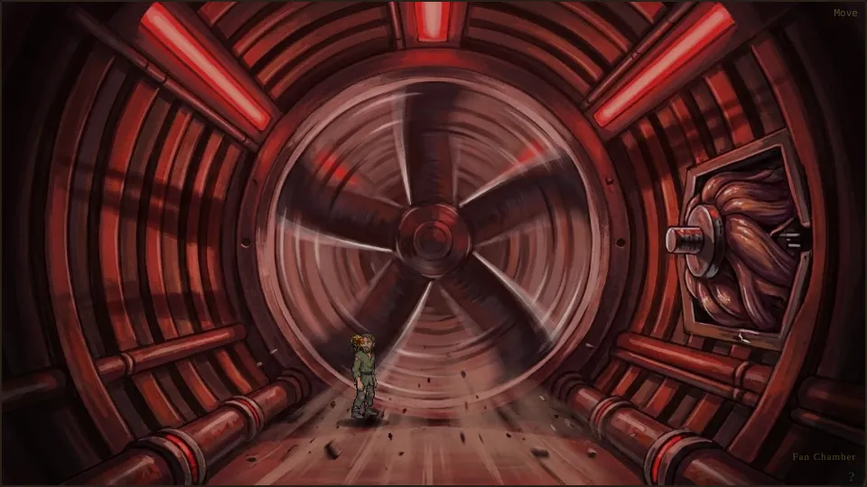

USE the **Surgical Probe** ON the **fan mechanism** (right side) to jam the blades (the probe is used up). Then MOVE into the fan to squeeze through. Walk in while it's spinning and you die.

### 12. Exit Passage

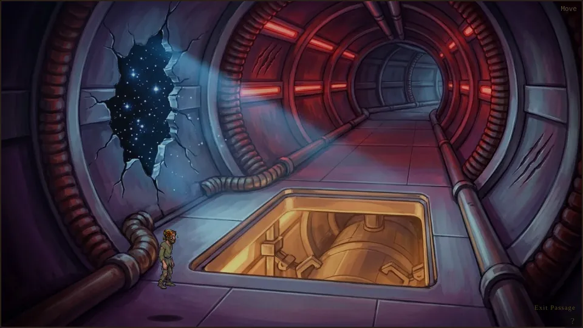

LOOK through the crack: stars. MOVE through the hatch to drop into the Airlock Bay.

### 13. Airlock Bay (end of Act 1)

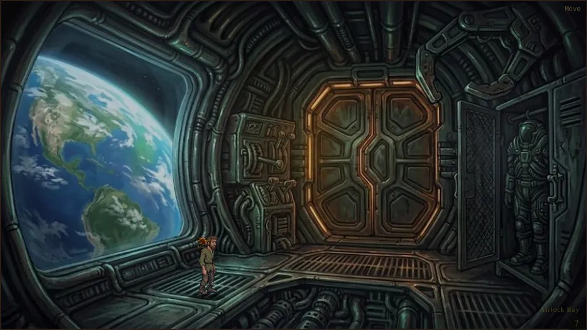

LOOK at the viewport (the planet and the energy siphons) and the empty docking clamps (your ship, the *Outrider*, is gone). USE the **Containment Key Card** ON the **override panel**. The shutters fold back from the great window and you see Earth with the siphon beams falling on it; click it for the **End of Act 1** screen, with your score out of 95.

---

## Where you can die

| Where | How | How to survive |
|---|---|---|
| Stasis Hold | HAND the walkway gap (you try to jump) | Cross with the grappling line |
| Gas-Filled Passage | MOVE forward without the helmet | Take the helmet from the Security Hub cabinet first |
| Gas-Filled Passage | MOVE back through the gas without the helmet | Same |
| Fan Chamber | MOVE into the fan before jamming it | USE the probe on the fan mechanism first |
| Vent maze | Crawl into a purge duct (3 of them) | LOOK first: scorched, breathing hot air. They're skulls on the map |

Every death has a warning first: LOOK at the gap, the gas or the fan before you act.

| Gas without a helmet | The fan |
|---|---|
| 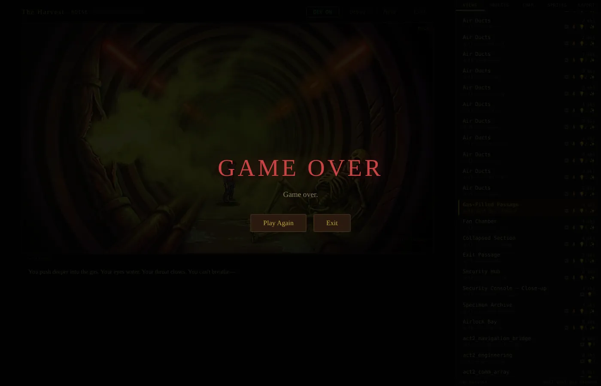 | 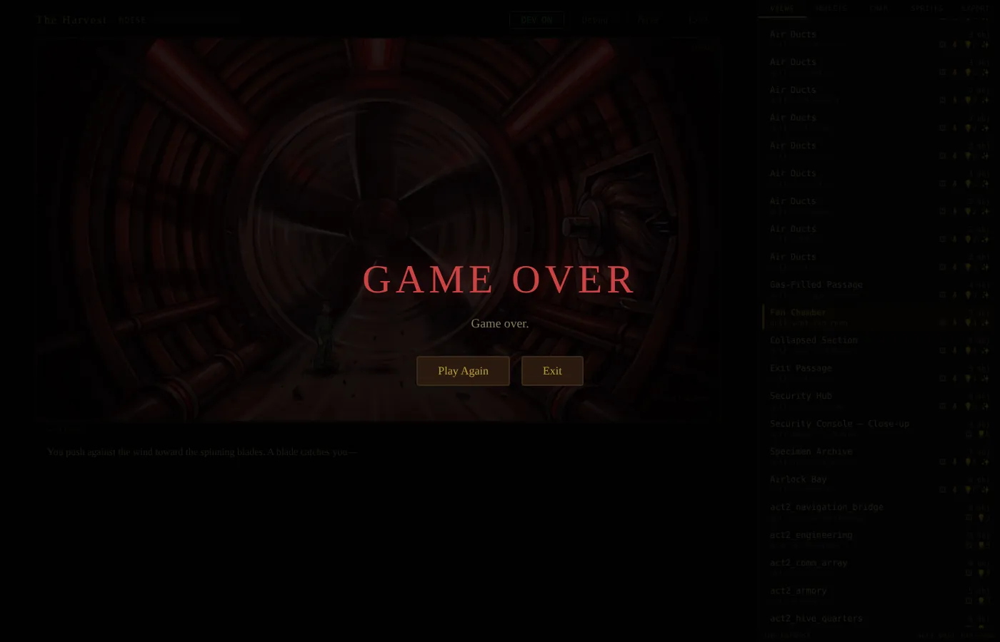 |

---

## Prisoner dialogue

The first time you TALK to the caged prisoner, your answer sets `prisoner_bond`, which carries into Act 2.

| Choice | Bond | Extra |
|---|---|---|
| "We're both prisoners here, aren't we?" | `empathy` | The creature mirrors your gestures |
| "Do you know a way out of here?" | `pragmatic` | It maps the ship with gestures and points toward the airlock (`airlock_hinted`) |
| "What are they? The ones who put us here?" | `knowledge` | The Choir *are* the ship (`choir_nature_known`) |
| [Say nothing — just nod] | `silent` | Respectful silence |

**Later conversations** (TALK again):

| Choice | When | What it does |
|---|---|---|
| "Do you know the ducts?" | Any bond except silent | It mimes the purge vents: hot wind, scorched mouths, death (`purge_warned`) |
| "I'll find a way to open your cage. I promise." | Until you've promised | `promised_freedom`; your bond becomes empathy |
| [Offer it the nutrient paste] | You carry the paste and haven't fed it | Same as using the paste on it (`prisoner_fed`) |
| "I have to go." | Always | Goodbye |

**The escape.** Pressing the security override drops every lock on the deck, the energy barriers included: the prisoner is gone when you come back, and the cage stays empty. If you promised to free it or fed it, it scratches the **safe route through the ducts** into the cage floor. HAND the scratches to copy them onto your map (`vent_route_known`); from then on the hint button in every duct names the next turn. If you never earned its trust, the cage is just empty.

---|---|---|
| "We're both prisoners here, aren't we?" | `empathy` | The creature mirrors your gestures |
| "Do you know a way out of here?" | `pragmatic` | It maps the ship with gestures and points toward the airlock (`airlock_hinted`) |
| "What are they? The ones who put us here?" | `knowledge` | The Choir *are* the ship (`choir_nature_known`) |
| [Say nothing — just nod] | `silent` | Respectful silence |

---

## Items (17)

Full details, every use and the in-game text for each item: the **[item compendium](https://claude.ai/artifact/9Zw5Tx8D9GitG6uGVvZ9Tt)**.

| Item | Where | How | Needed? |
|---|---|---|---|
| Surgical Probe | Processing Lab | HAND Instrument Rack | **Required** (strap, fan) |
| Restraint Strap | Processing Lab | USE probe ON Restraint Straps | **Required** (line) |
| Carcass Hook | Morgue | HAND hook in the open drawer | **Required** (line) |
| Grappling Line | Inventory | COMBINE strap + hook | **Required** (gap; used up) |
| Containment Key Card | Security Hub | HAND Key Card Drawer (right wall) | **Required** (airlock) |
| Emergency Suit Helmet | Security Hub | HAND Emergency Cabinet | **Required** (gas) |
| Ventilation Map | Ventilation Shaft | HAND wall scratches | Strongly recommended |
| Choir Access Chip | Collapsed Section | HAND skeleton twice | Optional (Act 2 shortcut) |
| Severed Neural Tendril | Morgue | HAND tendril | Optional (later acts) |
| Stasis Fluid Vial | Stasis Hold | USE jar ON drainage channel | Optional (later crafting) |
| Nutrient Paste Tube | Feeding Station | HAND dispenser | Optional |
| Empty Sample Jar | Processing Lab | HAND Sample Jars | Optional (becomes the vial) |
| Data Crystal — Personal Log | Specimen Archive | HAND misplaced crystal | Lore |
| Pod Glass Shard | Stasis Hold | HAND Broken Pod | Lore |
| Crew Datapad | Collapsed Section | HAND skeleton | Lore |
| Specimen Tag | Stasis Hold | HAND tag on your pod | Lore |
| Shadow Cat Fur | Corridor (2nd visit) | HAND the cat | Lore |

**Careful with:** the tendril (the hologram uses it up, and later acts want it), the stasis fluid (the archive reader uses it up) and the nutrient paste (feeding the prisoner uses it up). None of them matter for Act 1.

---

## Common stuck points

**"How do I get across the gap?"** Build a grappling line: cut a strap in the Processing Lab with the surgical probe, pull the hook from the morgue drawer, combine them, use the line on the gap, then HAND the line to climb across.

**"The keypad wants four characters."** They're on the specimen displays across the Stasis Hold gap: fern, double curl, sprouting snake, sprouting snake.

**"The override button does nothing."** It's dark until the lab terminal is unlocked with the code. Come back afterwards.

**"Where's the key card?"** The tan drawer unit on the Security Hub's right wall.

**"I can't get into the vent."** Press the armed override in the security close-up first.

**"I keep getting lost in the ducts."** That's the point, but it's beatable. Get the map from the wall scratches in the shaft, LOOK at it in your inventory, and keep count of every turn from the junction (ahead = north, left = west, right = east, back = south). The full route is in section 9.

**"Where's the cat?"** It turns up on your second visit to the corridor.
