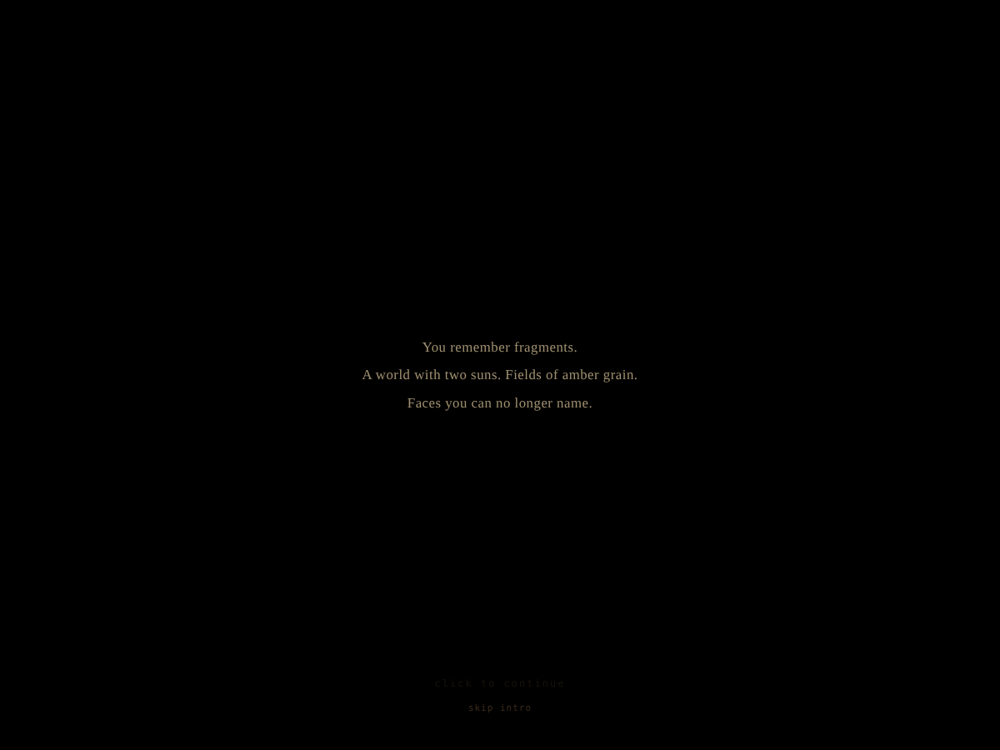
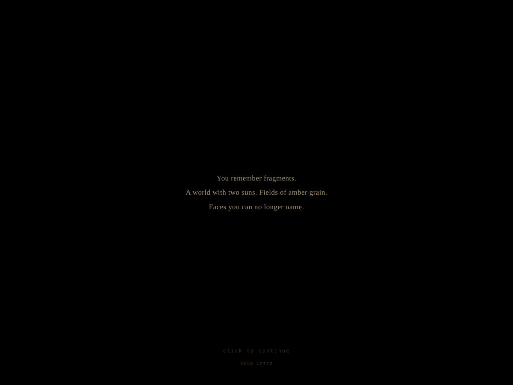
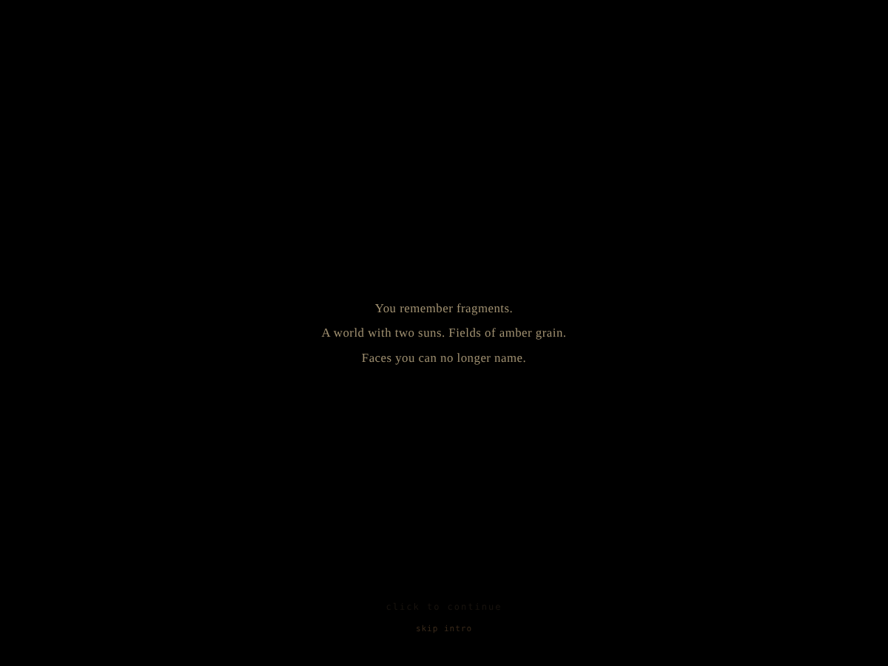
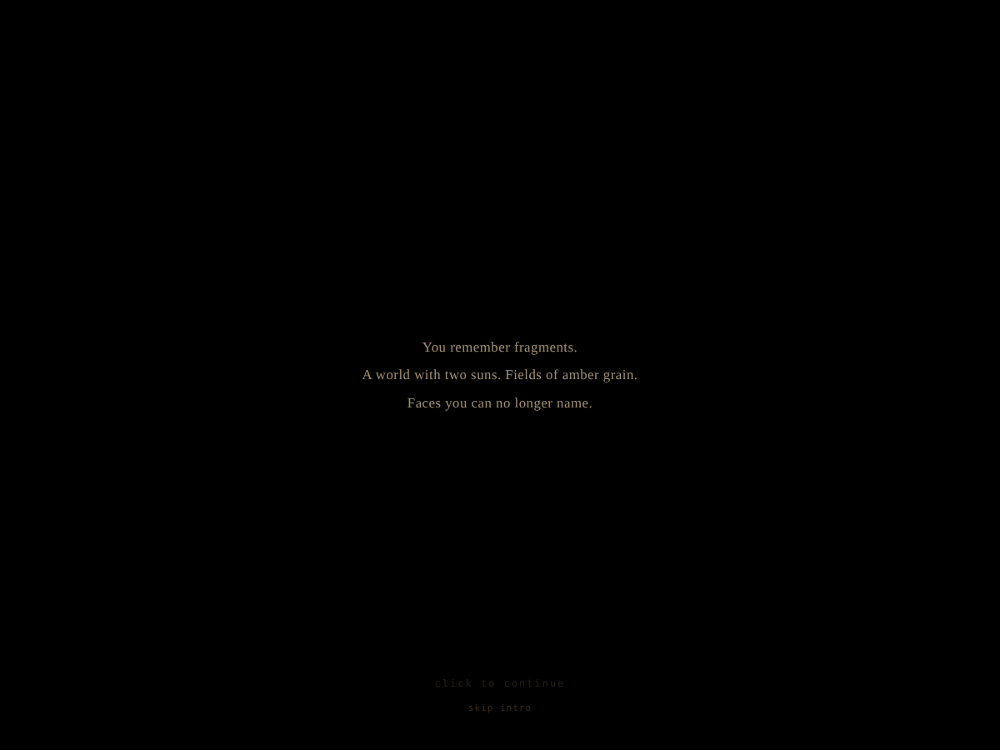
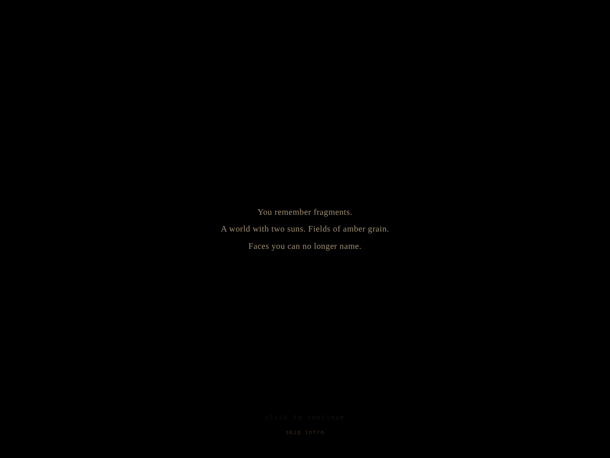

# The Harvest — Act 1 Walkthrough

## Premise

You are a goblin specimen aboard an alien harvester ship belonging to the Choir — a hive-mind species that collects and processes life forms from across the galaxy. You wake in a shattered stasis pod on the containment deck. Your ship, the Outrider, brought you here. Now you need to understand where you are, gather tools and knowledge, and find a way off this deck.

Act 1 takes place entirely on the containment deck: 10 interconnected rooms with 9 collectible items, multiple knowledge flags, and one branching NPC conversation. The critical path below gets you through every room and sets you up for Act 2.

> **Note**: This walkthrough covers the critical path only. Every room has additional LOOK interactions that build atmosphere and lore — explore freely. You can't softlock yourself; everything is recoverable.

---

## Room-by-Room Walkthrough

### 1. Stasis Hold (Starting Room)

You wake here among rows of specimen pods. Three items are within reach.

- **HAND the Broken Pod** — Snap off a curved shard of pod glass. Razor-sharp alien composite. *(Gains: `pod_glass_shard`)*
- **HAND the Pod Drainage Channel** — Scoop amber stasis fluid from the floor channel. *(Gains: `stasis_fluid_vial`)*
- **HAND the Specimen Tag Hook** — Tear your specimen tag from the pod frame. Proof you were cataloged. *(Gains: `specimen_tag`)*

**Also in this room**: Occupied Pods (MOVE to reach Pod Cluster), Neural Network Wall, Walkway Railing, Specimen Pod Wall — all have LOOK text for atmosphere.

---

### 2. Pod Cluster (Close-up from Stasis Hold)

MOVE on the **Occupied Pods** in Stasis Hold to climb up and examine the pod cluster.

- **HAND the Pod Labels** — Physically trace the numerical sequences across pods. The first four digits are identical: **7-3-1-9**. That's the section access code for the processing lab. *(Sets flag: `lab_code_known`)*

> **Easy to miss**: LOOKing at the labels only hints at the code. You must HAND them (trace the numbers) to actually memorize the pattern. This is the classic adventure-game distinction between observing and interacting.

Navigate back to Stasis Hold, then MOVE through the nav exit to the **Containment Corridor**.

---

### 3. Containment Corridor (Hub)

The central hallway connecting most of the deck. Four exits lead to: Stasis Hold, Processing Lab, Security Hub, and Feeding Station. No items to collect here, but LOOK at the drag marks and emergency panel for story context.

Head to the **Processing Lab** first.

---

### 4. Processing Lab

- **LOOK at the Lab Startup Display** — The screens cycle through processing routines. One shows a startup sequence for the security systems — five-button pattern with specific timing. You memorize it. *(Sets flag: `security_sequence_known`)*
- **HAND the Instrument Rack** — Take the smallest surgical instrument: a probe with a fine, flexible tip. *(Gains: `surgical_probe`)*

**Also here**: Examination Tables, Sample Jars, Anatomy Display, Restraint Straps — all with LOOK flavor text.

Return to the Corridor and head to the **Security Hub**.

---

### 5. Security Hub

This is a two-step interaction. You need the security sequence from the lab (Step 4) before the console will activate.

- **HAND the Security Console** (first time) — Enter the startup sequence. The console hums to life, revealing a full ship layout. *(Sets flags: `security_hub_accessed`, `ship_layout_known`)*
- **HAND the Security Console** (second time) — Trigger the containment lock override. Every sealed door on the deck clicks open. The Curator will notice. *(Sets flag: `security_locks_overridden`; adds 20 noise)*
- **HAND the Key Card Drawer** — Pull out a bio-organic containment key card. *(Gains: `containment_key_card`)*

> **Puzzle chain**: Pod Labels (HAND) → Lab Display (LOOK) → Security Console (HAND twice). If you try the console without the sequence, it just beeps and adds noise.

Return to the Corridor, then head to the **Feeding Station**.

---

### 6. Feeding Station (Secondary Hub)

The feeding station is the second hub with four exits: Morgue, Containment Corridor, Specimen Archive, and Ventilation Shaft.

- **HAND the Nutrient Dispenser** — Collect a tube of grey nutrient paste. Disgusting, but Choir drones are attracted to it. *(Gains: `nutrient_paste_tube`)*
- **TALK to the Caged Prisoner** — A four-armed alien creature behind an energy barrier. This triggers the **dialogue choice system** (see branching section below). *(Sets flags: `prisoner_spoken`, `prisoner_bond`, and potentially `airlock_hinted` or `choir_nature_known`)*

---

### 7. Morgue

Accessible from the Feeding Station.

- **HAND the Neural Tendril Sample** — Pick up a severed length of neural tendril. Warm, slightly damp, bio-electric. *(Gains: `severed_neural_tendril`)*
- **LOOK at the Dead Goblin** — A goblin like you, dead in a drawer. Surgical marks cover the body. You are not the first of your kind here. *(Sets flag: `dead_goblin_seen`)*

**Also here**: Morgue Drawers, Autopsy Slab, Recycling Vats, Chemical Cabinet, Drain Channel.

Return to the Feeding Station, then head to the **Specimen Archive**.

---

### 8. Specimen Archive

- **HAND the Personal Log Crystal** — Pocket a data crystal misfiled among specimen records. *(Gains: `data_crystal_personal_log`)*
- **USE the crystal ON the Reading Device** — Select the crystal from your inventory, then click the reading device. Alien text floods the air — diagrams of biological processes, planetary data, convergence timelines. *(Consumes or keeps: `data_crystal_personal_log`)*
- **LOOK at the Holographic Display** — Dozens of miniature planets drift overhead. Almost all marked with the red symbol of the Convergence. The Choir have been doing this to worlds across the galaxy. *(Sets flag: `convergence_history_known`)*

**Also here**: Crystal Rack, Right Crystal Wall, Archive Benches — lore-rich LOOK interactions.

Return to the Feeding Station, then head to the **Ventilation Shaft**.

---

### 9. Ventilation Shaft

- **HAND the Wall Scratches** — Trace a map scratched into the wall by a previous escapee. Three main routes memorized. *(Gains: `ventilation_map`; sets flag: `ventilation_map_found`)*

**Also here**: Shaft Branches, Old Remains (bones of a previous escapee), Maintenance Hatch.

Continue through to the **Airlock Bay**.

---

### 10. Airlock Bay

- **USE the Containment Key Card ON the Airlock Override Panel** — The key card interfaces with the lock, opening the override panel. *(Uses: `containment_key_card`)*
- **HAND the Suit Locker** — Choir emergency suits are too large, but the helmets have universal seals. *(Sets flag: `emergency_helmet_taken`)*
- **LOOK at the Empty Docking Clamps** — Your ship, the Outrider, was jettisoned. The docking clamps are empty. There is no easy way home. *(Sets flag: `outrider_gone_known`)*
- **LOOK at the Viewport** — The planet below is beautiful from orbit. But thin energy beams descend from the ship to the surface. The Convergence is already feeding. *(Sets flag: `airlock_visited`)*

---

## Prisoner Dialogue Branching

When you TALK to the caged prisoner, you get four dialogue choices. Each sets a different `prisoner_bond` value and may unlock additional knowledge flags. **You can only choose one per playthrough.**

| Choice | Bond | Extra Flags | What You Learn |
|--------|------|-------------|----------------|
| "We're both prisoners here, aren't we?" | `empathy` | — | Emotional connection. The creature mirrors your gestures. A foundation of trust. |
| "Do you know a way out of here?" | `pragmatic` | `airlock_hinted` | The creature maps the ship layout with gestures, pointing toward the airlock. Practical escape intel. |
| "What are they? The ones who put us here?" | `knowledge` | `choir_nature_known` | The creature reveals the Choir ARE the ship — not just passengers. The vessel is alive. |
| [Say nothing — just nod] | `silent` | — | Respectful silence. The creature nods back. Minimal information, but no missteps. |

The `prisoner_bond` value affects all subsequent interactions with the prisoner and may gate dialogue in later acts.

---

## Inventory Checklist

All 9 collectible items in Act 1:

| # | Item | Source Room | How |
|---|------|-------------|-----|
| 1 | Pod Glass Shard | Stasis Hold | HAND Broken Pod |
| 2 | Stasis Fluid Vial | Stasis Hold | HAND Pod Drainage Channel |
| 3 | Specimen Tag | Stasis Hold | HAND Specimen Tag Hook |
| 4 | Surgical Probe | Processing Lab | HAND Instrument Rack |
| 5 | Containment Key Card | Security Hub | HAND Key Card Drawer |
| 6 | Nutrient Paste Tube | Feeding Station | HAND Nutrient Dispenser |
| 7 | Severed Neural Tendril | Morgue | HAND Neural Tendril Sample |
| 8 | Personal Log Crystal | Specimen Archive | HAND Personal Log Crystal |
| 9 | Ventilation Map | Ventilation Shaft | HAND Wall Scratches |

---

## Knowledge Flags Checklist

| Flag | How to Set | Required? |
|------|-----------|-----------|
| `lab_code_known` | HAND Pod Labels in Pod Cluster | Story/future use |
| `security_sequence_known` | LOOK Lab Startup Display in Processing Lab | Yes — needed for security console |
| `security_hub_accessed` | HAND Security Console (with sequence) | Yes — unlocks ship layout |
| `security_locks_overridden` | HAND Security Console again (when active) | Yes — opens all doors |
| `ship_layout_known` | Set automatically with security_hub_accessed | Yes |
| `dead_goblin_seen` | LOOK Dead Goblin in Morgue | Story flag |
| `prisoner_spoken` | TALK to Caged Prisoner | Story flag |
| `convergence_history_known` | LOOK Holographic Display in Archive | Story flag |
| `ventilation_map_found` | HAND Wall Scratches in Vent Shaft | Yes — escape route knowledge |
| `airlock_visited` | LOOK Viewport in Airlock Bay | Story flag |
| `outrider_gone_known` | LOOK Empty Docking Clamps in Airlock Bay | Story flag |
| `airlock_hinted` | Prisoner dialogue: "way out" choice only | Branch-dependent |
| `choir_nature_known` | Prisoner dialogue: "what are they" choice only | Branch-dependent |

---

## Tips for Stuck Players

1. **"The security console won't activate"** — You need the startup sequence from the Processing Lab (LOOK at the Lab Startup Display). Without it, pressing buttons just triggers alarms. The lab code from the Pod Cluster (HAND the Pod Labels) is separate knowledge useful elsewhere.

2. **"I can't find the Pod Cluster"** — It's not a separate room on the map. MOVE on the Occupied Pods in the Stasis Hold to climb up to the close-up view.

3. **"The pod labels just describe codes but nothing happens"** — LOOK only hints at the code. You need to HAND the labels (physically trace them) to memorize the number sequence 7-3-1-9.

4. **"How do I use inventory items?"** — Click an item in your inventory to select it (it highlights), then click a world object to USE it on. The engine handles the `use_item` verb automatically. Used for: crystal on reading device, key card on airlock panel.

5. **"I can't reach the Morgue or Archive"** — Both are accessible from the Feeding Station, not the Containment Corridor. The Corridor leads to: Stasis Hold, Processing Lab, Security Hub, and Feeding Station. From the Feeding Station you reach: Morgue, Archive, Ventilation Shaft, and back to Corridor.

6. **"The prisoner won't talk to me"** — Make sure you're using the TALK verb, not HAND or LOOK. The dialogue choice modal appears after the initial greeting.

7. **"I explored everything but nothing seems to happen"** — Act 1 is about gathering items and knowledge. There's no timed pressure (the Curator exists but isn't active in this act). Take your time, LOOK at everything, and make sure you've visited all 10 rooms.

---

*This walkthrough was generated from automated Playwright testing of the scenario JSON. All steps verified as completable. Last tested: October 2026.*
